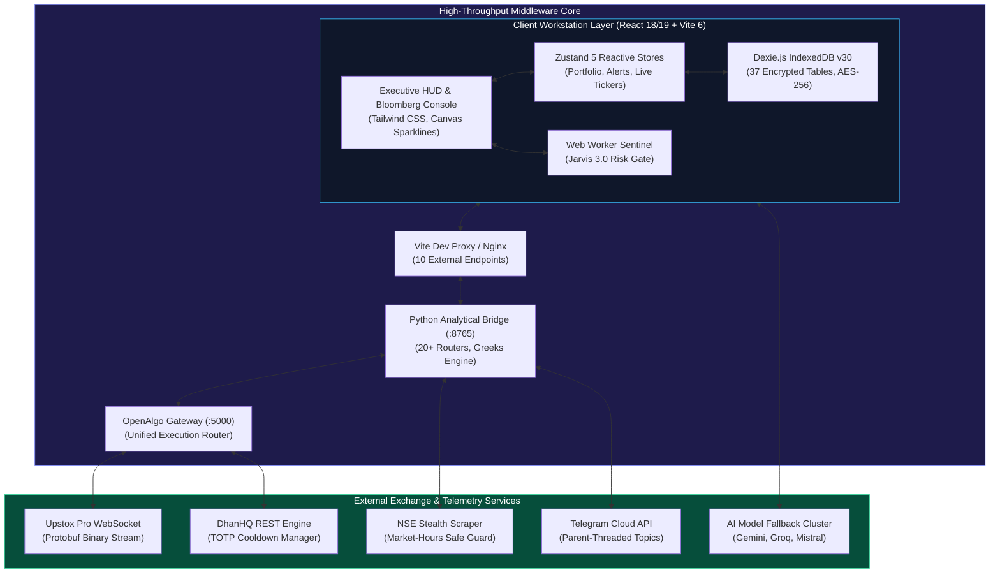

# 🦁 WealthOS v2

> **An institutional-grade, autonomous personal finance operating system & quantitative trading terminal built for the Indian market.**  
> Real-time broker sync · Sub-50ms OpenAlgo OMS · Quantitative GEX surfaces · Full psychology stack · Local-first air-gapped privacy  
> Engineered by **Sudhanshu Gaddam** ([@0codedev](https://github.com/0codedev)) -- NIT Warangal.

[](https://github.com/0codedev/wealthos/releases)
[](https://github.com/0codedev/wealthos/actions)
[](https://wealthos-sudhanshu.xyz)
[](https://typescriptlang.org)
[](https://python.org)
[](https://fastapi.tiangolo.com)
[](https://react.dev)
[](https://vitejs.dev)
[](https://dexie.org)
[](#-license)
[](#-contributing)
[](#)
[](#-the-three-foundational-pillars)

---

## ⚡ Executive Overview

**WealthOS v2** is a personal finance operating system and autonomous algorithmic execution terminal purpose-built for the Indian market (NSE & BSE). It unifies fragmented retail financial activities -- equities, derivatives, mutual funds, gold, fixed deposits, IPOs, and trading psychology -- into a single, Bloomberg-grade local-first workstation.

It pairs a high-performance **React 18/19 + Vite 6** frontend with an autonomous **Python 3.11 FastAPI bridge** and the **OpenAlgo multi-broker execution gateway**, delivering sub-50ms order routing, live Upstox Protobuf streaming, DhanHQ portfolio synchronization, and parent-threaded Telegram topic telemetry.

```
┌────────────────────────────────────────────────────────────────────────────────────────┐
│                              WEALTHOS v2 CORE CAPABILITIES                             │
├───────────────────────────────┬──────────────────────────┬─────────────────────────────┤
│ Execution & Routing           │ Quantitative Intelligence│ Psychological Fortress      │
│ • Sub-50ms OpenAlgo Gateway   │ • Real-time GEX Lens     │ • 29-Phase Trade Journal    │
│ • Adaptive Micro-Chase Engine │ • Black-Scholes Greeks   │ • Mirror of Truth 2.0 (₹)   │
│ • Bracket Guardian Trailing SL│ • MCS Momentum Scoring   │ • Tilt-Lock Sentry Shutdown │
│ • IN-NSE-2024 Statutory Engine│ • DuckDB Apex Backtester │ • Single 0-100 Profitability│
└───────────────────────────────┴──────────────────────────┴─────────────────────────────┘
```

---

## 🏛️ Master System Architecture

WealthOS combines an air-gapped client storage layer with an authenticated analytical sidecar and broker gateway:



---

## 🌟 The Three Foundational Pillars

1. **🔒 Your Data Belongs to You (100% Local-First):** Everything you enter -- trades, holdings, bank balances, psychological mistakes, and trade screenshots -- lives in your local IndexedDB and SQLite database encrypted with AES-256. Cloud sync to Firebase/Supabase is strictly opt-in and client-side encrypted.
2. **⚡ Sub-50ms Multi-Broker Execution Wire:** Physical exchange orders route through the OpenAlgo gateway with automated micro-chase fill logic, bracket order trailing stop-losses, and exact post-October 2024 statutory friction calculations.
3. **🧠 Psychological Risk Governance:** The Guardian Protocol and Tilt-Lock Sentry protect you from emotional drawdown by enforcing hard circuit breakers, mandatory cool-down periods, and pre-trade checklist compliance.

---

## 🚀 Quick Start (5 Minutes)

### Prerequisites
- **Node.js:** v18+ (Node 20 LTS recommended)
- **Python:** 3.11+
- **OpenAlgo Gateway:** Running on port 5000 (optional for live trading mode)

### 1. Clone & Install
```bash
# Clone the repository
git clone https://github.com/0codedev/wealthos.git
cd wealthos

# Install frontend dependencies
npm install

# Install Python Bridge dependencies
cd python-bridge
pip install -r requirements.txt
cd ..
```

### 2. Launch the Development Stack
```bash
# Terminal 1: Start React Frontend Client
npm run dev          # -> http://localhost:5173

# Terminal 2: Start Python Analytical Bridge
cd python-bridge
python app.py        # -> http://127.0.0.1:8765
```

---

## 📚 Master Documentation Index

To maintain executive clarity without losing deep architectural rigor, the exhaustive documentation is modularized into **10 authoritative architectural volumes** (preserving all 3,900+ lines of raw technical depth):

| Volume | Title | Core Technical Depth & Topics Covered | Link |
|---|---|---|---|
| **Volume 01** | **System Topology & Architecture** | Full-stack topology, port inventory (:8765, :5000, :8000), Vite proxy routes, architecture blueprints | [Read Volume 01](architecture_volumes/01_SYSTEM_TOPOLOGY_AND_ARCHITECTURE.md) |
| **Volume 02** | **The 19 Functional Hubs & Workflows** | Complete 19 hubs module map, visual feature walkthroughs, UI flows, and responsibilities | [Read Volume 02](architecture_volumes/02_THE_19_FUNCTIONAL_HUBS_WALKTHROUGH.md) |
| **Volume 03** | **Dexie IndexedDB v30 Database Schema** | Complete 37 relational database tables, compound indexes, entity schemas, Dexie migration history | [Read Volume 03](architecture_volumes/03_DEXIE_DATABASE_SCHEMA.md) |
| **Volume 04** | **Broker Integrations, OpenAlgo & OMS** | Upstox Protobuf WebSocket multiplexer, DhanHQ REST + TOTP auto-auth, OpenAlgo Sub-50ms gateway, Adaptive Micro-Chase | [Read Volume 04](architecture_volumes/04_BROKER_INTEGRATIONS_AND_OMS.md) |
| **Volume 05** | **AI Engine Fallback & Python Bridge** | 45+ AI models across 7 free providers, cache cascade, Python Bridge 20+ routers, APScheduler, NSE stealth scraper | [Read Volume 05](architecture_volumes/05_AI_ENGINE_AND_PYTHON_BRIDGE.md) |
| **Volume 06** | **Quantitative Alpha, GEX Lens & Greeks** | Black-Scholes Greeks surface, GEX Lens (Gamma Exposure), MCS momentum scoring, Apex MTF Backtester | [Read Volume 06](architecture_volumes/06_QUANTITATIVE_ALPHA_AND_GREEKS.md) |
| **Volume 07** | **Jarvis Voice & Telegram Telemetry** | Jarvis 4.0 voice workspace, parent-threaded Telegram topic router, interactive bot commands (/pnl, /positions) | [Read Volume 07](architecture_volumes/07_JARVIS_VOICE_AND_TELEGRAM_TELEMETRY.md) |
| **Volume 08** | **Trading Psychology & Mirror of Truth** | 29-phase trade journal, mistake monetary costing (₹), MirrorRules, single 0-100 Profitability KPI, Quant Duel | [Read Volume 08](architecture_volumes/08_PSYCHOLOGY_AND_MIRROR_OF_TRUTH.md) |
| **Volume 09** | **AES-256 Vault, Security & Cloud Sync** | Client-side AES-256 encryption, PBKDF2 PIN gate, Dual Auth model, Firebase/Supabase sync architecture | [Read Volume 09](architecture_volumes/09_SECURITY_VAULT_AND_CLOUD_SYNC.md) |
| **Volume 10** | **DevOps, Build & Production Deployment** | PM2 process supervision, Cloudflare Zero Trust perimeter, bundle optimization, testing suites, FAQs, gotchas | [Read Volume 10](architecture_volumes/10_DEVOPS_BUILD_AND_PRODUCTION.md) |

---

## 🛡️ Security & Zero-Trust Perimeter

WealthOS enforces a two-tier perimeter model to safeguard live trading terminals against automated web bots and broker IP rate bans:

1. **Public Showcase Tier:** Public viewers access static showcases, interactive architecture blueprints, and a sandboxed mock demo mode with zero live exchange connectivity.
2. **Hardened Production Tier:** Live execution terminals (`wealthos-sudhanshu.xyz`) are shielded behind **Cloudflare Zero Trust (Cloudflare Access)**. Access requires verified Google SSO or hardware OTP authentication before requests can reach the Oracle VPS or Python Bridge.

For vulnerability reporting procedures, refer to [SECURITY.md](SECURITY.md).

---

## 🤝 Contributing & Community

Contributions are welcome! Please review [CONTRIBUTING.md](CONTRIBUTING.md) for branch naming conventions, test guidelines, and the strict zero-AI co-author policy.

```bash
# Verify syntax and linting before submitting PR
npm run lint:tokens

# Run backend syntax compilation
npm run check:py
```

---

## 📄 License

WealthOS is open-source software licensed under the [MIT License](LICENSE).

---

<div align="center">

**Engineered with precision for the sovereign Indian investor and active quantitative trader.**  
[⬆ Back to Top](#-wealthos-v2)

</div>
