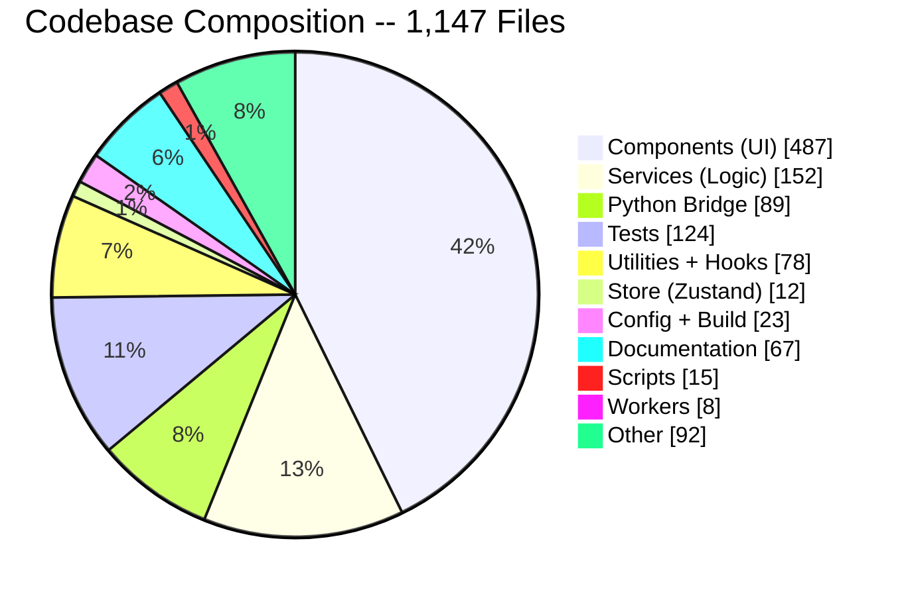
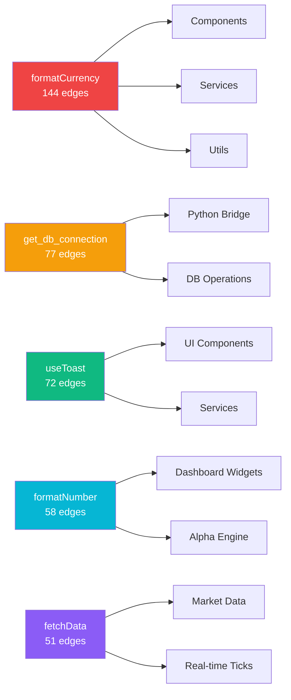
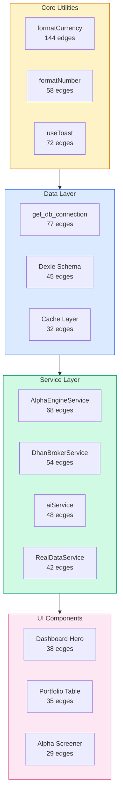
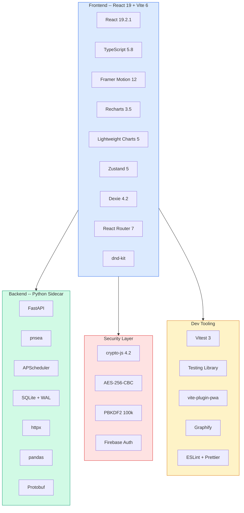
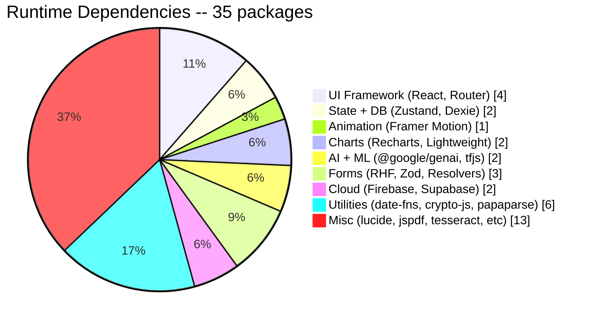
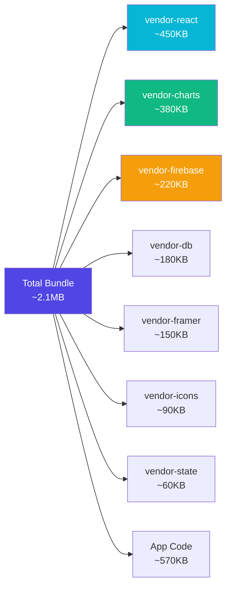

# 🏛️ Volume 01: System Topology & Full-Stack Architecture

> **Component of:** [WealthOS v2 Documentation Index](../README.md#-master-documentation-index)

---

## 1. Project Overview

**WealthOS v2 (Wealth Aggregator Pro)** is a comprehensive personal finance dashboard purpose-built for the Indian retail investor and active trader. It is not a SaaS product -- it is a fully self-hosted, local-first application that runs in your browser, backed by a lightweight Python sidecar process for NSE data.

### What it does

| Domain                    | Capability                                                                                     |
| ------------------------- | ---------------------------------------------------------------------------------------------- |
| **Portfolio**       | Track net worth across 12+ asset classes (MF, Stocks, Gold, ETF, FD, Crypto, Real Estate, IPO) |
| **Live Market**     | Real-time quotes via DhanHQ / Upstox Protobuf WebSocket / NSE scraper fallback chain          |
| **Trading Journal** | Full psychological trade logging -- emotions, grades, mistakes, screenshots, AI verdicts, P&L calendar, slump-buster |
| **IPO War Room**    | Full lifecycle IPO tracker with allotment probability, GMP radar, and syndicate management     |
| **Alpha Engine 2.0** | Quantitative screener with G-Factor + R-Factor, sector confluence, ORB, IV skew, factor attribution |
| **Quantum Terminal**| Cross-asset confluence, derivatives Greeks, hedging engine, profitability co-pilot, strategy optimizer |
| **Backtester**      | Multi-strategy backtesting with walk-forward optimization, Monte Carlo, and resilience logs    |
| **Momentum Pool**   | Pre-market watchlist with auto-verdict, Telegram push, drag-to-reorder cards                  |
| **AI Advisor**      | 7-provider AI fallback chain + 4 personas + Jarvis v2/v3/v4 voice workspace + Agentic Lab      |
| **Signal Intelligence** | Telegram multi-ear daemon, OCR signal ledger, two-way voice notes, daily digest            |
| **Tax Center**      | LTCG/STCG calculation, ITR data generation, F&O turnover, tax-loss harvesting, eCAS/CAMS import |
| **Life Planner**    | FIRE simulator, retirement planning, legacy/estate vault                                       |
| **Psychology**      | Mirror of Truth mistake tracker, Guardian Protocol guardrails, psych PnL scoring, Profitability Score |
| **Mastery & Quests** | Skill trees, achievement engine, wealth quest matrix, XP/streaks/badges                     |

### Graph Stats (from Graphify knowledge graph)

- **1,147 source files** -- approximately 3.9 million words of code
- **5,875 nodes** · **8,514 edges** · **441 communities** detected
- **God Node #1:** `formatCurrency()` with **144 edges** (cross-community bridge utility)
- **God Node #2:** `get_db_connection()` with **77 edges** (Python bridge singleton)
- **God Node #3:** `useToast()` with **72 edges** (toast/notifications god node)

**Codebase Composition -- Visual:**



**Top 10 God Nodes -- Most Connected Symbols:**



**Knowledge Graph -- Community Structure:**



---

## 2. System Architecture

### High-Level Architecture

```
+------------------------------------------------------------------------+
|                        BROWSER (React 19 + Vite)                       |
|                                                                        |
|  +----------+  +----------+  +----------+  +----------+              |
|  |Dashboard |  | Portfolio|  |  Alpha   |  |  Journal |  19 hubs...  |
|  |   Hub    |  |   Hub    |  |  Engine  |  |  Psych   |  + Quantum   |
|  +----+-----+  +----+-----+  +----+-----+  +----+-----+  + Pool      |
|       |              |              |              |       + Jarvis  |
|  +----+--------------------------------------------+------------+    |
|  |              Services Layer (~150+ services)                      |    |
|  |  DhanBroker | Upstox | AlphaEngine | AIService | QuantumEng     |    |
|  |  Jarvis3 | MomentumPool | Profitability | TelegramEar | SafeAsync|    |
|  |  + 7 sub-trees: alpha, brain, jarvis3, llm, live, ml, warRoom    |    |
|  +-------------------------------------------------------------+    |
|  +-------------------------------------------------------------+    |
|  |      Client-Side Storage (Local-First Design)               |    |
|  |  Dexie/IndexedDB v30 (37 tables) | Zustand 5 (5+ stores) | localStorage|  |
|  +-------------------------------------------------------------+    |
+-----------------------------+--------------------+--------------------+
                              |                    |
             +----------------+-+    +-------------+------+
             |  Vite Dev Proxy  |    |  Firebase / Supabase|
             |  (10 routes)     |    |  Auth + Sync        |
             +------------------+    +--------------------+
                      |
    +-----------------+--------------------------+
    |                 |                          |
    v                 v                          v
+-------+  +---------------------------+  +------------+
|DhanHQ |  |  Python Bridge (:8765)    |  | Yahoo/NSE  |
| API   |  |  app.py (FastAPI) | db.py |  | Moneycontrol|
|       |  |  20+ routers (nse, upstox,|  |            |
|       |  |  alpha, backtest, mf, cas,|  |            |
|       |  |  journal, dhan, alerts,   |  |            |
|       |  |  health, context, shared) |  |            |
|       |  |  SQLite cache.db (v4)     |  |            |
|       |  |  APScheduler background   |  |            |
+-------+  +---------------------------+  +------------+
```

### Data Fallback Philosophy

Every data source implements a **3 to 7 tier fallback chain**. The system never hard-crashes on missing data:

```
DhanHQ (real-time broker)
  --> Upstox V3 Protobuf WebSocket (live tick, single shared conn)
    --> NSE India (Stealth Scraper via Python Bridge)
      --> Yahoo Finance (free proxy)
        --> FMP / RapidAPI / Alpha Vantage (optional API keys)
          --> Gemini AI web-search grounding
            --> Mock zeros (never null/undefined)
```

---

## 3. Tech Stack

### Frontend

| Technology                      | Version    | Purpose                               |
| ------------------------------- | ---------- | ------------------------------------- |
| **React**                 | 19.2.1     | Core UI framework                     |
| **TypeScript**            | 5.8.x      | Type safety throughout                |
| **Vite**                  | 6.2.0      | Build tool + 10-route dev proxy       |
| **Framer Motion**         | 12.23.x    | Animations and page transitions       |
| **Recharts**              | 3.5.1      | Charting (PnL, allocation, etc.)      |
| **Lightweight Charts**    | 5.0.9      | TradingView-style candlestick charts  |
| **Zustand**               | 5.0.9      | Global state (5 stores)               |
| **Dexie**                 | 4.2.1      | IndexedDB ORM (37 tables, v31 schema) |
| **React Router DOM**      | 7.10.1     | Client-side routing                   |
| **Lucide React**          | 0.555.0    | Icon system                           |
| **@dnd-kit**              | 6.3 / 10.0 | Drag-and-drop widget grid             |
| **React Hook Form + Zod** | latest     | Form validation                       |
| **crypto-js**             | 4.2.0      | Client-side AES-256 encryption        |
| **firebase**              | 12.10.0    | Auth and Firestore cloud sync         |
| **papaparse**             | 5.5.3      | CSV parsing for bank statements       |
| **date-fns**              | 4.1.0      | Date manipulation                     |
| **totp-generator**        | 2.0.1      | DhanHQ 2FA auto-login                 |

### Backend (Python Sidecar)

| Technology                 | Purpose                                      |
| -------------------------- | -------------------------------------------- |
| **FastAPI**          | REST API bridge (port 8765)                  |
| **pnsea**            | NSE India stealth scraper (session-based)    |
| **APScheduler**      | Background job scheduling (cron + interval)  |
| **SQLite via db.py** | Local cache for NSE data (1,085 lines)       |
| **httpx**            | Async HTTP for Yahoo Finance candle data     |
| **pandas**           | DataFrame-based data normalization           |
| **Protobuf**         | Upstox WebSocket market feed deserialization |

### Dev Tooling

| Tool                             | Purpose                                       |
| -------------------------------- | --------------------------------------------- |
| **Vitest**                 | Unit and integration testing                  |
| **@testing-library/react** | Component testing                             |
| **vite-plugin-pwa**        | Progressive Web App (service worker, offline) |
| **Graphify**               | Knowledge graph of the entire codebase        |

**Tech Stack -- Layered Visual:**



**Dependency Footprint -- Visual:**



**Bundle Size Distribution -- Visual:**



---

## 4. Repository Structure

```
wealth-dashboard-v2/
+-- App.tsx                      # Root component: auth gate + routing
+-- index.tsx                    # React 19 entry point
+-- index.css                    # Global design system (motion + tokens)
+-- types.ts                     # Core TypeScript types (Investment, Trade...)
+-- database.ts                  # Dexie IndexedDB schema (v30, 37 tables)
+-- vite.config.ts               # Build config + 10-route dev proxy
+-- package.json                 # 35 runtime deps + 22 dev deps
+-- workers/                     # Web Workers (jarvis3.worker.ts: off-thread EMA/RSI/crossover)
|
+-- components/                  # UI layer (40+ sub-directories)
|   +-- alpha/                   # Alpha Engine 2.0 widgets (screener, heatmap, ORB, IV skew)
|   +-- ai/                      # AI chat, floating coach, voice interface, command hub
|   +-- analytics/               # Math lab, quant dashboard, tax harvesting
|   +-- backtester/              # Apex Engine + Legacy Lab + AdvancedAnalytics
|   +-- brain/                   # PersonalizedBrain + RAG query engine UI
|   +-- calculators/             # SIP, FIRE, bond, options, position size, math lab
|   +-- dashboard/               # Main hub, hero section, widget grid, hubs/
|   +-- fortress/                # Security vault, encryption UI
|   +-- goals/                   # Goal GPS, FIRE planner
|   +-- growth/                  # Alpha Predator, Bulk Deal, Insider Radar, Tax Harvester
|   +-- innovation/              # Moonshot Lab (syndicate, dynasty, black swan)
|   +-- ipo/                     # IPO War Room full lifecycle
|   +-- jarvis/                  # Jarvis 2.0/3.0 voice UI + VoiceOrderConfirmToast
|   +-- jarvis2/                 # Jarvis 2 ambient command center + proactive alerts
|   +-- journal/                 # Trade journal, speed-run review, calendar, what-if
|   +-- launchpad/               # Mac Dock + tool discovery
|   +-- market/                  # Macro Pulse, option chain, paper trading, calendar
|   +-- mastery/                 # Mastery Hub + XP celebration + overview widget
|   +-- mobile/                  # Mobile shell (PIN login, header, market intel)
|   +-- momentum/                # Momentum Hub (CC39) + Twitter bridge
|   +-- oracle/                  # Financial Oracle + scenario comparison + destiny gauge
|   +-- options/                 # Greeks panel, payoff chart, playground
|   +-- pool/                    # Momentum Pool hub (CC39) -- hero, watch grid, verdict feed
|   +-- portfolio/               # Portfolio overview, compliance
|   +-- psych/                   # Psychology dashboard, Mirror of Truth
|   +-- quantum/                 # Quantum Terminal deck, strategy optimizer, profitability co-pilot
|   +-- settings/                # Settings hub, API key manager
|   +-- shared/                  # Skeleton, CountUp, ValueFlash, MotionButton, EmptyState, HelpDrawer, Freshness
|   +-- signals/                 # Signal Intelligence Hub
|   +-- telegram/                # Telegram Intel Hub (CC40 refactor) -- ear, OCR, signal ledger
|   +-- ui/                      # animations.ts + motion/variants.ts + CommandPalette + ToastProvider
|   +-- ...10+ more directories
|
+-- services/                    # Service layer (~150+ services, 7 sub-dirs)
|   +-- AlphaEngineService.ts    # Core market intelligence (2,248 lines)
|   +-- DhanBrokerService.ts     # DhanHQ API client (1,608 lines)
|   +-- RealDataService.ts       # Unified market data fallback (1,130 lines)
|   +-- aiService.ts             # AI multi-provider gateway (940 lines)
|   +-- SecurityService.ts       # AES-256 encryption layer
|   +-- FirebaseSyncService.ts   # Cloud sync engine
|   +-- OptionChainService.ts    # Live F&O chain parser
|   +-- RiskEngine.ts            # Portfolio risk metrics
|   +-- BacktestingService.ts    # Strategy backtesting
|   +-- GamificationService.ts   # XP, streaks, badges, mastery engine
|   +-- ProfitabilityRecompute.ts # Recompute Profitability Score (Phase 12)
|   +-- ProfitabilityScore.ts    # 5 sub-scores → 0-100 KPI
|   +-- safeAsync.ts             # Result<T,E> typed wrapper
|   +-- logger.ts                # Dev-gated console replacement (CC80)
|   +-- appCopy.ts               # All user-facing copy vocabulary
|   +-- alpha/                   # 13 sub-services: Convergence, Derivatives, Fundamental, Institutional, OIStory, ReportExporter, RiskEngine, ShadowScreener, SignalFusion, SmartAlert, StockSelection, Verdict, provenance_guard
|   +-- brain/                   # PersonalizedBrain, RAGQueryEngine, VectorMemory
|   +-- jarvis3/                 # JarvisBrain, MarketSentinel, MemoryVault, RiskSafetyGate, WorkerHost, ActionExecutor
|   +-- llm/                     # keyPool, models, prompts, providers, quotaTracker
|   +-- live/                    # DataStreamRouter, LiveMarketFeedService
|   +-- ml/                      # OnlineRLEngine, ExperienceReplayBuffer, ModelVersioning
|   +-- warRoom/                 # AgentOrchestrator, AgentPersonas
|   +-- backtester/              # 15+ sub-services: StrategyParser, MonteCarlo, WalkForward, OptionsSim, QuantDuel
|   +-- ...100+ more services
|
+-- python-bridge/               # FastAPI market data sidecar
|   +-- app.py                   # Main FastAPI app
|   +-- db.py                    # SQLite cache layer (WAL mode, schema v4)
|   +-- db_stabilized.py         # Stabilized connection helper
|   +-- audit_database.py        # Audit log SQLite
|   +-- telemetry.py             # Bridge health telemetry (CC28)
|   +-- greeks.py                # Black-Scholes delta calculator
|   +-- nse_stealth.py           # NSE India stealth scraper (UA rotation)
|   +-- upstox.py                # Upstox V3 REST client (450 req/min sliding window)
|   +-- upstox_ws.py             # Upstox Protobuf WebSocket decoder
|   +-- upstox_resilience.py     # Reconnect/backoff/watchdog
|   +-- ws_multiplexer.py        # SSE multicast to all browser tabs
|   +-- analytics_engine.py      # Cross-asset analytics
|   +-- pattern_engine.py        # Pattern recognition engine
|   +-- screener.py              # Stock screener engine
|   +-- backup_gcp.py            # Encrypted GCP backup utility
|   +-- error_middleware.py      # Centralized error handling
|   +-- MarketDataFeedV3_pb2.py  # Generated Protobuf decoder
|   +-- routers/                 # 20+ FastAPI routers (nse, upstox, alpha, backtest, mf, cas, journal, dhan, alerts, health, context, shared)
|   +-- services/                # 12+ sub-services: capability_registry, credential_store, dhan_alert_manager, dhan_client, dhan_ws, discrepancy_monitor, instrument_registry, market_context, mf_nav_service, parquet_archiver, reconciliation, subscription_planner, telegram_bot
|   +-- tests/                   # 17+ Python unit tests
|   +-- requirements.txt         # Python dependencies
|   +-- cache.db                 # SQLite database (auto-created on first run)
|   +-- start.bat                # Windows one-click launch script
|
+-- store/                       # Zustand global state (5+ stores)
|   +-- portfolioStore.ts        # Investment CRUD + computed portfolio stats
|   +-- settingsStore.ts         # All user settings + API keys
|   +-- liteModeStore.ts         # Performance lite mode toggle
|   +-- useLiteModeStore.ts      # Lite mode state hook
|   +-- useGuardrailStore.ts     # Trading guardrails enforcement
|
+-- hooks/                       # Custom React hooks
|   +-- useUpstoxWebSocket.ts    # Live Upstox tick feed hook
|   +-- usePulseBridgeSync.ts    # Python bridge auto-handshake
|   +-- useMarketSentiment.ts    # VIX + market status calculation
|   +-- useHotkeys.ts            # Global keyboard shortcut system
|   +-- useIsMobile.ts           # Responsive breakpoint detection
|   +-- useKeyboardShortcuts.ts  # CC50 hook for global shortcuts
|   +-- usePrivacyMode.ts        # CC46 privacy blur mode
|   +-- useToast.ts              # Toast vocabulary hook
|
+-- contexts/                    # React Context providers
|   +-- AuthContext.tsx          # PIN-based local auth gate (with biometric)
|   +-- FirebaseAuthContext.tsx  # Firebase Google/Email auth
|   +-- FamilyContext.tsx        # Multi-entity Family Office mode
|   +-- PageVisibilityContext.tsx # Tab focus optimization
|
+-- lib/                         # Pure computation domain logic
|   +-- domain/portfolio.ts      # Portfolio view computation, diversity scores
|   +-- bootCoordinator.ts       # Lane-based app boot orchestration
|   +-- fetchCoordinator.ts      # Coordinated network requests
|   +-- firebase.ts              # Firebase initialization
|   +-- supabase.ts              # Supabase initialization (installed)
|
+-- utils/                       # Shared utilities
|   +-- helpers.ts               # formatCurrency (144-edge god node)
|   +-- Encryption.ts            # AES-256 + PBKDF2 secure key storage
|   +-- security.ts              # CSP headers, XSS sanitization
|   +-- safeAsync.ts             # Result<T,E> typed async wrapper
|   +-- idempotency.ts           # 60s TTL dedup in sessionStorage
|   +-- indianFormatter.ts       # Indian number formatting (Lakh/Crore)
|   +-- chartTheme.ts            # Unified chart color theme (Agent V)
|   +-- appCopy.ts               # All user-facing copy vocabulary
|   +-- logger.ts                # Dev-gated logger (CC80)
|   +-- format.ts                # Tabular numbers + Money component helper
|
+-- routes/
|   +-- AppRouter.tsx            # All 19 hub routes
|
+-- data/                        # Static data constants
|   +-- fno_stocks.ts            # 200+ F&O stock universe
|   +-- sectorConstituents.ts    # Sector-to-symbol mapping
|
+-- scripts/                     # Dev tooling
|   +-- telegram-ear-server.js   # Telegram multi-ear Node daemon (CC33)
|   +-- ear-config.json          # Per-channel filter config
|   +-- email_bridge.py          # IMAP-driven alert parser
|   +-- launch_bridge.ps1        # One-click Windows launcher
|
+-- docs/                        # In-repo documentation
|   +-- PREMIUM_GAP_AUDIT.md     # 20-point "billion-dollar app" gap audit
|   +-- DESIGN_TOKENS.md         # 7-color discipline + type scale + spacing
|   +-- UPSTOX_API_APP_INTEGRATION_GUIDE.md
|   +-- ULTIMATE_BREAKTHROUGH_FEATURES.md
|   +-- superpowers/plans/       # Implementation plans per agent
|
+-- graphify-out/                # Codebase knowledge graph
|   +-- graph.html               # Interactive visual graph (5MB)
|   +-- graph.json               # Raw graph data (5MB)
|   +-- GRAPH_REPORT.md          # Detailed graph analysis (93KB)
|   +-- manifest.json            # File inventory
```

---


---

## Modern Port Allocation Matrix (WP03 Standard)

| Service / Daemon | Port | Protocol | Purpose |
|---|---|---|---|
| Frontend Web Client | `:5173` / `:3000` | HTTP / WS | React 18/19 SPA with Vite HMR |
| Python Bridge Daemon | `:8765` | HTTP / REST | Analytical sidecar, Greeks engine, Telegram bot |
| OpenAlgo Broker Gateway | `:5000` | HTTP / REST | Sub-50ms multi-broker execution router |
| Auxiliary FastAPI Bridge | `:8000` | HTTP / REST | Secondary analytical tasks |
| Oracle VPS Cloud Host | `68.233.111.34` | HTTPS / SSH | 24/7 PM2 production cluster |
