# 🎬 Volume 02: The 19 Functional Hubs & Workflows Walkthrough

> **Component of:** [WealthOS v2 Documentation Index](../README.md#-master-documentation-index)

---

## 🎬 Feature Walkthrough

### Visual Hub Map -- All 19 Hubs at a Glance

```mermaid
mindmap
  root((WealthOS v2 (Wealth Aggregator Pro)))
    Dashboard
      Net Worth Hero
      Live Ticker
      VIX Orb
      Widget Grid
    Portfolio
      Holdings
      DNA Factors
      Smart Rebalance
      eCAS Import
    Alpha Engine 2.0
      Intraday Booster
      Shadow Screener
      ORB
      IV Skew
      Convergence
    Quantum Terminal
      Confluence Deck
      Strategy Optimizer
      Profitability Co-Pilot
      Wealth Quest Matrix
    Momentum Pool
      Hero Panel
      Watch Grid
      Verdict Feed
      Telegram Push
    Jarvis Workspace
      v2 Ambient
      v3 Sentinel
      v4 Voice
      Execution Conduit
    Signal Intelligence
      Telegram Ear
      OCR Pipeline
      Signal Ledger
      Daily Digest
    Mastery Hub
      Skill Trees
      Achievements
      XP Celebration
    Journal
      Mirror of Truth 2.0
      P&L Calendar
      Slump Buster
      What-If Builder
    Market Intel
      Macro Pulse
      Option Chain
      Paper Trading
    Strategy Lab
      Apex Backtester
      Walk-Forward
      Monte Carlo
    Growth Engine
      Alpha Predator
      Insider Radar
      Tax Harvester
    Analytics
      Black-Scholes
      IV Skew
      Delta Hedging
    Innovation Lab
      Boardroom
      Black Swan
      Dynasty Mode
    Life Planner
      Goal GPS
      FIRE
      Legacy Vault
    Tax Center
      LTCG/STCG
      eCAS Import
      Loss Harvesting
    Fortress
      AES-256
      Guardian Protocol
      Audit Log
    Settings
      API Keys
      Brokers
      Privacy
      Sync
    Launchpad
      Mac Dock
      Tool Cards
```

### 1. Dashboard Hub -- Your Command Center

The dashboard is the first thing you see. It gives you a complete picture of your financial health at a glance:

- **Net Worth Hero Card** -- Total portfolio value with 24h change, XIRR, and CAGR, animated `<CountUp>` and pulsing `<ValueFlash>` on every tick
- **Live Index Ticker** -- NIFTY 50, SENSEX, NIFTY BANK, INDIA VIX with color-coded momentum
- **VIX Sentiment Orb** -- Animated orb that changes color based on market fear/greed
- **Drag-and-Drop Widget Grid** -- Rearrange widgets to your preference; 4 view modes (Compact/Standard/Wide/Full)
- **Smart Watchlist** -- Live prices with your custom tracked stocks, `tactileHover` micro-interactions
- **Bloomberg Command Console** (CC19) -- `Ctrl+K` to jump anywhere; hot-key chain across 11+ hubs
- **Macro Regime Banner** -- regime-aware color band that warns you when sector rotation shifts
- **Morning Briefing** -- pre-market daily brief powered by the AI Advisor + Alpha engine

**Dashboard Layout -- Visual:**

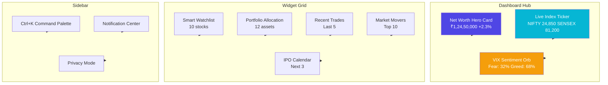

### 2. Portfolio Hub -- Know What You Own

- Add investments across 12 asset classes: Mutual Funds, Stocks, ETFs, Gold, FDs, Crypto, Real Estate, IPOs, etc.
- Automatic XIRR and CAGR calculation per investment and for the whole portfolio
- Asset allocation donut chart with rebalancing suggestions
- **One-click broker sync** (DhanHQ + Upstox) to pull live holdings and positions
- Compliance check: tracks over-concentration, sector exposure, and debt-equity ratio
- **Portfolio DNA + Factor Attribution** (CC30) -- value, momentum, quality, size, volatility factors
- **Smart Rebalancing Engine** with tax-aware trade suggestions

**Portfolio DNA -- Factor Attribution Visual:**

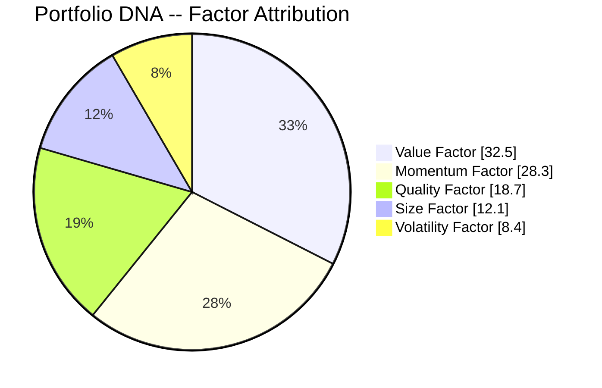

**Asset Allocation -- Example Distribution:**

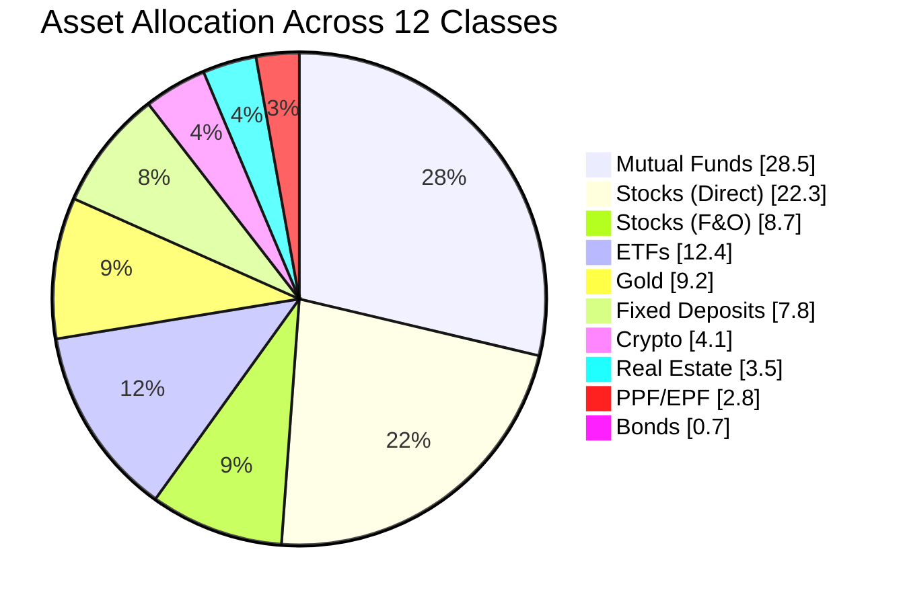

### 3. Alpha Engine 2.0 -- Find Trading Opportunities

- **Intraday Booster**: G-Factor ranked stock list updated every session -- gives you the top momentum picks
- **Shadow Screener**: Multi-filter stock screener with sector confluence scoring, fundamentals, and quality scorecard
- **Market Heatmap**: Visual sector heat map (16 sectors) with fatigue/springboard states
- **Order Flow Dashboard**: Live NSE option chain delta-weighted flow (requires Python bridge)
- **Stock Selection Engine** (CC14) -- relative-strength ranking with advanced filters
- **Opening Range Breakout (ORB)** + **Dynamic Risk Manager** (CC16)
- **Derivatives & Option Chain** (CC15) + **Advanced Greeks & IV Skew** (CC29)
- **Convergence Engine** -- fuses signals across technical, fundamental, institutional, derivatives, orderflow

**Alpha Engine 2.0 -- Signal Flow:**

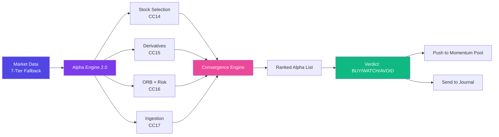

**Sector Heatmap -- 16 Tracked Sectors:**

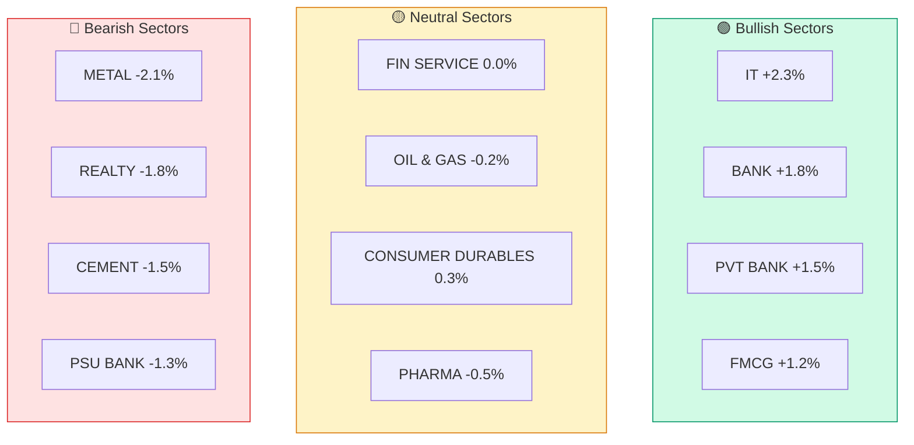

**How to use the Intraday Booster:**

1. Navigate to **Alpha Engine → Intraday Booster**
2. Click **Refresh Market Data** to pull fresh data
3. Stocks are ranked by G-Factor (highest = strongest intraday momentum)
4. Green tags = sector in confluence · Red = sector exhausted
5. Click any stock to see its detailed metrics, ATR, GRR, and OVR

### 4. Quantum Terminal -- Cross-Asset Confluence

A Bloomberg-style deck for serious traders. Top-level hubs:

- **Quantum Command Ribbon** -- live scroll of every signal across the system
- **Quantum Confluence Deck** -- multi-asset view (equity, derivatives, FX, commodity, crypto)
- **Profitability Co-Pilot** -- single 0–100 KPI from your journal, with 5 sub-scores and a 21-day projection
- **Strategy Optimizer Console** (CC36) -- institutional-grade strategy builder with walk-forward + Monte Carlo
- **Resilience Core Console** (CC38) -- backtester logs, telemetry, and the OCR-to-signal pathway
- **Wealth Quest Matrix** (CC37) -- gamified RPG-style progression
- **Beginner Explainer** -- collapsible 1-screen overview of every Quantum tab, in plain English
- **Floating "Ask Jarvis" button** -- bottom-right orb that opens `JarvisVoiceConsole` from any view
- **Cross-tab event bus** -- `quantum:export-to-payoff`, `quantum:sync-to-journal`, `quantum:slide-authorized`, `navigate-to-tab` for cross-widget signaling without coupling

**Profitability Score -- 5 Sub-Scores:**

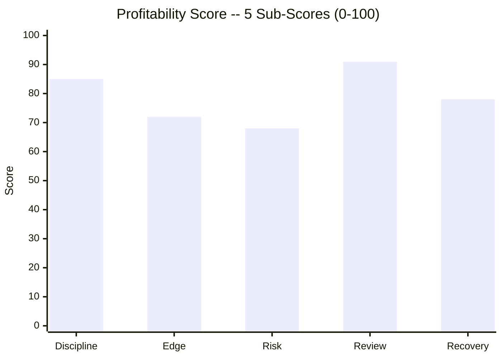

**Quantum Terminal -- User Journey:**

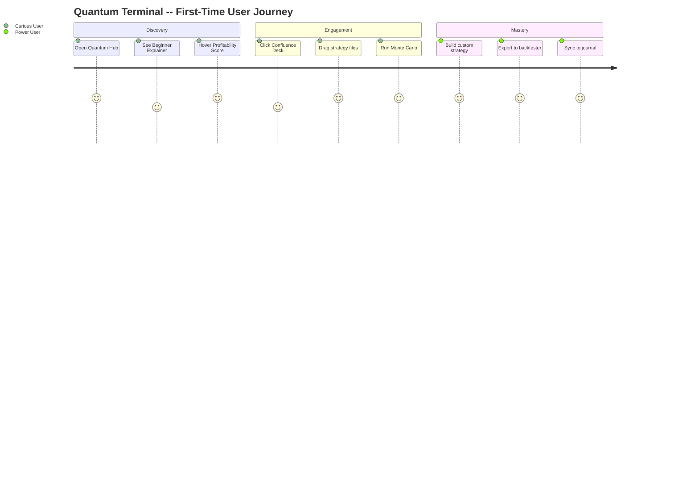

### 5. Momentum Pool -- Pre-Market Watchlist with Auto-Verdict (CC39)

A dedicated top-level hub for the pre-market routine:

- **Pool Hero Panel** -- single biggest mover and the system's pre-market pick
- **Pool Watch Grid** -- drag-to-reorder cards, color-coded by verdict
- **Pool Verdict Feed** -- auto-generated BUY/WATCH/AVOID verdicts with confidence score
- **Pool Telegram Push** -- one-tap push your watchlist to a private Telegram channel
- **Pool Sources Panel** -- manage which signals (Telegram ear, screener, broker feed) feed the pool
- **Pool Toast Bridge** -- instant toast notifications when verdicts change

**Momentum Pool -- Signal Flow:**

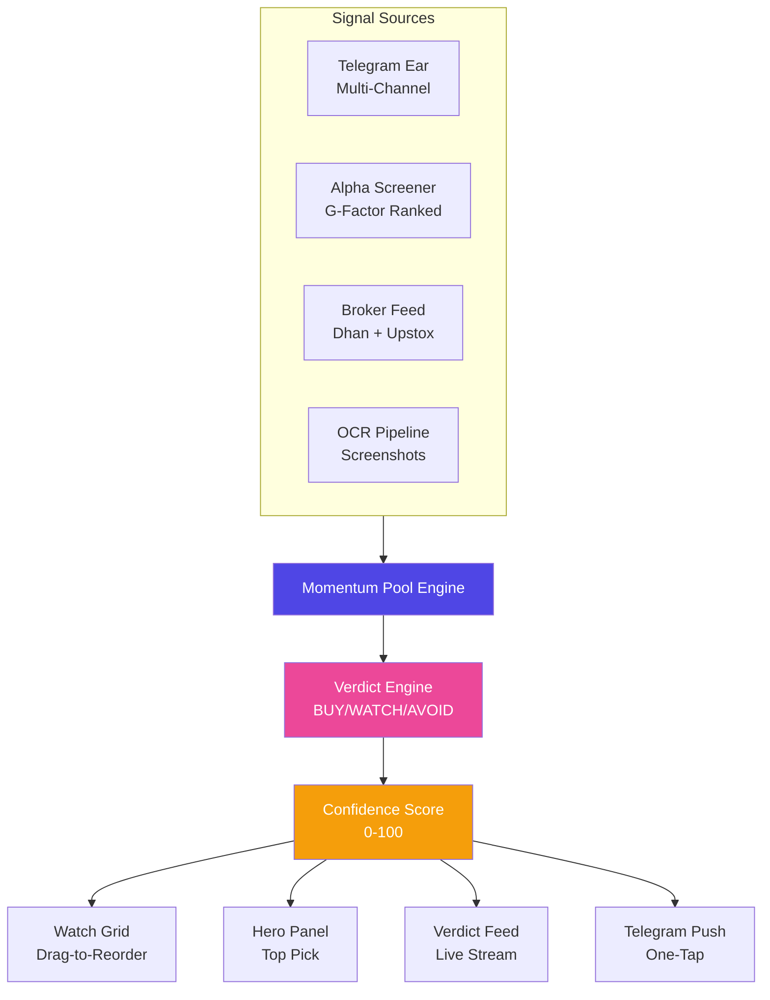

**Momentum Pool -- Verdict Distribution Example:**

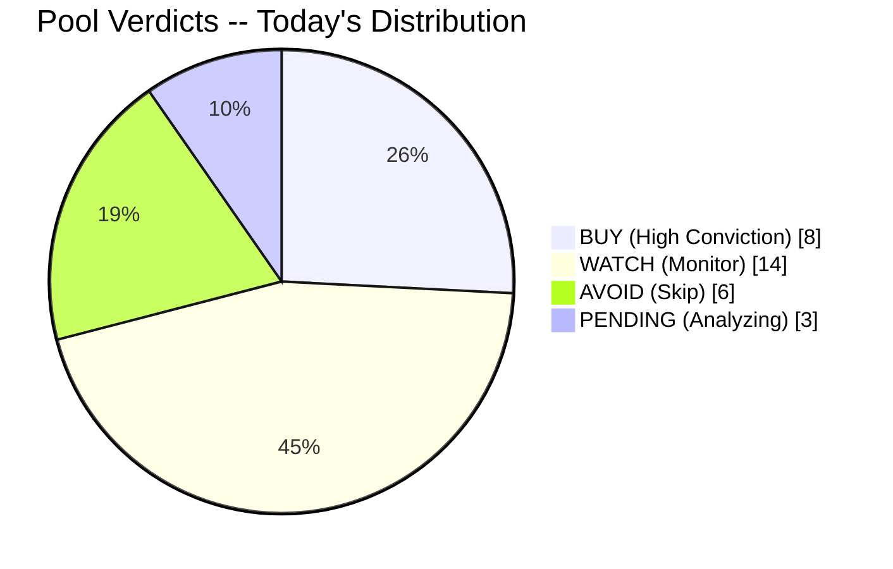

### 6. Jarvis Voice Workspace -- Speak, the App Obeys

Three generations, one philosophy:

- **Jarvis v2 -- Ambient AI** -- always-on command orb; `Ctrl+J` from anywhere
- **Jarvis v3 -- Autonomous Sentinel** (CC32) -- background Web Worker that watches the market, runs EMA/RSI off-thread, gates voice-routed orders through a hard `RiskSafetyGate` (₹50k session cap, ₹10k daily loss cap, 5 orders/session)
- **Jarvis v4 -- Voice-First Workspace** (CC35) -- push-to-talk with full grammar trained on trade vocabulary; "Sell 200 SBIN at 622, take profit" → confirm toast
- **AI Command Hub** -- 4 personas: **Sage** (conservative), **Oracle** (analytical), **Wolf** (aggressive), **Roast** (brutal honesty)
- Real-time web search grounding via `searchWeb()` for live market context
- Voice mode: speak naturally, get spoken responses (requires Gemini API key)
- Supports 45+ AI models -- switch between them in Settings

**Jarvis Evolution -- v2 → v3 → v4:**

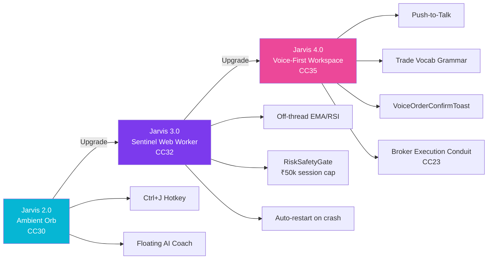

**RiskSafetyGate -- Voice Order Safety Flow:**

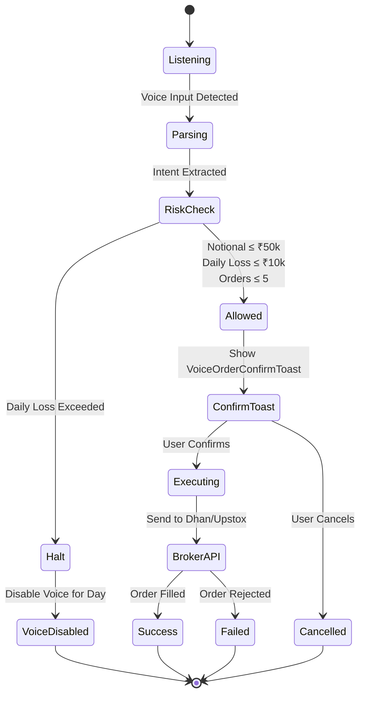

**AI Personas -- Behavioral Spectrum:**

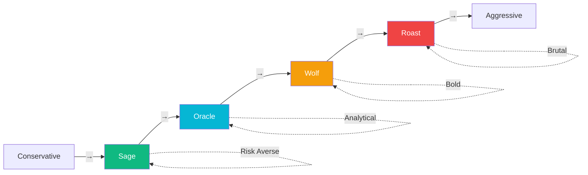

### 7. Telegram Multi-Ear + OCR Signal Ledger

- **Multi-channel watcher** -- listen to N premium channels, with per-channel keyword filters
- **OCR** -- `tesseract.js` parses screenshots (broker trades, advisory calls) into structured signals
- **Signal Ledger** -- every parsed signal gets stored with source, confidence, and time-to-resolution
- **Telegram Intel Hub** -- multi-channel digest with batched digests and "send to Momentum Pool"
- **Telethon history import** -- pull your *own* chat history to recover 6+ months of missed logs
- **Two-way voice notes** -- send a voice note to the bot → "Confirm this trade?" card with inline buttons

**Telegram OCR -- Pipeline:**

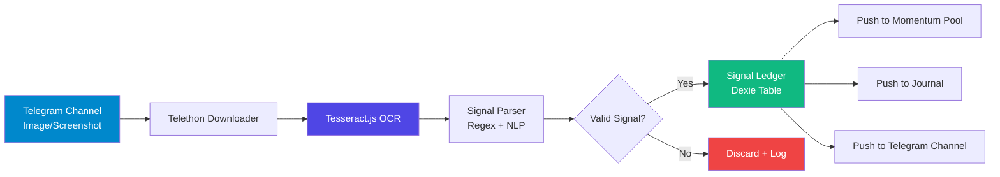

**Signal Ledger -- Example Entries:**

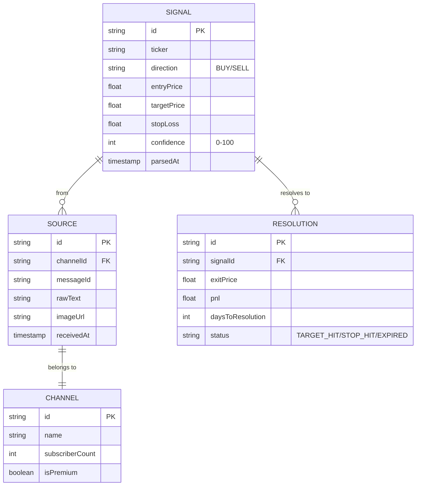

### 8. Trading Journal 2.0 -- Track Your Psychology

- Log every trade with: emotion before/after, setup grade (A+ to F), mistakes made, screenshots, notes
- The **Mirror of Truth** tracks your costliest mistakes and converts them into active trading rules
- **Quant Duel**: daily challenge where you pit your pick against the algorithm's pick
- Run the **Speed Review** to assess a week of trades in 60-second flash cards
- **Trade Diary Calendar** -- see every trade on a P&L heatmap calendar
- **Cosmic Circuit Breaker** -- automatic cool-down triggers when emotion + loss streak align
- **AI Verdict** per-trade: BUY/SELL/HOLD/WAIT with conviction score, and AI-graded grade (CC18)
- **Slump Buster** -- guided flow that helps you break out of losing streaks
- **What-If Scenario Builder** -- replay history with different exits

**Trade Journal -- Emotion Flow:**

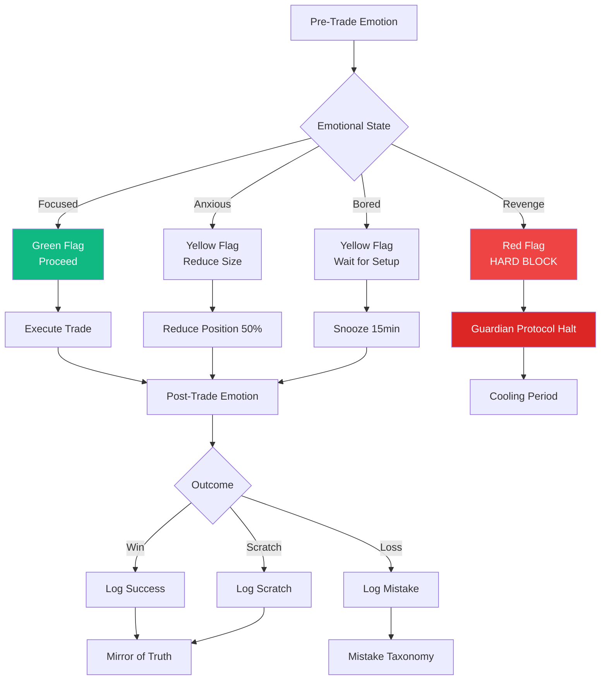

**Trade Grade Distribution -- Example:**

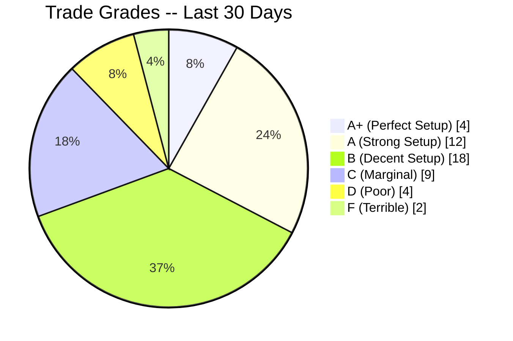

**Mirror of Truth -- Mistake → Rule Pipeline:**

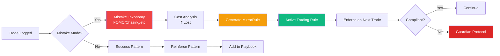

### 9. AI Advisor -- Your SEBI-Compliant AI

- 4 personas: **Sage** (conservative), **Oracle** (analytical), **Wolf** (aggressive), **Roast** (brutal honesty)
- Ask anything about your portfolio: "Should I add more to HDFC Bank?", "What's my biggest risk?"
- Real-time web search grounding via `searchWeb()` for live market context
- **Agentic Lab** -- chain multiple AI calls into multi-step analyses
- **Tab AI Strip** -- contextual AI hints on every tab
- **Quota Monitor** -- track per-provider usage and budget

**AI Provider Fallback Chain:**

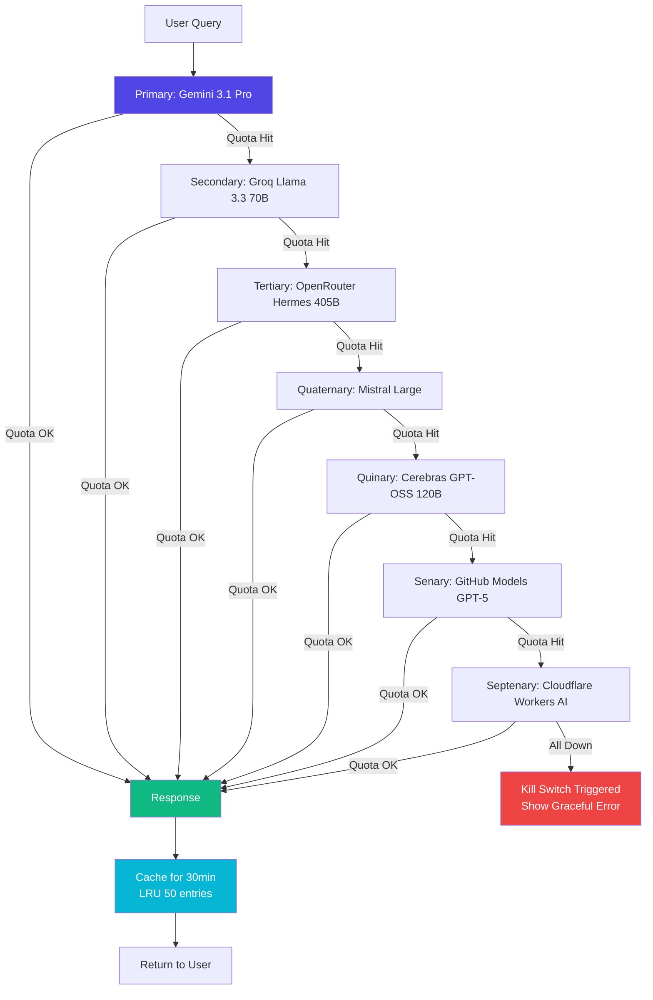

**AI Provider Usage -- Example Distribution:**

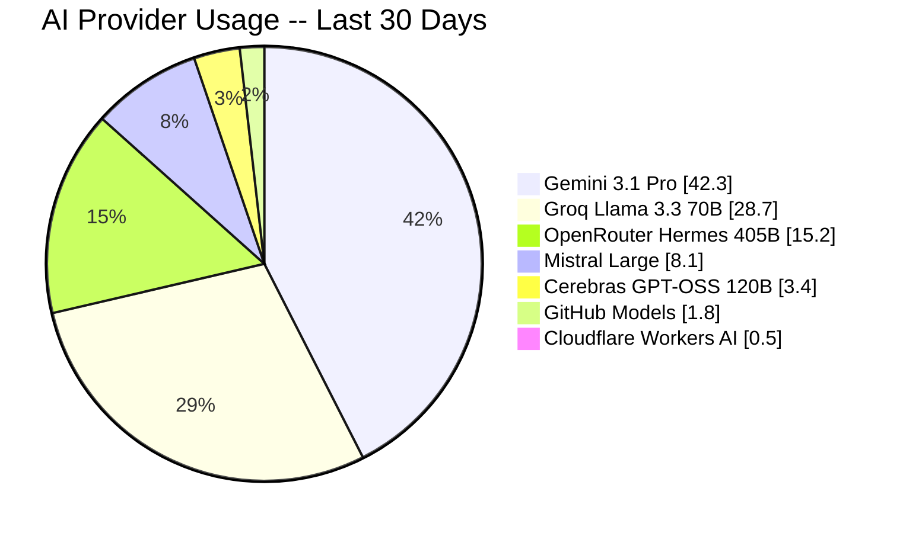

### 10. IPO War Room -- Never Miss an IPO

- Track IPOs from announcement → application → allotment → listing → exit
- GMP (Grey Market Premium) tracker with historical trend
- Syndicate management: track which friends applied and how much
- Allotment probability calculator based on subscription data
- Automatic cutoff price suggestions for RII category

**IPO Lifecycle -- State Machine:**

```mermaid
stateDiagram-v2
    [*] --> Announcement
    Announcement --> Application: Open for Subscription
    Application --> Allotment: Subscription Closed
    Allotment --> Listed: Allotment Confirmed
    Allotment --> NotAllotted: Oversubscribed

    Listed --> Exited: Book Profit/Loss
    Listed --> Holding: Long-term Hold

    Exited --> [*]
    Holding --> [*]
    NotAllotted --> [*]
```

**IPO Subscription Categories -- Example:**

```mermaid
pie showData
    title IPO Subscription -- QIB/NII/RII
    "QIB (Qualified Institutional)" : 45.2
    "NII (Non-Institutional)" : 28.7
    "RII (Retail Individual)" : 18.3
    "Others (Employees)" : 7.8
```

### 11. Tax Center -- Calculate Your Tax Bill

- LTCG and STCG auto-calculation based on your trade history
- F&O turnover computation for ITR-3
- **Tax-loss harvesting** suggestions: which stocks to book losses in before March 31
- Generates a summary ready for your CA
- **eCAS / CAMS / KFin import** (CC40 + `casparser>=1.1.0`) -- drag-and-drop your eCAS PDF, all MF holdings appear in your portfolio

**Tax Calculation -- Flow:**

```mermaid
flowchart TD
    A[All Trades<br/>FY 2025-26] --> B{Classification}
    B -->|Equity < 1yr| C[STCG<br/>15% Tax]
    B -->|Equity > 1yr| D[LTCG<br/>10% over ₹1L]
    B -->|F&O| E[Speculative<br/>30% Tax]
    B -->|Crypto| F[VDAS<br/>30% Tax]

    C --> G[Tax Calculation Engine]
    D --> G
    E --> G
    F --> G

    G --> H[Tax Liability]
    H --> I{Tax Saving Opportunity?}
    I -->|Yes| J[Tax-Loss Harvesting<br/>Suggestions]
    I -->|No| K[ITR Summary]

    J --> L[Book Losses Before Mar 31]
    L --> K

    K --> M[Export PDF for CA]

    style C fill:#f59e0b,color:#fff
    style D fill:#10b981,color:#fff
    style E fill:#ef4444,color:#fff
    style F fill:#dc2626,color:#fff
```

**Tax Liability Breakdown -- Example:**

```mermaid
pie showData
    title Tax Liability -- FY 2025-26
    "STCG (15%)" : 18.5
    "LTCG (10%)" : 32.3
    "F&O Speculative (30%)" : 28.7
    "Crypto VDAS (30%)" : 12.4
    "Dividend Tax" : 8.1
```

### 12. The Fortress -- Security and Guardrails

- AES-256 encrypted security vault for sensitive documents
- **Guardian Protocol**: set daily loss limits, max position size, emotion-based lockouts
- **Audit event log**: every action in the app is logged with timestamp
- **Data backup**: export all your data as encrypted JSON
- **Data restore**: import from a previous backup
- **GCP backup utility** -- encrypted Google Cloud Storage snapshots on demand

**Guardian Protocol -- State Machine:**

```mermaid
stateDiagram-v2
    [*] --> Normal
    Normal --> Halt: Daily Loss > ₹10k
    Normal --> SoftBlock: 3 Consecutive Losses
    Normal --> HardBlock: Position Size > 10% Portfolio

    Halt --> Cooldown: Mandatory 60min Wait
    Cooldown --> Resume: Timer Expired + Emotion Log

    SoftBlock --> Confirm: User Override
    Confirm --> Normal: User Confirms
    SoftBlock --> Halt: User Cancels

    HardBlock --> [*]: Order Rejected

    Resume --> Normal
    Normal --> [*]
```

**Encryption Architecture:**

```mermaid
flowchart LR
    A[User PIN<br/>1234] --> B[PBKDF2<br/>100k iterations]
    B --> C[Derived Key<br/>256-bit]
    C --> D[AES-256-CBC<br/>Encryption]
    D --> E[Encrypted Data<br/>localStorage]

    F[Biometric<br/>Touch ID] --> G[Keychain<br/>iOS/Android]
    G --> C

    H[Recovery Phrase<br/>12 words] --> I[Seed Phrase → Key]
    I --> C

    style A fill:#4f46e5,color:#fff
    style C fill:#10b981,color:#fff
    style E fill:#06b6d4,color:#fff
```

### 13. Settings Hub -- Configure Everything

- **API Keys**: Add/manage all your AI provider keys (shown masked, stored encrypted)
- **Broker Setup**: Connect DhanHQ or Upstox
- **Appearance**: Dark/Light mode, accent color, compact mode, font size
- **Privacy**: Control exactly what your AI advisor can see · **Privacy Mode** blur screen guard
- **Sync**: Enable/disable Firebase cloud sync
- **Guardrails**: Configure your trading risk guardrails
- **Onboarding Flow** -- guided first-launch experience
- **Data Freshness** -- see which widgets are live, cached, or stale

### 14. Calculator Hub -- Math Lab

- SIP/Lumpsum/Compound/CAGR/FIRE/Debt/EMI/Goal-Attainment/Position-Sizing calculators
- **Advanced Compound**, **Daily Compound**, **Averaging**, **ROICalculator**
- **Hindsight Simulator** -- what would have happened if you had entered earlier?
- **Options payoff calculator** with strategy visualizer (CC9)
- **Black-Scholes math lab** with live greeks

### 15. Growth Engine -- Long-Term Wealth Building

- **Alpha Predator Screener** -- fundamental + technical convergence
- **Insider Radar** -- promoter/FII/DII activity scanner
- **Bulk Deal Scanner** -- NSE bulk/block deal feeds
- **Tax Harvester** -- automated tax-loss harvesting
- **Academy** with XP, badges, streaks, mastery skill-trees (CC31)
- **Mastery Hub** -- gamified progression with celebration animations

### 16. Innovation Lab -- Moonshots

- **Boardroom** -- board-meeting style strategic review of your portfolio
- **Black Swan** -- what-if tail-risk scenarios
- **Opportunity Cost** -- what did skipping that trade actually cost you?
- **Dynasty Mode** -- multi-generational wealth transfer planning
- **Impulse Check** -- pause-and-reflect flow before any major decision
- **Liability Vault** -- track loans, EMIs, and net-of-debt wealth

### 17. Life Planner

- **Goal GPS** -- goal tracking with SIP status, countdown timers, FIRE progress bar
- **Retirement Planner** -- multi-stage retirement projection
- **Legacy Vault** -- beneficiaries, will tracking, estate document storage
- **Financial Independence Score** -- animated gauge showing % to FI

### 18. Analytics Center

- **Quant Dashboard** -- cross-asset correlation matrix, return distribution
- **Risk Engine** -- VaR, CVaR, max drawdown, beta to NIFTY
- **Monte Carlo Simulator** -- 10,000-path retirement projection
- **Black-Scholes Calculator** -- full Greeks (Δ, Γ, Θ, ν, ρ)
- **Hindsight Simulator** -- backtest your intuition

### 19. Strategy Lab

- **Apex Backtester** -- multi-strategy backtesting with walk-forward optimization and Monte Carlo simulation
- **Paper Trading** -- full paper-trading engine with virtual margin
- **Pre-Trade Checklist** -- required checklist before any live order
- **Strategy Manager** -- codified rulebook with checklist enforcement

### 20. Launchpad

- **Mac Dock** -- macOS-style app launcher for power users
- **Tool Cards** -- discover and pin tools to your sidebar

### 21. The Telegram Bridge (sidecar)

- Listens to N premium channels in parallel
- WebSocket feed at `ws://localhost:8081`, REST at `http://localhost:3001`
- Bidirectional -- `/positions`, `/pnl`, `/risk`, `/brief`, `/log`, `/mute`, `/screener` slash commands
- **Daily 9 AM digest** -- auto-push to your private channel

---

## 5. Module Map (19 Hubs)

The app is organized into **19 primary navigation hubs**:

```mermaid
graph TD
    A[App Root] --> B[Dashboard Hub]
    A --> C[Portfolio Hub]
    A --> D[Market Intel]
    A --> E[IPO War Room]
    A --> F[Psych Dashboard]
    A --> G[Growth Engine]
    A --> H[Life Planner]
    A --> I[Moonshot Lab]
    A --> J[Analytics Center]
    A --> K[The Fortress]
    A --> L[Alpha Engine 2.0]
    A --> M[Strategy Lab]
    A --> N[Launchpad]
    A --> O[Settings]
    A --> P[Quantum Terminal]
    A --> Q[Momentum Pool]
    A --> R[Jarvis Voice Workspace]
    A --> S[Signal Intelligence]
    A --> T[Mastery Hub]

    P --> P1[Quantum Confluence Deck]
    P --> P2[Strategy Optimizer]
    P --> P3[Profitability Co-Pilot]
    P --> P4[Resilience Core Console]
    P --> P5[Wealth Quest Matrix]

    Q --> Q1[Pool Hero Panel]
    Q --> Q2[Pool Watch Grid]
    Q --> Q3[Pool Verdict Feed]
    Q --> Q4[Pool Telegram Push]

    R --> R1[Jarvis 2.0 Ambient]
    R --> R2[Jarvis 3.0 Sentinel]
    R --> R3[Jarvis 4.0 Voice]

    S --> S1[Telegram Ear]
    S --> S2[OCR Pipeline]
    S --> S3[Signal Ledger]

    T --> T1[Mastery Skill Tree]
    T --> T2[Achievement Engine]
    T --> T3[XP Celebration]

    C --> C1[Portfolio Overview]
    C --> C2[Goal GPS]
    C --> C3[Compliance]

    D --> D1[Macro Pulse]
    D --> D2[Option Chain Intel]
    D --> D3[Paper Sandbox]

    F --> F1[Journal Dashboard]
    F --> F2[Speed-Run Review]

    G --> G1[Predator Engine]
    G --> G2[AI Advisor]
    G --> G3[Academy]

    L --> L1[Intraday Booster]
    L --> L2[Shadow Screener]
    L --> L3[Market Heatmap]
    L --> L4[ORB / IV Skew]
    L --> L5[Stock Selection]
    L --> L6[Convergence Engine]

    M --> M1[Apex Backtester]
    M --> M2[Legacy Simulator]
    M --> M3[Walk-Forward Optimizer]
```

### Hub Capability Reference

| Hub                        | Core Capabilities                                                                                  |
| -------------------------- | -------------------------------------------------------------------------------------------------- |
| **Dashboard**        | Net worth hero card with `<CountUp>` + `<ValueFlash>`, live index ticker, VIX sentiment orb, drag-and-drop widget grid, 4 view modes, Macro Regime banner, Morning Briefing |
| **Portfolio Hub**    | Holdings table, XIRR/CAGR computation, asset allocation donut, rebalance modal, compliance score, **Portfolio DNA + factor attribution (CC30)**, smart rebalance, eCAS/CAMS import |
| **Goal GPS**         | Goal tracking with SIP status, countdown timers, FIRE progress bar, animated FI Score gauge |
| **Market Intel**     | Macro panel (VIX/Gold/Crude/USDINR), FII/DII flows, live option chain, earnings calendar, IV skew chart |
| **IPO War Room**     | Application tracker (apply to list lifecycle), GMP radar, grey market feed, syndicate friends pool |
| **Psych Dashboard**  | Emotion-tagged journal, Mirror of Truth 2.0, AI psych scoring, **P&L calendar**, **Slump Buster**, **What-If Scenario Builder**, streak/badge tracker, **Cosmic Circuit Breaker** |
| **Growth Engine**    | Alpha Predator, Bulk Deal Scanner, Insider Radar, Tax Harvester, 4-persona AI advisor, Academy with mastery skill-trees |
| **Life Planner**     | FIRE simulator, Monte Carlo retirement model, legacy vault with beneficiary pie, Dynasty Mode |
| **Moonshot Lab**     | Boardroom, Black Swan, Opportunity Cost, Impulse Check, Liability Vault, multi-generational wealth transfer |
| **Analytics Center** | Black-Scholes calculator, Monte Carlo simulation, deep quant correlation matrix, IV skew & delta hedging, scenario comparison, destiny gauge |
| **The Fortress**     | AES-256 security vault, audit event log, data backup/restore, GCP encrypted backups, guardrail system |
| **Alpha Engine 2.0** | Intraday Booster (G-Factor + R-Factor), Shadow Screener, Market Heatmap, **ORB**, **IV Skew**, **Stock Selection (CC14)**, **Derivatives & Order-Flow Confluence (CC15)**, **Dynamic Risk Manager (CC16)**, Ingestion Failover (CC17) |
| **Strategy Lab**     | Apex Backtester, walk-forward optimization, paper trading simulator, **Strategy Optimizer (CC36)**, **Resilience Core logs (CC38)**, Quant Duel |
| **Launchpad**        | Mac Dock launcher, Tool Cards, App discovery surface |
| **Settings**         | All integrations config, API key manager, broker setup, appearance, privacy, sync, onboarding, data freshness |
| **Quantum Terminal** | Quantum Confluence Deck, Strategy Optimizer Console, **Profitability Co-Pilot** (single 0–100 KPI), **Wealth Quest Matrix**, **Resilience Core**, Beginner Explainer, Floating "Ask Jarvis" button, cross-tab event bus |
| **Momentum Pool**    | Pool Hero Panel, Pool Watch Grid (drag-to-reorder), **Pool Verdict Feed** (auto BUY/WATCH/AVOID), **Pool Telegram Push** (CC39) |
| **Jarvis Workspace** | Jarvis 2.0 ambient orb, **Jarvis 3.0 sentinel Web Worker (CC32)** with hard RiskSafetyGate, **Jarvis 4.0 voice workspace (CC35)** with grammar trained on trade vocab, AI Command Hub, Floating Coach |
| **Signal Intelligence** | Telegram multi-ear, **OCR pipeline (tesseract.js)**, **Signal Ledger**, Telethon history import, two-way voice notes, daily 9 AM digest, slash commands (`/pnl`, `/risk`, `/brief`) |
| **Mastery Hub**      | Gamified skill trees, achievement engine, XP celebration, mastery overview widget (CC31) |

---

