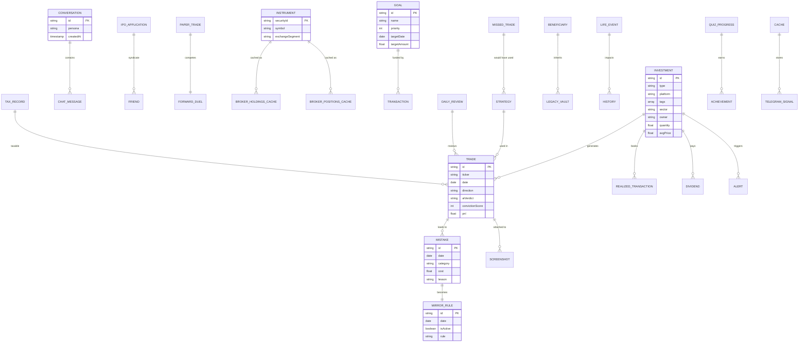
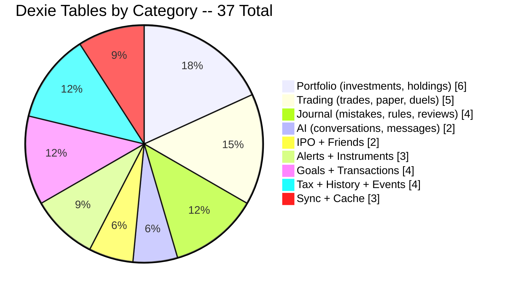
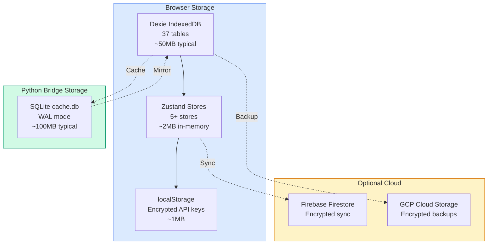

# 🗄️ Volume 03: Dexie IndexedDB v30 Database Schema (37 Tables)

> **Component of:** [WealthOS v2 Documentation Index](../README.md#-master-documentation-index)

---

## 6. Data Layer and Database Schema

### Dual Storage Architecture

```
CLIENT SIDE (Browser)
+-----------------------------------------------------------------------+
|  Dexie IndexedDB (WealthAggregatorDB v31)                            |
|  37 tables -- structured, fully queryable, offline-capable             |
|  All financial / personal data lives here                             |
+-----------------------------------------------------------------------+
|  Zustand (5 stores)          |  localStorage                         |
|  In-memory + persist plugin  |  API keys, appearance settings        |
+------------------------------+---------------------------------------+

SERVER SIDE (Python Bridge - optional sidecar)
+-----------------------------------------------------------------------+
|  SQLite (cache.db) -- 10+ tables                                      |
|  NSE market data cache (delivery, insider, orderflow, FII/DII)       |
|  TTL-aware with market-hours awareness                                |
+-----------------------------------------------------------------------+
```

### Dexie IndexedDB Schema (Version 30)

All 37 tables are defined in `database.ts` across 30 versioned migrations:

**Database Schema -- Entity Relationship:**



**Table Categories -- Visual Distribution:**



**Storage Architecture -- Visual:**



| Table                      | Primary Key / Indexes                        | Purpose                                   |
| -------------------------- | -------------------------------------------- | ----------------------------------------- |
| `investments`            | `id, type, platform, *tags, sector, owner` | Core investment holdings (12 asset types) |
| `trades`                 | `id, ticker, date, direction, aiVerdict`   | Full trade journal (146-field schema)     |
| `history`                | `date`                                     | Daily net worth snapshots                 |
| `goals`                  | `id, name, priority, category, targetDate` | Financial goal tracking                   |
| `transactions`           | `id, date, category, type, bankName`       | Bank/UPI transaction log                  |
| `mistakes`               | `id, date, category`                       | Mirror of Truth mistake ledger            |
| `mirror_rules`           | `id, date, isActive`                       | Rules derived from mistakes               |
| `strategies`             | `id, name`                                 | Strategy rulebook with rule checklists    |
| `daily_reviews`          | `date`                                     | Daily trading report cards                |
| `conversations`          | `id, persona, createdAt, updatedAt`        | AI chat threads                           |
| `chat_messages`          | `id, conversationId, timestamp`            | Per-message AI history                    |
| `ipo_applications`       | `id, ipoName, status, upiHandle`           | IPO application lifecycle                 |
| `paper_trades`           | `id, ticker, status`                       | Paper trading positions                   |
| `forward_duels`          | `id, date, systemTicker`                   | Human vs System daily challenge           |
| `dividends`              | `id, ticker, date`                         | Dividend income records                   |
| `friends`                | `id, name, balance`                        | IPO syndicate friends pool                |
| `alerts`                 | `id, type, assetId, isActive`              | Smart price/SIP alert system              |
| `instruments`            | `securityId, symbol, exchangeSegment`      | DhanHQ instrument master                  |
| `broker_holdings_cache`  | `broker, brokerSecurityId, fetchedAt`      | Live holdings snapshot                    |
| `broker_positions_cache` | `broker, brokerSecurityId, fetchedAt`      | Live intraday positions                   |
| `sync_records`           | `id, entityType, syncStatus, lastSyncedAt` | Cloud sync audit trail                    |
| `historical_data`        | `id, date, symbol, assetClass`             | OHLCV data vault for backtesting          |
| `cache`                  | `id, key, timestamp, ttl`                  | General-purpose TTL cache                 |
| `beneficiaries`          | `id, name, allocation`                     | Estate planning beneficiary registry      |
| `realized_transactions`  | `id, investmentId, saleDate`               | Profit booking history                    |
| `missed_trades`          | `id, date, ticker, reason`                 | Missed trade analysis                     |
| `quiz_progress`          | `id, userId, totalXP`                      | Academy gamification state                |
| `tax_records`            | `id, fy`                                   | Tax year computation records              |
| `life_events`            | `id, date`                                 | Major life events for wealth simulation   |

### SQLite Cache Tables (Python Bridge)

| Table                 | Key Columns                      | Data Freshness Strategy                |
| --------------------- | -------------------------------- | -------------------------------------- |
| `delivery_history`  | `symbol, date`                 | 30-day rolling, skips non-market hours |
| `insider_trading`   | `symbol, created_at`           | 12-hour TTL refresh                    |
| `pledged_shares`    | `symbol, updated_at`           | 1-day TTL                              |
| `mf_insider`        | `symbol, isin`                 | 7-day TTL                              |
| `orderflow_ticks`   | `symbol, timestamp, time_slot` | 5-minute interval polling              |
| `volume_averages`   | `symbol, exchange`             | 20-day rolling average                 |
| `instrument_master` | `security_id, symbol`          | Daily sync from Upstox gzip master     |
| `ohlcv_cache`       | `symbol, date`                 | Historical candle data vault           |
| `fii_dii_history`   | `date`                         | FII/DII daily flow data                |
| `intraday_history`  | `symbol, time_slot`            | R-Factor intraday baseline             |

---

> **Interactive Graph:** `graphify-out/graph.html`
> **Graph Analysis:** `graphify-out/GRAPH_REPORT.md`

# WealthOS v2 (Wealth Aggregator Pro) v2.0 -- README (Part 2)

> This is a continuation of [README.md](file:///C:/Users/gadda/.gemini/antigravity-ide/brain/09c45d80-3b56-4434-b12f-cb1bd33bbd3c/README.md)

---

