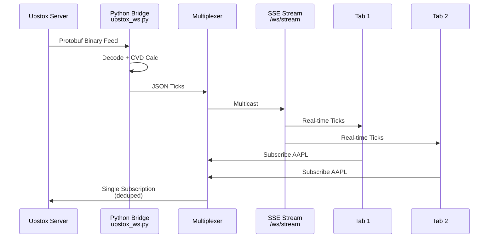
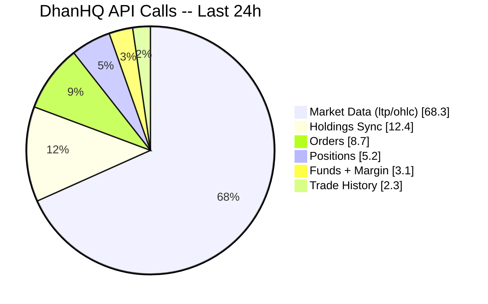
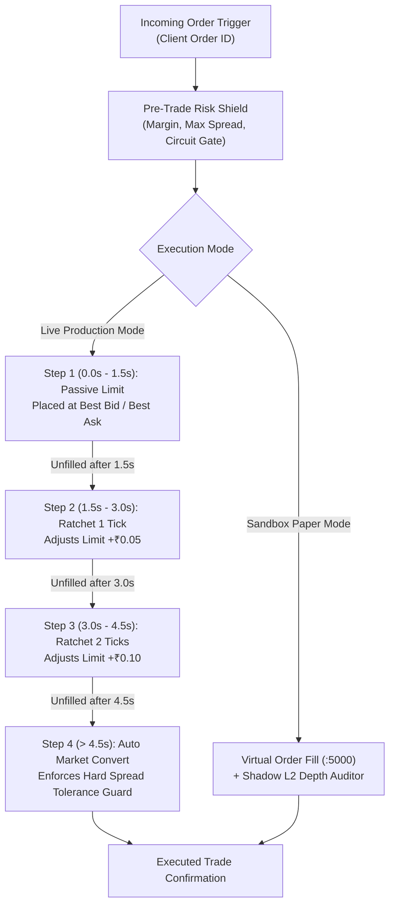

# 🏦 Volume 04: Broker Integrations, OpenAlgo Gateway & OMS

> **Component of:** [WealthOS v2 Documentation Index](../README.md#-master-documentation-index)

---

## 7. Broker Integrations

### DhanHQ (Primary Broker)

The `DhanBrokerService` (61KB, 1,530 lines) is the most complex service in the app. It handles the entire DhanHQ API surface including live market data, portfolio sync, order placement, and automatic token renewal.

```
Authentication Flow:
  1. User provides Client ID + Access Token (manual paste from web.dhan.co)
     OR
  2. User provides Client ID + PIN + TOTP Secret
     -> App auto-generates TOTP code every 2 minutes
     -> App calls /auth/dhan/app/generateAccessToken
     -> Fresh Access Token saved to settingsStore
     -> 2-minute cooldown enforced (DhanHQ server-side limit)
```

#### Full API Surface Covered

| Endpoint | Method | What it does |
|----------|--------|-------------|
| `/v2/marketfeed/ltp` | POST | Live Last Traded Price for N instruments (batched) |
| `/v2/marketfeed/ohlc` | POST | Open/High/Low/Close for N instruments |
| `/v2/holdings` | GET | All equity holdings (demat) |
| `/v2/positions` | GET | Intraday/carry-forward positions |
| `/v2/positions/convert` | POST | Convert position type (INTRADAY <-> CNC <-> MTF) |
| `/v2/orders` | GET / POST | Order list + order placement |
| `/v2/orders/{orderId}` | PUT / DELETE | Modify/cancel order |
| `/v2/orders/slice` | POST | Slice large orders into smaller lots |
| `/v2/orders/gtt` | POST | Good-Till-Triggered (GTT) order |
| `/v2/trades` | GET | Trade history |
| `/v2/tradeHistory` | GET | Date-ranged trade history |
| `/v2/fundlimit` | GET | Available margin + fund limit |
| `/v2/calculateMargin` | POST | Pre-trade margin calculator |
| `/v2/edis/form` | POST | Demat EDIS pledge form generation |
| `/v2/ledger` | GET | Account ledger (debit/credit history) |
| `/v2/statement` | GET | Consolidated account statement |

#### Security IDs (Instrument Master)

The `SECURITY_IDS` constant maps 40+ key NSE symbols to their DhanHQ integer security IDs, covering major indices and Nifty 50 components:

```typescript
// Indices
'NIFTY 50'   -> securityId: '13', segment: 'IDX_I'
'SENSEX'     -> securityId: '51', segment: 'IDX_I'
'NIFTY BANK' -> securityId: '25', segment: 'IDX_I'
'INDIA VIX'  -> securityId: '26', segment: 'IDX_I'

// Equities (NSE_EQ)
'RELIANCE'   -> securityId: '2885'
'TCS'        -> securityId: '11536'
'HDFCBANK'   -> securityId: '1333'
...40+ more
```

#### Token Auto-Renewal Pattern

```typescript
// Exponential backoff + singleton auth promise (prevents concurrent auth races)
private authPromise: Promise<boolean> | null = null;
private readonly AUTH_COOLDOWN_MS = 130000; // 2m 10s -- DhanHQ enforces 2-min minimum

async authenticateWithTotp(): Promise<boolean> {
  if (this.authPromise) return this.authPromise; // Deduplicate concurrent calls
  this.authPromise = this._executeAuthenticateWithTotp();
  try { return await this.authPromise; }
  finally { this.authPromise = null; }
}
```

#### Batch Quote Pattern

The app uses a **50ms batching window** to deduplicate N concurrent calls into a single API request:

```typescript
let dhanBatchQueue = []; 
let dhanBatchTimer = null;

async function fetchDhanQuoteBatched(symbol) {
  return new Promise((resolve, reject) => {
    dhanBatchQueue.push({ symbol, resolve, reject });
    if (!dhanBatchTimer) {
      dhanBatchTimer = setTimeout(async () => {
        // Flush batch -> single /v2/marketfeed/ltp call
        const tickers = [...new Set(queue.map(q => q.symbol))];
        const results = await dhanBrokerService.getBatchStockLTP(tickers);
        // Distribute results back to individual promises
      }, 50);
    }
  });
}
```

### Upstox (Secondary Broker)

The `upstox_ws.py` module provides a live WebSocket tick feed:

- **Protocol:** gRPC/Protobuf over WebSocket
- **Auth:** OAuth2 code exchange (access token stored in settingsStore)
- **Feed:** Real-time OHLCV ticks for subscribed securities
- **Frontend Hook:** `useUpstoxWebSocket.ts` manages connection lifecycle + reconnection

**DhanHQ API Surface -- Visual:**

```mermaid
graph TB
    A[DhanBrokerService<br/>1,530 lines] --> B[Authentication]
    A --> C[Market Data]
    A --> D[Portfolio]
    A --> E[Orders]
    A --> F[Reports]

    B --> B1[Manual Token]
    B --> B2[TOTP Auto-Renew<br/>2-min cooldown]

    C --> C1[/v2/marketfeed/ltp]
    C --> C2[/v2/marketfeed/ohlc]
    C --> C3[Batch 50ms Window]

    D --> D1[/v2/holdings]
    D --> D2[/v2/positions]
    D --> D3[/v2/positions/convert]

    E --> E1[/v2/orders GET/POST]
    E --> E2[/v2/orders PUT/DELETE]
    E --> E3[/v2/orders/slice]
    E --> E4[/v2/orders/gtt]

    F --> F1[/v2/trades]
    F --> F2[/v2/tradeHistory]
    F --> F3[/v2/fundlimit]
    F --> F4[/v2/calculateMargin]
    F --> F5[/v2/edis/form]
    F --> F6[/v2/ledger]
    F --> F7[/v2/statement]

    style A fill:#4f46e5,color:#fff
    style B fill:#06b6d4,color:#fff
    style C fill:#10b981,color:#fff
    style D fill:#f59e0b,color:#fff
    style E fill:#ec4899,color:#fff
    style F fill:#8b5cf6,color:#fff
```

**Upstox Protobuf WebSocket Flow:**



**Broker API Call Distribution -- Example:**



---


---

## ⚡ OpenAlgo Execution Gateway & Sub-50ms OMS

WealthOS bridges physical exchange execution via OpenAlgo on port **5000**, proxied through Python Bridge on port **8765**.



### Bracket Guardian & Dynamic Trailing Stop-Loss
- **OCO Invariant:** When target limit order fills, pending stop-loss leg is immediately canceled.
- **Dynamic Step-Trailing:** Stop-loss steps upward by 0.5R for every 1.0R unrealized gain.
- **Emergency Panic Flush:** `/api/v1/cancel_all_order` purges all pending orders in <20ms.

### Statutory Friction Engine (IN-NSE-2024-10-01 Spec)
- **STT (Options):** 0.1% on Sell Premium.
- **STT (Futures):** 0.02% on Sell Turnover.
- **Exchange Fees:** NSE 0.03503% on Option Premium, 0.00173% on Futures.
- **SEBI Charges:** ₹10 per Crore.
- **GST:** 18% on (Brokerage + Exchange Fees + SEBI).
