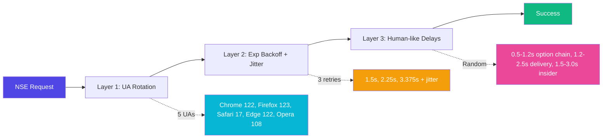
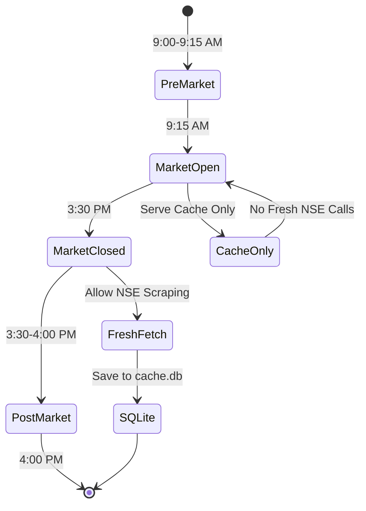
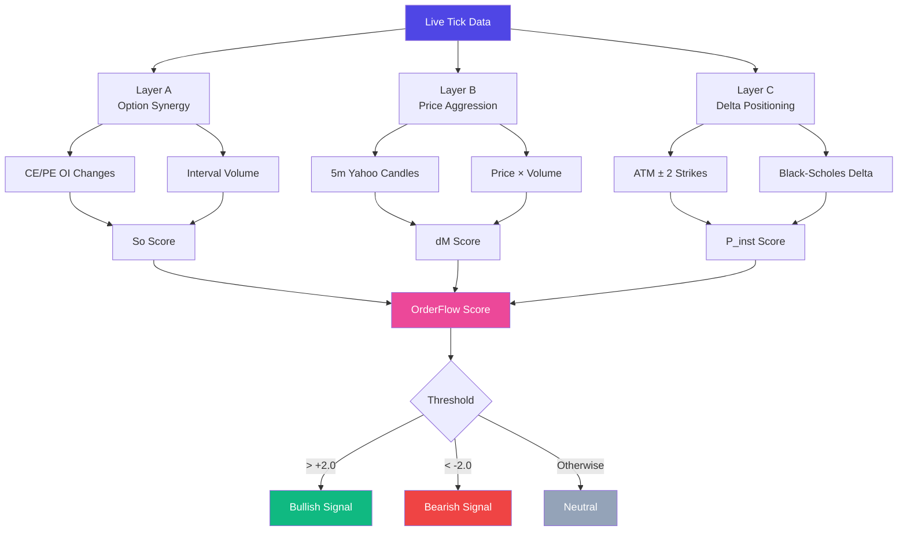

# 🤖 Volume 05: AI Engine Fallback Chain & Python Bridge Sidecar

> **Component of:** [WealthOS v2 Documentation Index](../README.md#-master-documentation-index)

---

## 8. AI Engine and Multi-Provider Fallback Chain

### Architecture: Agnostic LLM Pipeline

The AI system is built around a **provider-agnostic pipeline** with 7 providers and 45+ models, all accessible through a single `llmPipeline()` function:

```
llmPipeline(prompt, options)
    |
    +--> settingsStore.preferredModel
    |
    +--> MODEL_REGISTRY lookup
    |
    +--> Route to provider:
         |
         +-- gemini    -> generateGemini()   (REST: generativelanguage.googleapis.com)
         +-- groq      -> generateOpenAI()   (OpenAI-compatible: api.groq.com/openai/v1)
         +-- openrouter-> generateOpenAI()   (OpenAI-compatible: openrouter.ai/api/v1)
         +-- mistral   -> generateOpenAI()   (OpenAI-compatible: api.mistral.ai/v1)
         +-- cerebras  -> generateOpenAI()   (OpenAI-compatible: api.cerebras.ai/v1)
         +-- github    -> generateOpenAI()   (OpenAI-compatible: models.inference.ai.azure.com)
         +-- cloudflare-> generateOpenAI()   (Cloudflare AI Gateway)
```

### Model Registry (45+ Models)

#### Google / Gemini Tier (Primary)

| Model ID | Name | Best For |
|----------|------|---------|
| `gemini-3.1-pro-preview` | Gemini 3.1 Pro | Complex reasoning, coding, STEM |
| `gemini-3-flash-preview` | Gemini 3 Flash | Multimodal reasoning, speed |
| `gemini-3.1-flash-lite-preview` | Gemini 3.1 Flash Lite | Ultra-fast fallback |
| `gemini-2.5-flash` | Gemini 2.5 Flash | Multimodal workhorse |
| `gemini-2.5-flash-preview-tts` | Gemini 2.5 Flash TTS | Text-to-speech |
| `gemma-3-27b` | Gemma 3 27B | Open-weights reasoning |

#### Groq Tier (Ultra-Fast)

| Model ID | Best For |
|----------|---------|
| `llama-3.3-70b-versatile` | GPT-4 class, speed |
| `deepseek-r1-distill-llama-70b` | Strong reasoning |
| `llama-3.1-8b-instant` | Instant UI interaction |
| `meta-llama/llama-4-maverick-17b-128e-instruct` | Next-gen preview |
| `qwen/qwen3-32b` | Advanced reasoning |
| `moonshotai/kimi-k2-instruct` | High context |

#### OpenRouter Free Tier (20+ models including)

| Model | Intelligence |
|-------|-------------|
| `nousresearch/hermes-3-405b-instruct:free` | Max (405B) |
| `meta-llama/llama-3.3-70b-instruct:free` | High (70B) |
| `google/gemma-3-27b:free` | High (27B) |
| `qwen/qwen3-coder-480b-a35b:free` | Coding Max |
| `deepseek/deepseek-r1:free` | Reasoning |

#### Other Providers

| Provider | Notable Models |
|----------|---------------|
| **Mistral** | `codestral-latest`, `mistral-large-latest` (1B tokens/month free) |
| **Cerebras** | `gpt-oss-120b` (extreme speed, wafer-scale hardware) |
| **GitHub Models** | `gpt-5-preview`, `o3-mini`, `o4-mini` (frontier preview) |
| **Cloudflare** | `@cf/meta/llama-4-scout` (edge performance) |

### Safety Controls in aiService.ts

```typescript
const GLOBAL_THROTTLE_MS = 2000;      // 2-second minimum between calls
const MAX_CALLS_PER_MINUTE = 10;       // Hard cap: 10 calls per 60-second window
const SAFETY_KILL_SWITCH = false;      // Emergency halt (flip to true to disable AI)
const USER_TRIGGERED_ONLY = true;      // Background processes blocked from AI calls
const AI_CACHE_TTL = 30 * 60 * 1000;  // 30-minute response cache (50 entry LRU)
```

### AI Personas System (4 Personas)

The AI Advisor supports 4 distinct SEBI-compliant personas:

| Persona | Tone | Focus |
|---------|------|-------|
| **Sage** | Professional, risk-averse | SEBI-compliant wealth advice |
| **Oracle** | Data-driven, analytical | Technical analysis, quant patterns |
| **Wolf** | Bold, contrarian | High-conviction trading opportunities |
| **Roast** | Brutally honest | Portfolio weakness identification |

### Voice AI (Live API)

The `LiveVoiceSession` class enables real-time voice conversation:

- **Input:** Browser microphone -> PCM16 audio at 16kHz
- **Processing:** Gemini Live API (`gemini-2.5-flash`)
- **Output:** PCM16 audio at 24kHz -> Web Audio API playback
- **Voice:** "Zephyr" (prebuilt Gemini voice)
- **System prompt:** Full SEBI compliance core injected

### AI Context Policy

The `AIContextPolicy` interface controls what financial data is shared with the AI per-request:

```typescript
interface AIContextPolicy {
  includeAbsoluteValues: boolean;      // Show actual ₹ amounts
  includeHoldings: boolean;            // Show individual holdings
  includeAllocationBreakdown: boolean; // Show asset allocation %
  includeSensitiveBrokerFields: boolean; // Show broker account IDs
}
```

---

## 9. Python Bridge (NSE/Market Data Backend)

The Python Bridge is an **optional sidecar process** running at `http://127.0.0.1:8765`. When active, it unlocks capabilities that are impossible from the browser: direct NSE India scraping, SQLite caching, and background scanning.

**Python Bridge -- Architecture:**

```mermaid
graph TB
    A[FastAPI App<br/>:8765] --> B[20+ Routers]
    A --> C[12+ Sub-Services]
    A --> D[SQLite cache.db<br/>WAL Mode]

    B --> B1[nse.py<br/>Stealth Scraper]
    B --> B2[upstox.py<br/>V3 REST + WS]
    B --> B3[alpha.py<br/>Quant Analytics]
    B --> B4[backtest.py<br/>Strategy Engine]
    B --> B5[mf.py<br/>Mutual Funds]
    B --> B6[cas.py<br/>eCAS Parser]
    B --> B7[journal.py<br/>Sync]
    B --> B8[dhan.py<br/>Broker Bridge]
    B --> B9[alerts.py<br/>Price Alerts]
    B --> B10[health.py<br/>Telemetry]
    B --> B11[context.py<br/>Market Context]
    B --> B12[shared.py<br/>Utilities]

    C --> C1[capability_registry]
    C --> C2[credential_store]
    C --> C3[dhan_alert_manager]
    C --> C4[dhan_client]
    C --> C5[dhan_ws]
    C --> C6[discrepancy_monitor]
    C --> C7[instrument_registry]
    C --> C8[market_context]
    C --> C9[mf_nav_service]
    C --> C10[parquet_archiver]
    C --> C11[reconciliation]
    C --> C12[subscription_planner]
    C --> C13[telegram_bot]

    D --> D1[upstox_instruments]
    D --> D2[active_subscriptions]
    D --> D3[delivery_history]
    D --> D4[insider_trading]
    D --> D5[orderflow_ticks]
    D --> D6[ohlcv_cache]
    D --> D7[fii_dii_history]

    style A fill:#4f46e5,color:#fff
    style B fill:#10b981,color:#fff
    style C fill:#06b6d4,color:#fff
    style D fill:#f59e0b,color:#fff
```



**NSE Stealth -- 3-Layer Anti-Detection:**



**NSE Market Hours Guard -- State Machine:**



**APScheduler -- 5 Background Jobs:**

```mermaid
gantt
    title Python Bridge Background Jobs
    dateFormat HH:mm
    axisFormat %H:%M

    section During Market
    Orderflow Polling (5min)    :active, j1, 09:15, 6h
    NSE Session Warm-up (30min) :active, j2, 09:00, 9h

    section After Market
    Volume Avg Update (4 PM)    :crit, j3, 16:00, 10m
    Instrument Sync (6 AM)      :crit, j4, 06:00, 30m
    Cache Cleanup (2 AM)        :crit, j5, 02:00, 15m
```



**Order Flow Algorithm -- 3-Layer Composition:**



### Startup and Security

```python
# app.py startup sequence
nse = NSE()                          # Initialize pnsea stealth session
# CORS: Restricted to localhost:3000 and localhost:5173 ONLY
# Rate limit: 180 requests/minute per IP (thread-safe sliding window)
# Security headers: X-Frame-Options, X-Content-Type-Options, X-XSS-Protection
```

### NSE Stealth Pattern

The bridge implements a **2-layer anti-detection system** to reliably scrape NSE India:

**Layer 1: User-Agent Rotation**

```python
USER_AGENTS = [
  "Mozilla/5.0 (Windows NT 10.0; Win64; x64) Chrome/122...",
  "Mozilla/5.0 (Macintosh; Intel Mac OS X 10_15_7) Chrome/122...",
  "Mozilla/5.0 (Windows NT 10.0; Win64; x64) Firefox/123...",
  ...5 different fingerprints
]

def rotate_stealth_headers(nse_instance):
    ua = random.choice(USER_AGENTS)
    nse_instance.session.headers.update({"User-Agent": ua})
```

**Layer 2: Exponential Backoff + Jitter**

```python
def run_with_retry(func, *args, retries=3, backoff=1.5, **kwargs):
    for attempt in range(retries):
        rotate_stealth_headers(nse)
        sleep_time = (backoff ** attempt) + random.uniform(0.5, 1.5)  # Jitter
        time.sleep(sleep_time)
        result = func(*args, **kwargs)
        return result
```

**Layer 3: Human-like Delays**

```python
# Before every NSE API call:
time.sleep(random.uniform(0.5, 1.2))  # Option chains
time.sleep(random.uniform(1.2, 2.5))  # Delivery history
time.sleep(random.uniform(1.5, 3.0))  # Insider trading
```

### Full Endpoint Reference

| Route | Method | Function | Cache |
|-------|--------|----------|-------|
| `GET /` | - | Health check + market hours status | None |
| `GET /api/nse/option-chain` | `symbol` | Live NSE option chain | In-memory 5min |
| `GET /api/nse/delivery-history` | `symbol, from_date, to_date` | Equity delivery history | SQLite 30-day |
| `GET /api/nse/insider-trading` | `symbol, from_date, to_date` | SAST insider trades | SQLite 12h |
| `GET /api/nse/pledged-shares` | `symbol` | Promoter pledge data | SQLite 1-day |
| `GET /api/nse/mf-insider` | `symbol, isin` | MF insider activity | SQLite 7-day |
| `GET /api/nse/delivery-radar` | - | Bulk delivery data (all scanned stocks) | SQLite |
| `GET /api/nse/delivery-radar/scan-progress` | - | Background scan progress | Memory |
| `POST /api/nse/delivery-radar/scan` | `symbols[]` | Start bulk background scan | - |
| `POST /api/nse/delivery-radar/cancel` | - | Cancel running scan | - |
| `GET /api/nse/orderflow/{symbol}` | - | Real-time order flow metrics | SQLite 5min |
| `GET /api/nse/orderflow/batch` | `symbols` | Batch order flow | SQLite |
| `GET /api/upstox/volume-avg/{symbol}` | - | 20-day average volume | SQLite |
| `GET /api/upstox/candles/{symbol}` | `interval, from_date` | OHLCV historical | SQLite |
| `GET /api/fii-dii` | - | FII/DII activity data | SQLite |
| `GET /api/nse/quote/{symbol}` | - | Quote with OHLCV | Cache |
| `GET /api/nse/market-movers` | - | Top gainers/losers | Cache |
| `GET /api/nse/market-status` | - | Exchange open/closed | None |
| `GET /api/upstox/instruments/search` | `query` | Symbol search | SQLite master |

### Background Scheduler (APScheduler)

The bridge runs **5 scheduled jobs** using APScheduler:

```python
scheduler = BackgroundScheduler()

# Job 1: Order Flow Polling Loop (every 5 minutes during market hours)
scheduler.add_job(orderflow_polling_loop, 'interval', minutes=5)

# Job 2: Bulk Volume Average Update (daily at 4 PM IST)
scheduler.add_job(update_bulk_volume_averages, CronTrigger(hour=16, minute=0, timezone='Asia/Kolkata'))

# Job 3: Instrument Master Sync (daily at 6 AM IST -- downloads Upstox gzip)
scheduler.add_job(download_and_sync_instruments, CronTrigger(hour=6, minute=0, timezone='Asia/Kolkata'))

# Job 4: NSE Session Warm-up (every 30 minutes -- keeps stealth session alive)
scheduler.add_job(warm_nse_session, 'interval', minutes=30)

# Job 5: Cache Cleanup (daily -- removes stale entries)
scheduler.add_job(cleanup_stale_cache, CronTrigger(hour=2, minute=0))
```

### Order Flow Algorithm

The order flow computation is the most complex algorithm in the bridge. It runs every 5 minutes per tracked symbol and computes:

```
OrderFlow Score = Layer_A (Option Synergy) + Layer_B (Price Aggression) + Layer_C (Delta Positioning)

Layer A: Option Synergy (So)
  For each ATM ± 1 strike CE:
    So += (change in OI) × (interval volume traded)

Layer B: Price Spread Aggression (dM)
  From Yahoo 5m candles:
  dM = price movement × volume in each 5m bar
  Aggregated as cumulative signed delta

Layer C: Greeks Delta-weighted Positioning (P_inst)
  For each ATM ± 2 strike:
    P_inst += (delta_CE_OI × Black-Scholes delta) - (delta_PE_OI × |Black-Scholes delta|)

Final Signal: stored in SQLite orderflow_ticks with timestamp and time_slot
```

### Market Hours Guard

Every NSE fetch endpoint enforces a **market hours guard**:

```python
def is_market_hours() -> bool:
    ist_now = datetime.now(timezone.utc) + timedelta(hours=5, minutes=30)
    if ist_now.weekday() >= 5:  # Saturday/Sunday
        return False
    market_start = ist_now.replace(hour=9, minute=15)
    market_end = ist_now.replace(hour=15, minute=30)
    return market_start <= ist_now <= market_end

# During market hours: serve cache ONLY, do not call NSE directly
# After hours: allow fresh fetch + save to SQLite
# force=True query param bypasses this guard
```

---

