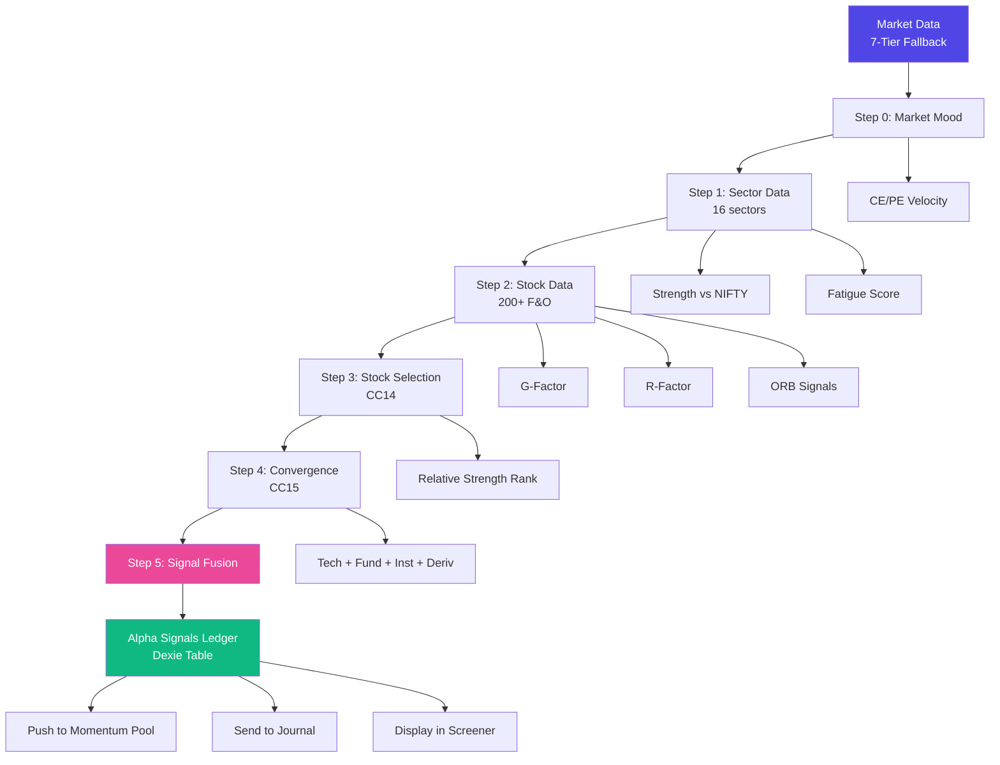
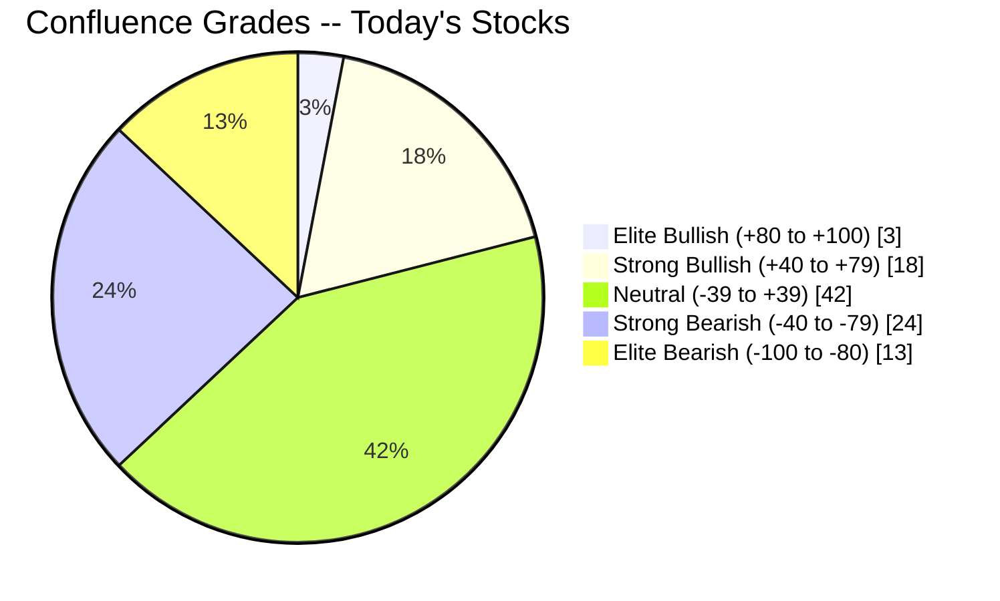
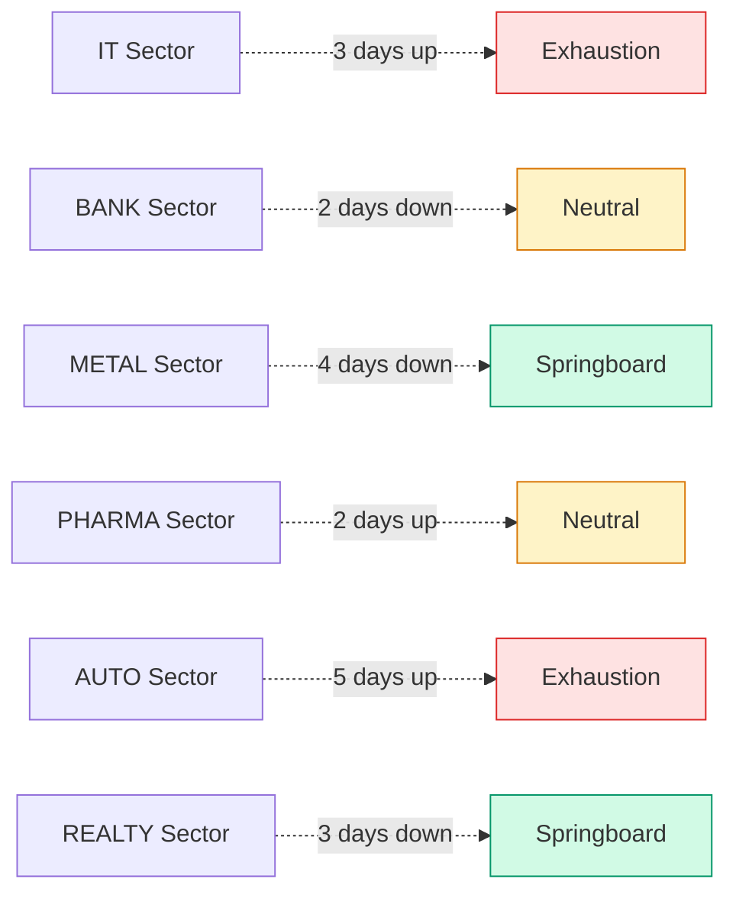
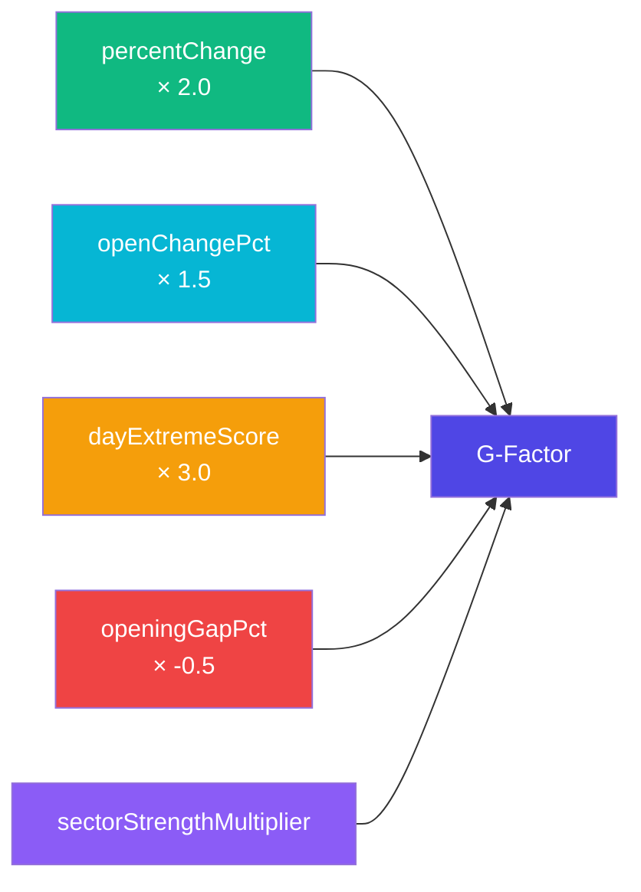
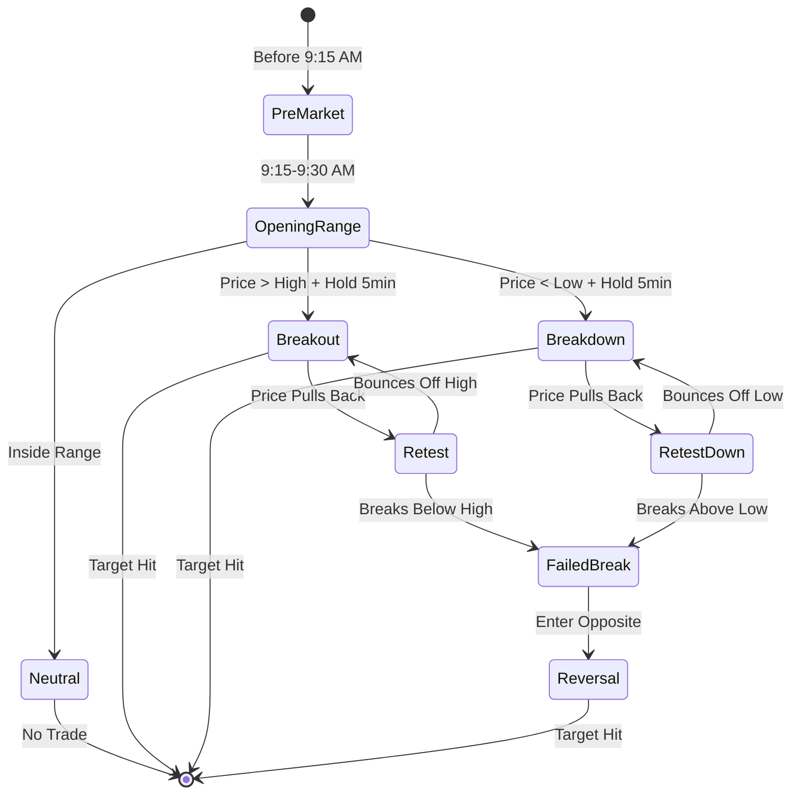
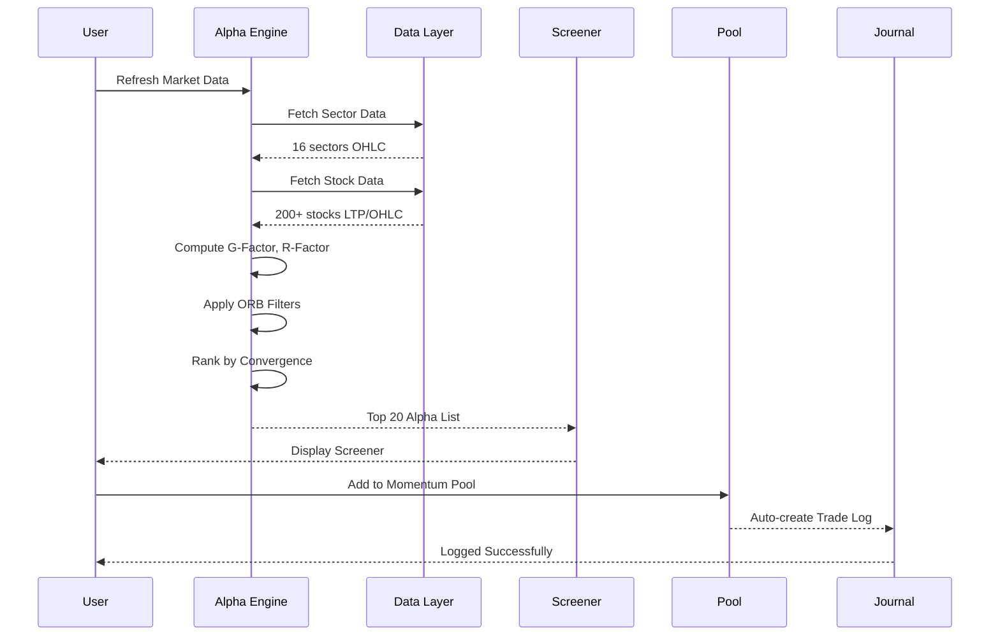

# 📊 Volume 06: Quantitative Alpha Engine, GEX Lens & Backtesting

> **Component of:** [WealthOS v2 Documentation Index](../README.md#-master-documentation-index)

---

## 10. Alpha Engine 2.0 and Quantitative Systems

### Overview

The `AlphaEngineService` (singleton pattern, ~2,250 lines) is the core quantitative intelligence engine. It processes 15+ Indian market sectors and 200+ F&O stocks to generate trading signals. **Alpha 2.0** (CC13–CC17) added: stock-selection, relative-strength ranking, derivatives & order-flow confluence, opening-range breakout (ORB), dynamic risk manager, and ingestion failover.

### Data Flow

```
Step 0: fetchMarketMood()
   → NIFTY Option Chain (CE velocity vs PE velocity)
   → Returns: MarketMood { isBullish, ceVelocity, peVelocity }

Step 1: fetchSectorData()
   → For each of 16 sector configs (NSE Index + Yahoo fallback):
     - Fetch OHLC from DhanHQ or Yahoo Finance
     - Compute strengthRatio (vs NIFTY 50)
     - Track fatigueScore (consecutive directional days)
     - Determine fatigueState: springboard | exhaustion | neutral
     - Calculate confluenceScore (-100 to +100)
     - Count intradayBoosterCount

Step 2: fetchStockData()
   → For each of 200+ F&O stocks:
     - Fetch LTP, OHLC, Volume
     - Compute gFactor (G-Factor score)
     - Compute rFactor (R-Factor intraday momentum)
     - Flag isORBLowPreservedProxy, isORBHighPreservedProxy
     - Assess isExhausted, isTrapRisk, isRebound
     - Compute ATR, GRR (Gain-to-Risk Ratio), OVR (Open Velocity Ratio)

Step 3: StockSelectionEngine (CC14)
   → Relative-strength ranking
   → Fundamental + technical + sector confluence filter
   → Output: ranked Alpha-list with conviction score

Step 4: ConvergenceEngine (CC15)
   → Fuses: technical, fundamental, institutional flow, derivatives OI,
            order-flow delta
   → Outputs: 0–100 convergence score per symbol

Step 5: SignalFusionService
   → Cross-domain dedup + conflict resolution
   → Persists to alpha_signals_ledger (Dexie table, CC22)
```

### G-Factor Scoring Algorithm

The G-Factor (Gyan Factor) is the primary stock ranking metric:

```typescript
gFactor = (
  percentChange * 2.0    // Day's move weight
  + openChangePct * 1.5  // Open-to-LTP momentum
  + dayExtremeScore * 3.0 // Position in day range (0=at low, 1=at high)
  - openingGapPct * 0.5  // Penalty for large gaps (reversion risk)
) * sectorStrengthMultiplier
```

### Sector Fatigue System

```typescript
// fatigueScore = consecutive days the sector moved in same direction
// Example: +4 means 4 consecutive up days → exhaustion territory
// Example: -4 means 4 consecutive down days → potential springboard

fatigueState:
  | 'springboard'  // 3+ consecutive down days → potential reversal
  | 'exhaustion'   // 3+ consecutive up days → overextended
  | 'neutral'      // Within ±2 consecutive days
```

### 16 Tracked Sectors

IT, NIFTY MID SELECT, NIFTY 50, SENSEX, FIN SERVICE, FMCG, REALTY, PHARMA, OIL & GAS, CEMENT, BANK, PVT BANK, METAL, PSU BANK, AUTO, CONSUMER DURABLES

### Confluence Score Formula

```
confluenceScore = (
  strengthRatio × 30           // Sector relative strength vs NIFTY
  + fatigueScore × -5          // Contra-signal for exhausted sectors
  + intradayBoosterCount × 10  // Number of stocks at day highs
  + bullsBearsRatio × 15       // CE vs PE OI ratio
) → clamped to [-100, +100]

Grade mapping:
  +80 to +100: 'ELITE BULLISH'
  +40 to +79:  'STRONG BULLISH'
  -39 to +39:  'NEUTRAL'
  -40 to -79:  'STRONG BEARISH'
  -100 to -80: 'ELITE BEARISH'
```

### Black-Scholes Engine (Built-in)

`RealDataService.ts` includes a custom Black-Scholes implementation calibrated for far-OTM near-expiry Indian index options:

```typescript
export function blackScholesOptionPrice(
  spot: number,      // Nifty/BankNifty spot
  strike: number,
  type: 'CE' | 'PE',
  daysToExpiry: number = 2,
  ivAnnual: number = 0.15   // 15% IV as default for weekly
): number {
  // normCDF approximation via sigmoid: 1 / (1 + exp(-1.7x))
  // Returns ₹1-15 for 2-3% OTM with 1-5 DTE
  // Minimum floor: ₹0.05 (exchange minimum)
}
```

### Opening Range Breakout (ORB) -- CC16

A 15-minute opening range is computed for every F&O stock. Signals fire on break-and-hold, retest-and-rebound, or failed-break. Combined with dynamic risk manager that adjusts position size based on intraday realized vol.

### Ingestion Failover -- CC17

Every fetch route is wrapped in a typed `Result<T,E>` pipeline with circuit breakers. If DhanHQ throttles, we automatically promote Upstox; if NSE scraper 5xxs, we degrade to Yahoo; if everything is dead, we serve the last cached snapshot with a "stale" freshness badge. **No hard crashes, ever.**

**Alpha Engine 2.0 -- End-to-End Pipeline:**



**Confluence Score -- Grade Distribution Example:**



**Sector Fatigue -- Example States:**



**G-Factor Computation -- Visual Formula:**



**Black-Scholes Inputs -- Visual:**

```mermaid
graph TB
    A[Black-Scholes<br/>Option Price] --> B[Inputs]
    A --> C[Calculation]
    A --> D[Output]

    B --> B1[Spot Price]
    B --> B2[Strike Price]
    B --> B3[Time to Expiry]
    B --> B4[Volatility IV]
    B --> B5[Risk-Free Rate]

    C --> C1[d1 = ln(S/K) + (r + σ²/2)t / σ√t]
    C --> C2[d2 = d1 - σ√t]
    C --> C3[Call = S·N(d1) - K·e^(-rt)·N(d2)]
    C --> C4[Put = K·e^(-rt)·N(-d2) - S·N(-d1)]

    D --> D1[Option Premium ₹]
    D --> D2[Delta, Gamma, Theta, Vega, Rho]

    style A fill:#4f46e5,color:#fff
    style B fill:#06b6d4,color:#fff
    style C fill:#f59e0b,color:#fff
    style D fill:#10b981,color:#fff
```

**ORB Trading States:**



**Alpha Engine Signal -- End-to-End Sequence:**



---

## 11. Quantum Terminal & Cross-Asset Confluence

A Bloomberg-style institutional deck, shipped in Phases 12–14. Lives at the `Quantum` hub.

### Sub-Consoles

- **Quantum Command Ribbon** -- single scrollable live ribbon of every active signal across the system
- **Quantum Confluence Deck** -- multi-asset view: equity · derivatives · FX · commodity · crypto
- **Quantum Scenarios Ribbon** -- side-by-side "what-if" projection
- **Quantum Prime Ribbon** -- top-of-book for the day's most actionable setups
- **Profitability Co-Pilot** -- single 0–100 KPI from your journal (5 sub-scores: discipline, edge, risk, review, recovery) with a 21-day projection
- **Strategy Optimizer Console (CC36)** -- drag-and-drop strategy builder with walk-forward + Monte Carlo
- **Resilience Core Console (CC38)** -- backtest logs, telemetry, OCR-to-signal pathway
- **Wealth Quest Matrix (CC37)** -- RPG-style gamified progression with achievement engine

### Cross-Cutting "Anyone Can Win" Layer (Phase 12)

- **Profitability Score** -- single 0–100 KPI from journal data (5 sub-scores, tier, coach cue, 21-day projection)
- **Beginner Explainer** -- collapsible 1-screen overview of every Quantum tab, in plain English
- **Hot-key `Ctrl+Y`** -- instant jump to the Quantum Deck from any tab
- **Floating "Ask Jarvis" button** -- bottom-right orb that opens `JarvisVoiceConsole` from any view
- **Cross-tab event bus** -- `quantum:export-to-payoff`, `quantum:sync-to-journal`, `quantum:slide-authorized`, `navigate-to-tab`

---

## 12. Momentum Pool & Signal Intelligence

### Momentum Pool (CC39)

A dedicated top-level hub for the pre-market routine:

- **Pool Hero Panel** -- single biggest mover and the system's pre-market pick
- **Pool Watch Grid** -- drag-to-reorder cards, color-coded by verdict
- **Pool Verdict Feed** -- auto-generated BUY/WATCH/AVOID verdicts with confidence score
- **Pool Telegram Push** -- one-tap push your watchlist to a private Telegram channel
- **Pool Sources Panel** -- manage which signals (Telegram ear, screener, broker feed) feed the pool
- **Pool Toast Bridge** -- instant toast notifications when verdicts change

### Signal Intelligence Hub (CC33)

- **Telegram Multi-Ear Daemon** -- Node `scripts/telegram-ear-server.js` listens to N premium channels
- **OCR Pipeline** -- `tesseract.js` parses screenshots (broker trades, advisory calls) into structured signals
- **Signal Ledger** -- every parsed signal gets stored with source, confidence, and time-to-resolution
- **Multi-channel digest** with batched digests and "send to Momentum Pool"
- **Telethon history import** -- pull your *own* chat history to recover 6+ months of missed logs
- **Two-way voice notes** -- send a voice note to the bot → "Confirm this trade?" card with inline buttons
- **Daily 9 AM digest** -- auto-push to your private channel

---


---

## 🔬 GEX Lens & Momentum Continuation Score (MCS)

### GEX Lens (Gamma Exposure Profiler)
The GEX Lens estimates market maker hedging pressures across NIFTY and BANKNIFTY option chains:
- **Positive GEX (Long Gamma):** Market makers buy dips and sell rips, dampening volatility and enforcing mean-reversion.
- **Negative GEX (Short Gamma):** Market makers sell into weakness and buy into rallies, accelerating momentum and breakout velocity.
- **Zero Gamma Flip Point:** The critical price inflection where market regime transitions from range-bound to trending.

### MCS (Momentum Continuation Score)
$$\text{MCS} = w_1 \cdot V_{\text{surge}} + w_2 \cdot D_{\text{ratio}} + w_3 \cdot \Delta_{\text{OI}} + w_4 \cdot \text{VCP}_{\text{comp}}$$
Evaluates whether price velocity represents institutional accumulation or retail exhaustion.
