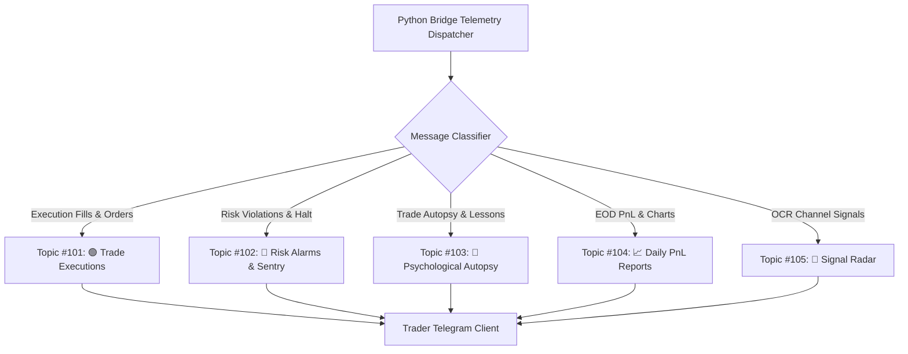

# 📡 Volume 07: Jarvis Voice Workspace & Telegram Topic Telemetry

> **Component of:** [WealthOS v2 Documentation Index](../README.md#-master-documentation-index)

---

## 13. Jarvis Voice Workspace (v2 / v3 Sentinel / v4)

Three generations, one philosophy.

### Jarvis 2.0 -- Ambient (Always-On Orb)

- Globe orb always visible; `Ctrl+J` from anywhere
- Floating AI Coach (CC4 polish)
- Quick questions about your portfolio, no friction

### Jarvis 3.0 -- Autonomous Sentinel Web Worker (CC32)

- **Off-thread indicators** -- `ema`, `rsi`, `detectCrossover` run entirely in a Web Worker (`workers/jarvis3.worker.ts`)
- **Coordinated polling with full-jitter exponential backoff** -- AWS pattern
- **2-second snapshot coalescing** -- drops identical ticks within 2s
- **Market-hours gate** -- IST 9:00–15:30 Mon–Fri, minus `NSE_HOLIDAYS_2026`
- **Cached 200 EMA** -- recompute only on `update200EMA(val)`
- **Hard `RiskSafetyGate`** (default caps, overridable):
  - `sessionMarginCap: ₹50,000`
  - `dailyLossCap: ₹10,000`
  - `ordersPerSession: 5`
- **`WORKER_ERROR` self-reporting** -- host discards stale messages via `generation` counter
- **Auto-restart on crash** with exponential backoff (1s, 2s, 4s, max 3 attempts)

### Jarvis 4.0 -- Voice-First Workspace (CC35)

- Push-to-talk with full grammar trained on trade vocabulary
- "Sell 200 SBIN at 622, take profit" → confirm toast (`VoiceOrderConfirmToast`)
- Glassmorphic slide-up confirmation: side, symbol, qty, price, notional, SL, target
- Color-coded BUY/green, SELL/rose
- Optional spoken confirmation

### Broker Execution Conduit (CC23)

- **Ambient Jarvis → Broker Execution** wiring, gated by `RiskSafetyGate`
- Pre-trade checks: compliance, position size, emotion log, cooldowns
- One-tap execution handoff to Dhan/Upstox

---

## 14. Telegram Multi-Ear + OCR Signal Ledger

See [§12 Momentum Pool & Signal Intelligence](#12-momentum-pool--signal-intelligence) for the full architecture. The Telegram daemon:

- WebSocket feed at `ws://localhost:8081`, REST at `http://localhost:3001`
- Bidirectional -- `/positions`, `/pnl`, `/risk`, `/brief`, `/log`, `/mute 4h`, `/screener momentum`, `/health` slash commands
- `Discovery Mode` (`npm run ear:discover`) logs incoming channel IDs for 30s
- Per-channel filters under `scripts/ear-config.json`

---

---

## 📱 Parent-Threaded Telegram Telemetry & Bot Commands

WealthOS routes real-time system alerts, trade notifications, and risk alarms into a structured Telegram Supergroup organized by specific message topics:

### Interactive Telegram Commands
- `/pnl`: Live intraday realized and unrealized MTF PnL summary.
- `/positions`: Open position book with quantities and broker sources.
- `/cancelall`: Emergency `/api/v1/cancel_all_order` purging all pending limit orders.
- `/risk`: Active loss streak, daily limit drawdown, and lockout status.
- `/brief`: 60-second morning pre-market brief with FII/DII flow and key support/resistance levels.
