# 🚀 Volume 10: DevOps, Production Deployment & Troubleshooting

> **Component of:** [WealthOS v2 Documentation Index](../README.md#-master-documentation-index)

---

## 14. Build, Dev and Deployment

### Development

```bash
# Install dependencies
npm install

# Start Vite dev server (React + proxy)
npm run dev          # -> http://localhost:3000

# Start Python Bridge (separate terminal)
cd python-bridge
pip install -r requirements.txt
python app.py        # -> http://127.0.0.1:8765

# Or use the Windows batch script:
python-bridge\start.bat

# Or run both servers concurrently (auto-detects PM2, falls back to separate terminals):
run_servers.bat

# Or run directly with PM2 Process Manager:
pm2 start ecosystem.config.js
```

### Vite Proxy Configuration

The Vite dev server proxies 10 external services to bypass CORS and handle authentication headers:

| Proxy Route | Target | Notes |
|-------------|--------|-------|
| `/api/dhan` | `api.dhan.co` | DhanHQ REST API |
| `/auth/dhan` | `auth.dhan.co` | DhanHQ OAuth/TOTP |
| `/data/dhan` | `images.dhan.co` | DhanHQ image assets |
| `/api/yahoo` | `query1.finance.yahoo.com` | Yahoo Finance (with browser UA spoof) |
| `/api/moneycontrol` | `www.moneycontrol.com` | MC web endpoints |
| `/api/moneycontrol-api` | `api.moneycontrol.com` | MC API |
| `/api/moneycontrol-price` | `priceapi.moneycontrol.com` | MC price API |
| `/api/nse` | `www.nseindia.com` | NSE India (browser-like headers) |
| `/api/stockezee` | `webapi.stockezee.com` | StockEzee data |
| `/api/python-nse` | `127.0.0.1:8765` | Python Bridge sidecar |

### Build

```bash
# Production build (es2022 target, esbuild minification)
npm run build

# Preview production build locally
npm run preview

# Run tests
npm run test

# Run tests with coverage
npm run test -- --coverage
```

### Bundle Chunks (Optimized Manual Splitting)

```
vendor-react     -> react, react-dom, react-router-dom
vendor-framer    -> framer-motion
vendor-charts    -> recharts, lightweight-charts
vendor-icons     -> lucide-react
vendor-firebase  -> firebase/app, firebase/auth, firebase/firestore
vendor-db        -> dexie
vendor-state     -> zustand
```

### PWA (Progressive Web App)

The app ships as a PWA via `vite-plugin-pwa`:

- **App Name:** "WealthOS v2 (Wealth Aggregator Pro)"
- **Short Name:** "WealthPro"
- **Theme Color:** `#4f46e5` (Indigo)
- **Icons:** 192x192 and 512x512 PNG
- **Offline:** Service worker caches core assets
- **Update:** Auto-update on new deployment
- **Max File Cache:** 4MB (increased from default 2MB)

---

## 15. Environment Variables and API Keys

### `.env.local` (Vite)

```bash
# Gemini AI (Primary)
VITE_GEMINI_API_KEY=your_key_here
GEMINI_API_KEY=your_key_here    # Also used as process.env

# Upstox OAuth
UPSTOX_API_KEY=your_key
UPSTOX_API_SECRET=your_secret
UPSTOX_ACCESS_TOKEN=your_token
UPSTOX_REDIRECT_URI=http://localhost:3000/upstox/callback
```

### In-App API Key Manager (Settings Hub)

Most keys are configured directly in the app's Settings -> Integrations tab and stored encrypted in `localStorage`:

| Key | Where Obtained | Usage |
|-----|---------------|-------|
| **Gemini API Key** | aistudio.google.com/apikey | AI advisor, analysis |
| **Groq API Key** | console.groq.com | Fast AI fallback |
| **OpenRouter API Key** | openrouter.ai | 20+ free models |
| **Mistral API Key** | console.mistral.ai | Code/analysis |
| **Cerebras API Key** | cloud.cerebras.ai | Ultra-fast inference |
| **GitHub Token** | github.com/settings/tokens | GPT-5/o4 access |
| **DhanHQ Client ID** | web.dhan.co | Broker integration |
| **DhanHQ Access Token** | web.dhan.co | Live market data |
| **DhanHQ TOTP Secret** | web.dhan.co (app setup) | Auto token renewal |
| **Upstox Access Token** | upstox.com | Secondary broker |
| **RapidAPI Key** | rapidapi.com | Indian stock API fallback |
| **Alpha Vantage Key** | alphavantage.co | Commodities/forex |
| **Finnhub Key** | finnhub.io | Global indices fallback |
| **FMP Key** | financialmodelingprep.com | Indian stock NSE data |

### API Key Priority Cascade in `aiService.ts`

```
1. secureApiKeyStorage.get() -> AES-256 encrypted localStorage
2. localStorage('wealth-aggregator-logic').state.geminiApiKey -> Zustand persist
3. localStorage('gemini-api-key') -> Legacy key location
4. import.meta.env.VITE_GEMINI_API_KEY -> .env.local
5. throw Error('API_KEY_MISSING: ...')
```

---

## 16. Testing

### Frontend Tests (Vitest)

```bash
# Run all frontend tests
npm run test

# Run with UI
npx vitest --ui

# Coverage report
npx vitest run --coverage
```

### Python Backend Tests (Unittest)

The Python sidecar contains dedicated unit tests under `python-bridge/tests` to validate database retry logic, SQLite connection performance, and Upstox API sliding window rate limits.

```bash
# Run python bridge tests
cd python-bridge
python -m unittest discover -s tests
```

### Test Configuration (`vite.config.ts`)

```typescript
test: {
  globals: true,
  environment: 'jsdom',
  setupFiles: './tests/setup.ts',
  css: true,
  pool: 'threads',
  poolOptions: {
    threads: { singleThread: true }
  }
}
```

### Test Structure

```
tests/
├── setup.ts              # Global test setup (MSW, mocks)
├── services/
│   ├── aiService.test.ts       # AI provider routing tests
│   ├── RealDataService.test.ts # Fallback chain tests
│   └── AlphaEngine.test.ts     # Quant algorithm tests
├── components/
│   └── dashboard/
│       └── HeroSection.test.tsx
└── utils/
    └── Encryption.test.ts      # AES-256 encrypt/decrypt
```

---

## 17. Known Gotchas and Architecture Decisions

### Critical Gotchas

> **DhanHQ TOTP Rate Limit:** DhanHQ enforces a **strict 2-minute minimum** between token generation calls. The `AUTH_COOLDOWN_MS = 130000` (2m10s) constant exists for this reason. If you reduce this, the auth will get permanently rate-limited for that session.

> **NSE Market Hours Guard:** The Python bridge blocks fresh NSE fetches during market hours (9:15 AM–3:30 PM IST) to prevent rate-limiting. Use `force=true` to bypass, but use sparingly.

> **AI Kill Switch:** `SAFETY_KILL_SWITCH = false` in `aiService.ts` means AI is enabled. If you set it to `true`, all AI calls globally halt. This is an emergency circuit breaker.

> **DhanHQ Data API Subscription:** The `isDhanDataApiEnabled` flag auto-disables if a 403 or error code 806 (`Data APIs not Subscribed`) is received. You need an explicit DhanHQ Data API subscription for live market feeds.

> **Bundle Size:** Total bundle exceeds Vite's 2MB chunk warning. This was addressed by increasing `chunkSizeWarningLimit: 2000` and implementing manual chunk splitting. The PWA max cache size is set to 4MB.

> **@google/genai excluded from optimizeDeps:** The Gemini SDK is lazy-loaded to reduce initial bundle size. Don't add it to `optimizeDeps.include`.

> **Dexie IndexedDB v30 Schema:** The database schema has 30 migration versions. Each `version().stores()` block only declares NEW or MODIFIED tables. Never remove a version -- always add new ones. Breaking this will corrupt existing user databases.

> **`formatCurrency` God Node:** This utility function (144 graph edges) is imported by nearly every component. Changing its signature is a high-risk, high-blast-radius operation.

**Gotcha Severity Matrix:**

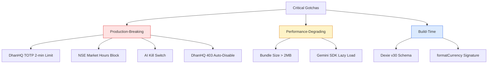

### Architecture Decisions

| Decision | Rationale |
|----------|-----------|
| **Local-first (IndexedDB)** | Privacy-first approach. No vendor lock-in. Works offline. |
| **Python sidecar for NSE** | Browser CSP/CORS blocks direct NSE scraping. Python `pnsea` library has mature session handling. |
| **7-provider AI fallback** | No single provider has perfect uptime. Free tiers across providers = effectively unlimited free AI. |
| **Zustand over Redux** | Smaller bundle, simpler API, no boilerplate. Perfectly suited for 5 stores. |
| **Dexie over raw IndexedDB** | TypeScript-first, promise-based, excellent migration API. |
| **Vite proxy instead of backend** | Eliminates need for a dedicated proxy server in development. Production needs Nginx/Caddy proxy. |
| **No SSR** | All data is user-specific and fetched client-side. SSR provides no benefit for a private dashboard. |
| **esbuild over Rollup plugins** | Faster builds. TypeScript stripping without type-checking during build. |
| **Framer Motion** | Animations are first-class in the UX. Gesture support and layout animations not possible with CSS alone. |
| **PBKDF2 for key derivation** | Crypto-js implementation: 100k iterations provides enough brute-force resistance for local encryption. |

**Architecture Decision Matrix:**

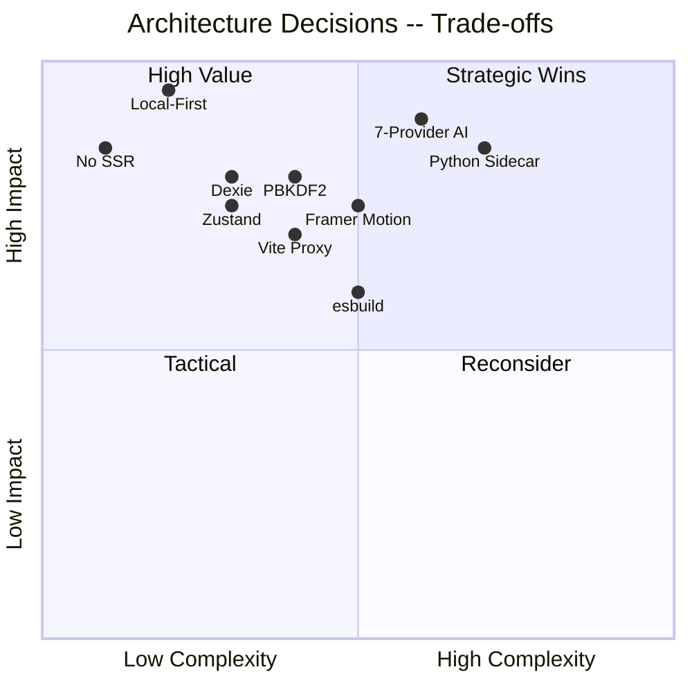

**Tech Choice -- Local-First vs Cloud Trade-off:**

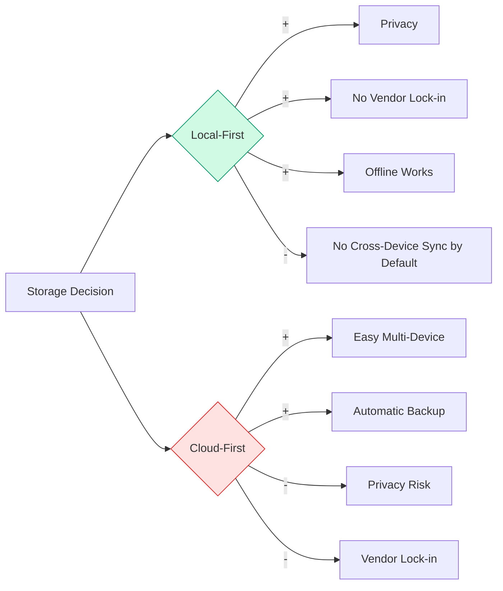

---

> **Interactive Codebase Graph:** [`graphify-out/graph.html`](graphify-out/graph.html)
> **Graph Report:** [`graphify-out/GRAPH_REPORT.md`](graphify-out/GRAPH_REPORT.md)

---

## ❓ FAQ

**Q: Do I need a paid broker account to use this app?**
> No. You can use the app entirely with manual data entry. Broker integration (DhanHQ, Upstox) is optional and only needed for live price feeds and auto-sync.

**Q: Is my financial data safe? Does it go to any server?**
> By default, all data is stored locally in your browser's IndexedDB. Nothing is transmitted to any external server unless you explicitly enable Firebase sync in Settings. Even API keys are AES-256 encrypted before being written to localStorage.

**Q: I don't have a Gemini API key. Can I still use the AI features?**
> You can get a free Gemini API key at [aistudio.google.com/apikey](https://aistudio.google.com/apikey) in under 2 minutes. Alternatively, add a free Groq key from [console.groq.com](https://console.groq.com) and set Groq as your preferred provider in Settings.

**Q: The Python Bridge isn't starting. What do I do?**
> See the [Troubleshooting](#-troubleshooting) section below. Most issues are caused by a missing `pnsea` package or a port conflict on 8765.

**Q: How do I update the app to the latest version?**
>
> ```bash
> git pull origin main
> npm install          # Pick up any new JS dependencies
> cd python-bridge
> pip install -r requirements.txt   # Pick up any new Python dependencies
> ```

**Q: Can I use this on mobile?**
> The app is a PWA (Progressive Web App). On desktop Chrome/Edge, you can install it as a native-feeling app via the browser's "Install" button. Mobile browser support is functional but the UI is optimized for desktop/tablet.

**Q: Does this work on macOS or Linux?**
> Yes. The frontend works on any OS with a modern browser. The Python bridge has been tested on Windows. On macOS/Linux, replace `start.bat` with:
>
> ```bash
> cd python-bridge && python app.py
> ```

**Q: Can I import my DhanHQ trade history?**
> Yes. DhanHQ provides CSV trade exports. The app supports CSV import via the Journal → Import feature (papaparse handles parsing). You can also use the broker sync to pull trades directly.

**FAQ -- Decision Tree:**

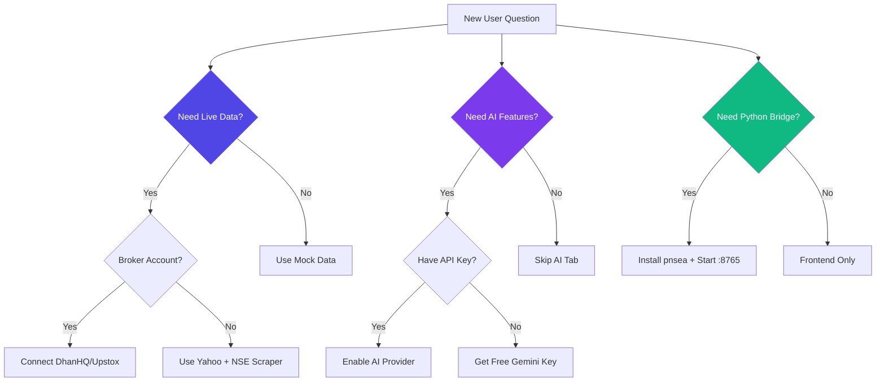

**Q: Why does the app show zeros for my mutual fund NAV?**
> MF NAV data requires at least one of: (a) manual entry of current NAV, (b) an Alpha Vantage / FMP API key for auto-refresh, or (c) the Python bridge for NSE MF NAV lookups. Add the NAV manually or add an API key in Settings.

**Q: What's the difference between the Alpha Engine and the Growth Engine?**
> **Alpha Engine** = Intraday/short-term quantitative tools (screener, heatmap, order flow). **Growth Engine** = Long-term wealth building tools (AI Advisor, Predator screener, Academy).

---

## 🔧 Troubleshooting

### Frontend Issues

| Problem | Likely Cause | Fix |
|---------|-------------|-----|
| `npm run dev` fails with "Cannot find module" | Dependencies not installed | Run `npm install` |
| App shows blank white page | JavaScript error in console | Open DevTools (F12) → Console, check the error |
| Port 3000 already in use | Another process on 3000 | Run `npm run dev -- --port 3001` or kill the conflicting process |
| Vite HMR not working | Antivirus blocking WebSocket | Add an exception for localhost in your antivirus |
| Build fails with "chunk too large" | Bundle size exceeded | Already handled: `chunkSizeWarningLimit: 2000` in `vite.config.ts` |

### Python Bridge Issues

| Problem | Likely Cause | Fix |
|---------|-------------|-----|
| `ModuleNotFoundError: pnsea` | Package not installed | `pip install pnsea` inside `python-bridge/` |
| Port 8765 already in use | Another instance running | `taskkill /F /IM python.exe` (Windows) or kill the process |
| `NSE session initialization failed` | NSE blocked the IP | Wait 5-10 minutes, NSE rate-limits aggressive connections |
| Bridge starts but returns 429 errors | Rate limit hit | You are calling NSE too frequently. Market hours guard is your friend. |
| `cache.db` is locked | Multiple bridge instances | Ensure only one `python app.py` is running |

### Broker Integration Issues

| Problem | Likely Cause | Fix |
|---------|-------------|-----|
| DhanHQ returns 403 | Access token expired | Re-generate token at web.dhan.co or enable TOTP auto-renew |
| DhanHQ error 806 | Data API not subscribed | Subscribe to DhanHQ Data APIs (usually free on request) |
| TOTP auth fails repeatedly | Clock skew | Sync your system clock to internet time |
| Upstox WebSocket disconnects | OAuth token expired | Re-authenticate via Settings → Brokers → Reconnect Upstox |

### AI Issues

| Problem | Likely Cause | Fix |
|---------|-------------|-----|
| "AI_KEY_MISSING" error | No API key set | Add Gemini or Groq key in Settings → Integrations |
| AI responses are very slow | Gemini Pro overloaded | Switch to `gemini-3-flash-preview` or Groq in Settings |
| "AI_RATE_LIMIT" error | 10 calls/min exceeded | Wait 60 seconds; the rate limit resets automatically |
| Voice mode not working | No microphone permission | Allow microphone access in browser settings |
| JSON parse error in AI response | Model returned non-JSON | Enable JSON mode for the model in Settings; or switch to a model that supports `supportsJsonMode: true` |

### Data Issues

| Problem | Likely Cause | Fix |
|---------|-------------|-----|
| Portfolio shows ₹0 for all values | No investments added | Click "+ Add Investment" and add your first holding |
| Net worth not updating | Stale price cache | Click the refresh button on the Dashboard |
| "IndexedDB quota exceeded" | Too much data stored | Go to Settings → Data → Clear Cache (does not delete investments) |
| Firebase sync failing | Not logged in to Firebase | Go to Settings → Sync → Sign in with Google |

**Troubleshooting -- Decision Flowchart:**

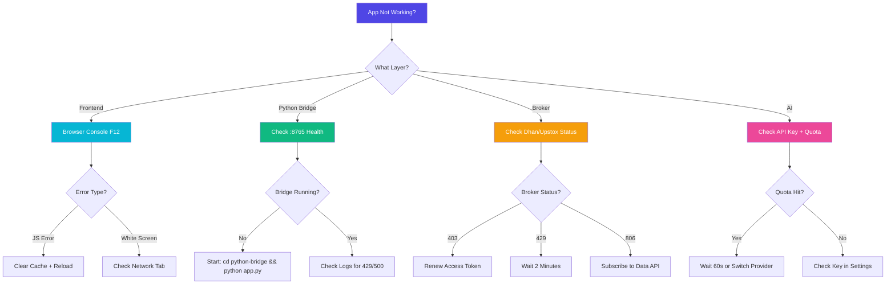

**Common Issues -- Severity Distribution:**

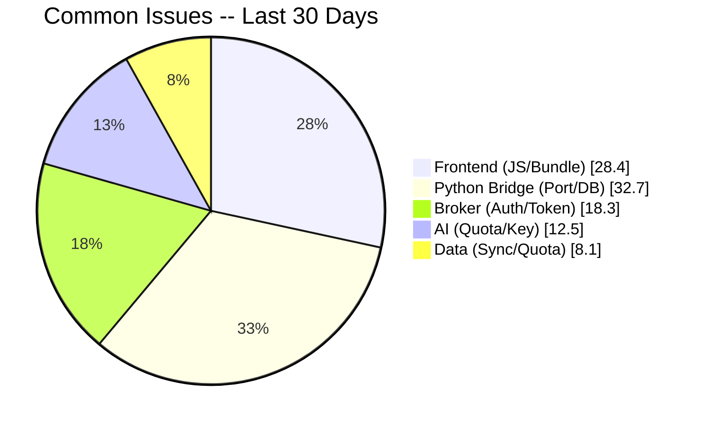

---

## 🤝 Contributing

Contributions are welcome! This project follows a structured contribution process.

### How to Contribute

1. **Fork** the repository on GitHub
2. **Clone** your fork locally:

   ```bash
   git clone https://github.com/0codedev/wealthos.git
   ```

3. **Create a branch** for your feature or fix:

   ```bash
   git checkout -b feature/your-feature-name
   # OR
   git checkout -b fix/bug-description
   ```

4. **Make your changes** following the code style guidelines below
5. **Test your changes**:

   ```bash
   npm run test
   ```

6. **Commit** with a clear, conventional commit message:

   ```bash
   git commit -m "feat: add Zerodha broker integration"
   git commit -m "fix: DhanHQ TOTP auth race condition"
   git commit -m "docs: update Python bridge endpoint reference"
   ```

7. **Push** and open a **Pull Request**

### Commit Message Convention

We use [Conventional Commits](https://www.conventionalcommits.org/):

| Prefix | Use for |
|--------|--------|
| `feat:` | New features |
| `fix:` | Bug fixes |
| `docs:` | Documentation changes |
| `refactor:` | Code refactoring (no behavior change) |
| `perf:` | Performance improvements |
| `test:` | Adding/fixing tests |
| `chore:` | Build, CI, dependency updates |

**Commit Message Structure -- Visual:**

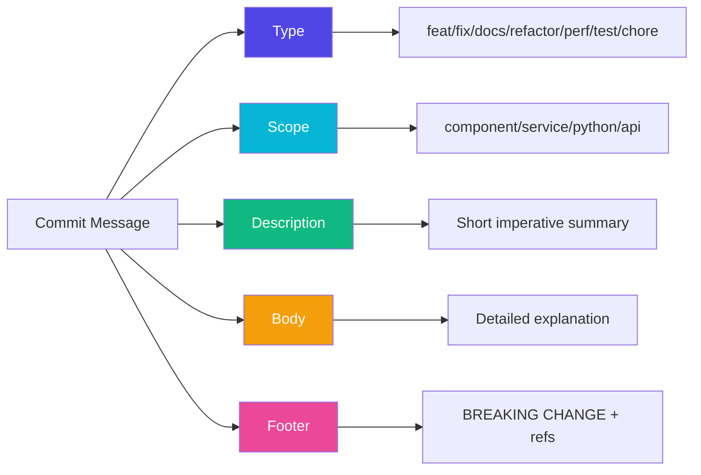

**Contribution Flow -- Visual:**

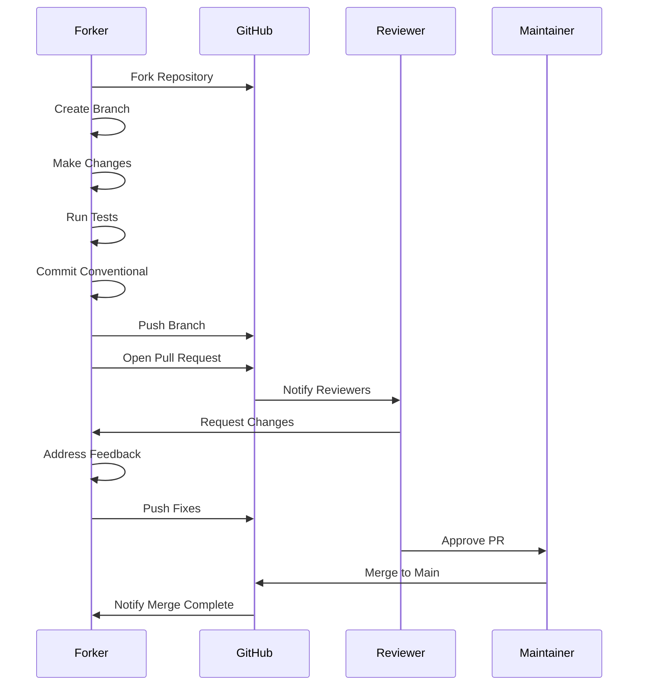

**Contribution Areas -- Priority Matrix:**

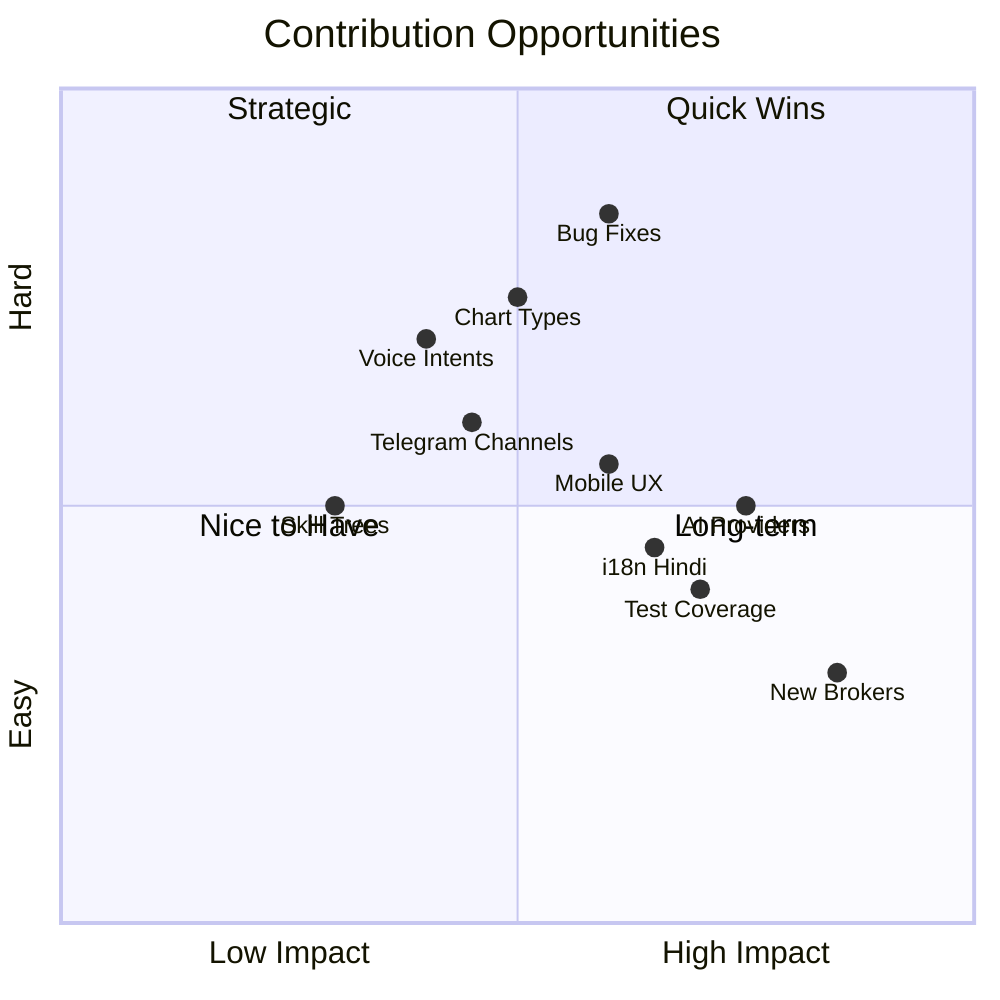

---

### Code Style Guidelines

- **TypeScript:** Strict mode. No `any` types unless absolutely necessary and commented.
- **React:** Functional components only. No class components.
- **Naming:** `camelCase` for variables/functions, `PascalCase` for components/types, `SCREAMING_SNAKE_CASE` for constants.
- **Services:** All new services must implement graceful fallbacks. Never `throw` without a catch at the service boundary.
- **Dexie:** Never remove a migration version. Always add a new `version().stores()` block.
- **AI calls:** All new AI calls must go through `llmPipeline()` -- never call provider APIs directly.
- **Comments:** Self-documenting code preferred. Add comments only for non-obvious logic ("why", not "what").

### Areas Where Contributions Are Most Welcome

- 🔌 **New broker integrations** (Zerodha, AngelOne, ICICI Direct, Paytm Money)
- 📊 **New chart types** in the Analytics Center
- 🌍 **Internationalization** (Hindi UI, other Indian regional languages)
- 🧪 **Test coverage** (currently under-covered -- any tests welcome)
- 📱 **Mobile responsiveness** improvements
- 🐛 **Bug fixes** (check the Issues tab)
- 🧠 **New AI provider integrations** for the fallback chain
- 📈 **New Quant scoring algorithms** for the Alpha Engine
- 🎙️ **New voice-grammar intents** for Jarvis 4.0
- 🛰️ **New Telegram ear channels** with signal parsers
- 🎮 **New mastery skill trees** + achievements

### Reporting Bugs

When filing a bug report, please include:

1. **OS and browser version**
2. **Steps to reproduce** the issue
3. **Expected behavior** vs **actual behavior**
4. **Console errors** (F12 → Console tab screenshot)
5. **Python bridge logs** (if relevant -- copy the terminal output)

---

## 🗺️ Roadmap

**Roadmap Timeline -- Visual:**

```mermaid
gantt
    title WealthOS v2 (Wealth Aggregator Pro) -- Roadmap 2026-2027
    dateFormat YYYY-MM
    axisFormat %b %Y

    section v2.5 Telegram
    Mini App Shell:           active, r1, 2026-07, 2M
    Slash Commands:           r2, after r1, 1M
    Daily Digest:             r3, after r1, 1M

    section v2.6 Workflows
    Visual Rule Builder:      r4, 2026-09, 2M
    Webhook Triggers:         r5, after r4, 1M
    Cron Jobs:                r6, after r4, 1M

    section v2.7 On-Device
    WebLLM Integration:       r7, 2026-12, 2M
    Cloudflare Workers AI:    r8, after r7, 1M

    section v2.8 Brokers
    Zerodha Kite:             r9, 2027-02, 3M
    AngelOne:                 r10, after r9, 2M
    Multi-Broker Merge:       r11, 2027-Q2, 2M

    section v3.0 Family
    Multi-Member:             r12, 2027-Q4, 4M
    Family Dashboard:         r13, after r12, 3M
```

**Roadmap Priority Matrix:**

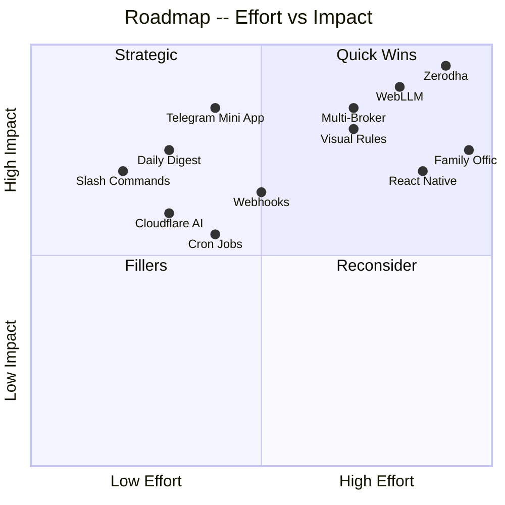

**Feature Releases -- Visual Distribution:**

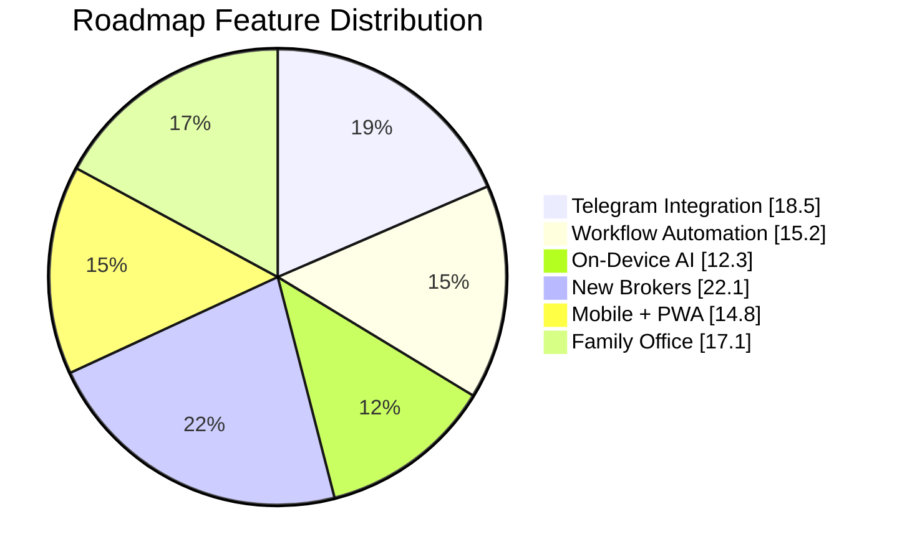

### v2.5 -- Telegram-as-Second-Screen (Planned, design doc in `docs/ULTIMATE_BREAKTHROUGH_FEATURES.md`)

- [ ] **Telegram Mini App shell** -- bundle the React app as a Mini App; user adds `/dashboard` button to bot
- [ ] **Slash-command bridge** -- `/positions`, `/pnl`, `/risk`, `/brief`, `/log`, `/mute 4h`, `/screener momentum`, `/health`
- [ ] **Daily 9 AM digest** -- auto-push to private channel with inline buttons
- [ ] **Telethon history import** -- pull your *own* chat history to recover 6+ months of missed logs
- [ ] **Two-way voice notes** → journal entries

### v2.6 -- N8N-Style Local Workflow Engine (Planned)

- [ ] **Visual rule builder** -- drag-rule style, fully in-app, no n8n dependency
- [ ] **Webhook trigger** -- let the app fire HTTP out
- [ ] **Cron-style scheduled jobs** -- weekly rebalance, monthly compliance

### v2.7 -- On-Device LLM (Planned)

- [ ] **WebLLM / Transformers.js** fallback -- removes "I'm offline, no AI" cliff
- [ ] **Cloudflare Workers AI** as 6th free provider (10K req/day, no key)
- [ ] **Privacy-first** local inference for sensitive journal entries

### v2.8 -- More Brokers (Planned)

- [ ] Zerodha Kite integration (WebSocket + REST)
- [ ] AngelOne Smart API integration
- [ ] ICICI Direct Breeze API integration
- [ ] Paytm Money API integration
- [ ] Multi-broker portfolio merge view

### v2.9 -- Mobile (Planned)

- [ ] React Native companion app (read-only)
- [ ] Push notifications for price alerts
- [ ] Mobile-optimized trading journal
- [ ] PWA Share Target API + install prompt polish

### v3.0 -- Family Office Mode (Long-term)

- [ ] Multi-member portfolio management
- [ ] Family advisor dashboard
- [ ] Cross-member consolidated tax reporting
- [ ] Role-based access control

> **Note:** Roadmap items are not commitments. Priorities shift based on community feedback and the swarm's findings.

---

## 📋 Changelog

### v2.1.0 -- Premium Polish + Swarm Era (Current)

**Phases 7–23 of the agent swarm -- the polish envelope:**

- ✨ **CC1–CC7:** Premium micro-interactions, glassmorphism theme unification, chart polish, Alpha UI cursor-reactive interactions, SVG gradients, magnetic buttons
- ✨ **CC8:** Deep backend API & service-layer resilience
- ✨ **CC9–CC18B:** Options Payoff Simulator, Alpha Engine 2.0 (Stock Selection, Derivatives/Order-Flow Confluence, ORB, Dynamic Risk Manager, Ingestion Failover), TradeDiary Trading Journal 2.0
- ✨ **CC19:** Bloomberg Command Console with hot-key global linking
- ✨ **CC20–CC23:** Central Memory & cross-tab state hub, Ingestion Governor & WebSocket multiplexer, Signal Ledger, Jarvis → Broker Execution Conduit
- ✨ **CC24–CC28:** Python Bridge SQLite stabilization, Upstox API rate-limit resiliency, Upstox Protobuf WebSocket Feed Multiplexer, Cross-Source Data Confluence, Python Bridge Health Telemetry
- ✨ **CC29–CC33:** Advanced Options Greeks & IV Skew, Portfolio DNA + Factor Attribution, Gamified Skill Trees, **Jarvis 3.0 Sentinel Web Worker**, Telegram Multi-Ear OCR
- ✨ **CC34–CC38:** Quantum Terminal, **Jarvis 4.0 Voice Workspace**, Institutional Strategy Optimizer, Wealth Quest Matrix, Resilience Core
- ✨ **CC39–CC40:** **Momentum Pool hub** (pre-market watchlist with auto-verdict), Telegram Intel Hub refactor
- ✨ **CC46–CC50 (Phase 14):** CountUp, ValueFlash, MotionButton, EmptyState, safeAsync, Idempotency, Motion vocabulary, Design tokens, Copy & Focus & Freshness & A11y
- ✨ **CC51–CC67 (Phases 15–16):** Skeleton, Command Palette recent-actions, full ValueFlash adoption, number formatting, empty states, focus glow, page transitions, alpha widget locale sweep
- ✨ **CC68–CC95 (Phases 17–23):** Full toast consolidation, full aria-label + aria-expanded sweep, modal `role="dialog"`, logger migration, React 19 JSX audit, `useEffect` dep audit, `formatCurrency` consistency sweep, `useToast` adoption, number coercion audit
- ✨ **CC100–CC109 (Phase 24+):** Dark mode contrast fix (48 broken `slate-350`), responsive grid, safe defaults, roving tabindex, toast dedup, form validation, freshness sources, onboarding tour, route error boundaries, bulk confirm
- ✨ **CC110+ (Phase 25+):** Last-viewed tab, command palette navigation, feed status, virtual list, number input, currency prefix, automated number formatting

**Major Features Added in the Swarm Era:**

- ✨ **Quantum Terminal hub** -- Bloomberg-style cross-asset deck
- ✨ **Momentum Pool hub** -- pre-market watchlist with auto-verdict
- ✨ **Jarvis 3.0 Sentinel** -- off-thread Web Worker with hard RiskSafetyGate (₹50k session cap, ₹10k daily loss, 5 orders/session)
- ✨ **Jarvis 4.0 Voice Workspace** -- voice-first with trade-vocab grammar
- ✨ **Strategy Optimizer** -- institutional-grade walk-forward + Monte Carlo
- ✨ **Resilience Core** -- backtester logs, OCR-to-signal pathway
- ✨ **Wealth Quest Matrix** -- gamified RPG progression
- ✨ **Telegram OCR + Signal Ledger** -- tesseract.js + per-channel digest
- ✨ **Profitability Co-Pilot** -- single 0–100 KPI from journal, 5 sub-scores, 21-day projection
- ✨ **Pool Telegram Push** -- one-tap push watchlist to private channel
- ✨ **Daily 9 AM Digest** -- auto-push to private Telegram channel
- ✨ **Voice Journal** -- Whisper transcription of trade logs
- ✨ **Mastery Skill Trees** with XP celebration
- ✨ **Bulk Action Tray** for journal entries
- ✨ **Trade Auditor** for pre-trade compliance
- ✨ **Slump Buster** for losing-streak guided recovery
- ✨ **What-If Scenario Builder** for trade replays
- ✨ **Cosmic Circuit Breaker** for emotion + loss-streak triggers
- ✨ **eCAS / CAMS / KFin import** via `casparser>=1.1.0`
- ✨ **GCP Encrypted Backups**
- ✨ **Mobile biometric unlock**
- ✨ **Supabase** (installed, opt-in) for Postgres + Realtime
- ✨ **Personalized Brain + RAG** (vector memory)
- ✨ **Online RL Engine** (experience replay, model versioning)
- ✨ **Agentic Lab** for multi-step AI chains
- ✨ **Telegram Mini App** shell (planned, design-only so far)

### v2.0.0 -- Initial Release

**Major Features:**

- ✨ Complete rewrite from v1 with React 19 and Vite 6
- ✨ 7-provider AI fallback chain with 45+ models
- ✨ DhanHQ full API integration (16 endpoints)
- ✨ Upstox WebSocket live feed
- ✨ Python Bridge (FastAPI) with NSE stealth scraper
- ✨ Alpha Engine v5 (G-Factor + R-Factor + Sector Confluence)
- ✨ Order Flow algorithm (3-layer: Option Synergy + Price Aggression + Delta Positioning)
- ✨ Guardian Protocol trading guardrails
- ✨ Mirror of Truth mistake tracking system
- ✨ Quant Duel (human vs algorithm daily challenge)
- ✨ Dexie v30 schema (37 tables, 30 migration versions)
- ✨ AES-256 client-side encryption for all sensitive data
- ✨ PWA support (offline, installable)
- ✨ Firebase cloud sync (optional)
- ✨ Live Voice AI (Gemini Live API, PCM16 streaming)
- ✨ Apex Backtesting Engine (walk-forward, Monte Carlo)
- ✨ LTCG/STCG tax calculation
- ✨ IPO War Room (full lifecycle tracker)
- ✨ Gamification system (XP, badges, streaks)

**Breaking Changes from v1:**

- IndexedDB schema is not backward-compatible with v1
- API key format changed -- re-enter keys in Settings
- Python bridge is now required for NSE data (was optional in v1)

### v1.x (Legacy)

- Original proof-of-concept dashboard
- Manual portfolio entry only
- Basic DhanHQ read-only integration
- No AI features

---

## 📄 License

```
MIT License

Copyright (c) 2025 WealthOS v2 (Wealth Aggregator Pro) Contributors

Permission is hereby granted, free of charge, to any person obtaining a copy
of this software and associated documentation files (the "Software"), to deal
in the Software without restriction, including without limitation the rights
to use, copy, modify, merge, publish, distribute, sublicense, and/or sell
copies of the Software, and to permit persons to whom the Software is
furnished to do so, subject to the following conditions:

The above copyright notice and this permission notice shall be included in all
copies or substantial portions of the Software.

THE SOFTWARE IS PROVIDED "AS IS", WITHOUT WARRANTY OF ANY KIND, EXPRESS OR
IMPLIED, INCLUDING BUT NOT LIMITED TO THE WARRANTIES OF MERCHANTABILITY,
FITNESS FOR A PARTICULAR PURPOSE AND NONINFRINGEMENT. IN NO EVENT SHALL THE
AUTHORS OR COPYRIGHT HOLDERS BE LIABLE FOR ANY CLAIM, DAMAGES OR OTHER
LIABILITY, WHETHER IN AN ACTION OF CONTRACT, TORT OR OTHERWISE, ARISING FROM,
OUT OF OR IN CONNECTION WITH THE SOFTWARE OR THE USE OR OTHER DEALINGS IN THE
SOFTWARE.
```

**Third-Party Licenses:**

| Library | License |
|---------|---------|
| React | MIT |
| Vite | MIT |
| FastAPI | MIT |
| Dexie | Apache 2.0 |
| Framer Motion | MIT |
| Zustand | MIT |
| crypto-js | MIT |
| Recharts | MIT |
| Firebase SDK | Apache 2.0 |
| pnsea | MIT |
| APScheduler | MIT |
| pandas | BSD 3-Clause |

> **Disclaimer:** This software is for **personal use and educational purposes only**. It is not a SEBI-registered investment advisor. Nothing in this software constitutes financial advice. Always consult a qualified financial advisor before making investment decisions. The AI features are powered by third-party models and their outputs should not be treated as professional financial advice.

---

## 🙏 Acknowledgments

### Core Technologies

- [**React Team**](https://react.dev) -- For React 19 and the incredible ecosystem
- [**Vite Team**](https://vitejs.dev) -- For the fastest build tool in the ecosystem
- [**Google DeepMind**](https://deepmind.google) -- For Gemini models and the Google AI Studio free tier
- [**Groq**](https://groq.com) -- For the fastest inference API on the planet (free tier)
- [**OpenRouter**](https://openrouter.ai) -- For access to 20+ free frontier models
- [**DhanHQ**](https://dhan.co) -- For the comprehensive and well-documented trading API
- [**Upstox**](https://upstox.com) -- For the WebSocket market feed API
- [**NSE India**](https://www.nseindia.com) -- For the world's largest F&O exchange data
- [**Yahoo Finance**](https://finance.yahoo.com) -- For free historical OHLCV data

### Open Source Libraries

- [**pnsea**](https://pypi.org/project/pnsea/) -- The Python NSE scraper library that makes the bridge possible
- [**Dexie.js**](https://dexie.org) -- The best IndexedDB wrapper in existence
- [**Framer Motion**](https://www.framer.com/motion/) -- For making the UI feel alive
- [**Recharts**](https://recharts.org) -- Beautiful, composable charting for React
- [**TradingView Lightweight Charts**](https://tradingview.github.io/lightweight-charts/) -- Professional candlestick charts
- [**Lucide Icons**](https://lucide.dev) -- The cleanest icon set available
- [**APScheduler**](https://apscheduler.readthedocs.io) -- Reliable background job scheduling

### Inspiration

- **Zerodha Varsity** -- For educating an entire generation of Indian investors
- **NSE Academy** -- For F&O and options education
- **The Indian Trading Community** -- For the relentless pursuit of alpha in a complex market

---

<div align="center">

**Built with ❤️ for the Indian investor**

[⬆ Back to Top](#-wealth-aggregator-pro-v20)

</div>

---

## 🛡️ Cloudflare Zero Trust Perimeter & WAF Defense

To protect the live trading node from malicious crawlers, scrapers, and broker rate bans:
1. **Cloudflare Access (Zero Trust):** Enforces hardware key or Google SSO authentication at the edge before any traffic can reach `wealthos-sudhanshu.xyz`.
2. **Cloudflare WAF Bot Fight Mode:** Challenges suspicious non-browser automated scrapers with Turnstile.
3. **Internal Proxy Rate Limiting:** Enforces an absolute cap of 180 requests/min per IP on the Python Bridge.
