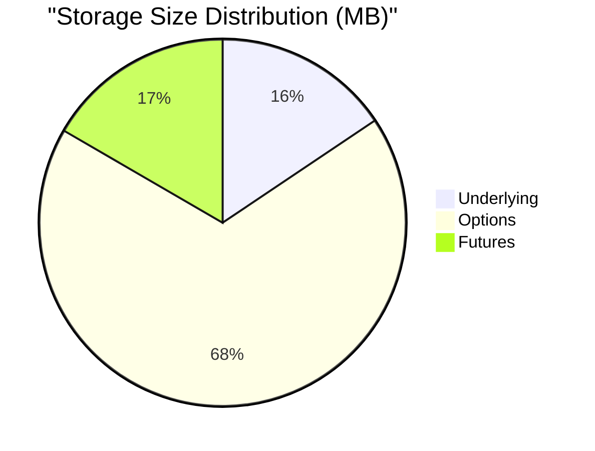
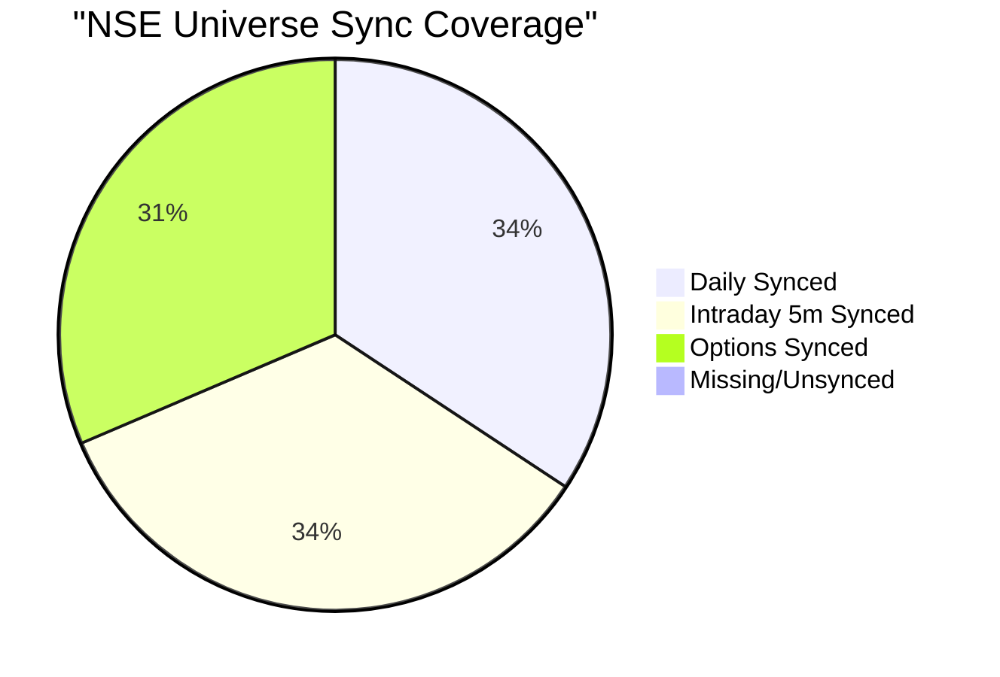
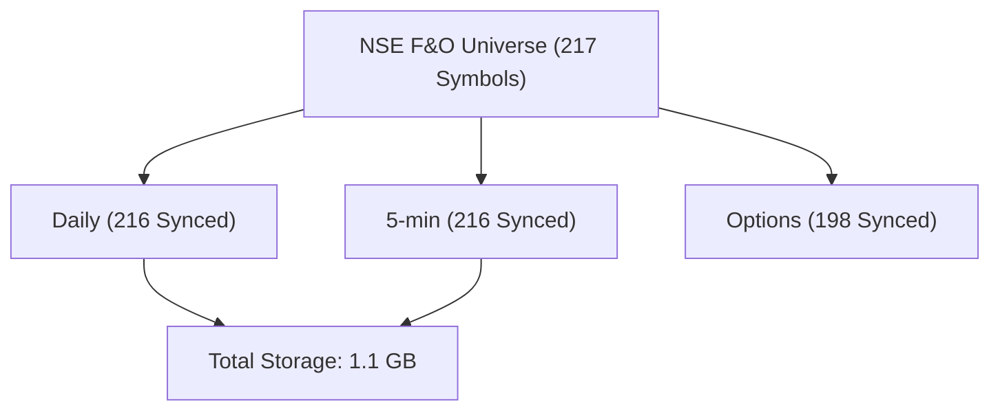

# Upstox Parquet Database Audit Report

Generated on: 2026-10-11 15:01:16 IST

## 📊 Database Health Visualizer

## Database Health Overview

* **Total Symbols in Universe:** 217 (Indices + F&O)
* **Underlying Daily Coverage:** 216 / 217 symbols
* **Underlying 5-min Coverage:** 216 / 217 symbols
* **Underlying 15-min Coverage:** 216 / 217 symbols
* **Options Expiry Coverage:** 198 / 217 symbols
* **Futures Expiry Coverage:** 198 / 217 symbols
* **Total Storage Size:** 1.1 GB *(Underlying: 175.68 MB, Options: 763.43 MB, Futures: 187.41 MB)*

## Benchmark Analysis (NIFTY)

| Interval | Records | Start Date | End Date | Size | Status |
| --- | --- | --- | --- | --- | --- |
| Daily | 2539 | 2016-07-01 | 2026-09-29 | 82.87 KB | [OK] 10 Years Synced |
| 5-minute | 70588 | 2022-12-07 | 2026-09-29 | 1.84 MB | [OK] 180 Days Synced |
| 15-minute | 23561 | 2022-12-07 | 2026-09-29 | 719.69 KB | [OK] 180 Days Synced |

## Detailed Symbol Status Table

> **Note on Gaps**: Gaps represent missing trading days in the range (excluding weekends and common exchange holidays). If gaps exist, they are listed below.

| Symbol | Daily (Range & Gaps) | 5-min (Range & Gaps) | Options | Futures | Total Disk Size |
| --- | --- | --- | --- | --- | --- |
| **NIFTY** | 2539 rows (2016-07-01 to 2026-09-29) ℹ️ **Holidays/Gaps**: 144 days | 70588 rows (2022-12-07 to 2026-09-29) ℹ️ **Holidays/Gaps**: 56 days | 91 expiries (111.46 MB) | 19 expiries (3.02 MB) | **117.1 MB** |
| **BANKNIFTY** | 2532 rows (2016-07-01 to 2026-09-18) ℹ️ **Holidays/Gaps**: 144 days | 70134 rows (2022-12-07 to 2026-09-18) ℹ️ **Holidays/Gaps**: 55 days | 25 expiries (34.76 MB) | 19 expiries (2.86 MB) | **40.4 MB** |
| **FINNIFTY** | 2552 rows (2016-06-03 to 2026-09-18) ℹ️ **Holidays/Gaps**: 144 days | 14775 rows (2025-12-03 to 2026-09-18) ⚠️ **Gaps (12d)**: 2025-12-25, 2026-01-15... | 26 expiries (17.62 MB) | 20 expiries (1.47 MB) | **19.7 MB** |
| **MIDCPNIFTY** | 2552 rows (2016-06-03 to 2026-09-18) ℹ️ **Holidays/Gaps**: 144 days | 14775 rows (2025-12-03 to 2026-09-18) ⚠️ **Gaps (12d)**: 2025-12-25, 2026-01-15... | - | - | **603.27 KB** |
| **SENSEX** | 2492 rows (2016-06-03 to 2026-06-24) ℹ️ **Holidays/Gaps**: 142 days | 10275 rows (2025-12-03 to 2026-06-24) ⚠️ **Gaps (10d)**: 2025-12-25, 2026-01-15... | 89 expiries (70.54 MB) | 55 expiries (2.25 MB) | **73.31 MB** |
| **360ONE** | 1737 rows (2019-09-19 to 2026-09-18) ℹ️ **Holidays/Gaps**: 99 days | 12975 rows (2025-12-29 to 2026-09-18) ⚠️ **Gaps (18d)**: 2026-01-15, 2026-01-26... | 2 expiries (413.42 KB) | 2 expiries (113.43 KB) | **937.86 KB** |
| **ABB** | 2529 rows (2016-07-01 to 2026-09-18) ℹ️ **Holidays/Gaps**: 146 days | 69603 rows (2022-12-07 to 2026-09-18) ℹ️ **Holidays/Gaps**: 62 days | 10 expiries (4.5 MB) | 10 expiries (1.15 MB) | **7.97 MB** |
| **ABCAPITAL** | 2241 rows (2017-09-01 to 2026-09-18) ℹ️ **Holidays/Gaps**: 129 days | 12975 rows (2025-12-29 to 2026-09-18) ⚠️ **Gaps (18d)**: 2026-01-15, 2026-01-26... | 10 expiries (2.47 MB) | 10 expiries (1.04 MB) | **3.93 MB** |
| **ADANIENSOL** | 2549 rows (2016-06-03 to 2026-09-18) ℹ️ **Holidays/Gaps**: 146 days | 12975 rows (2025-12-29 to 2026-09-18) ⚠️ **Gaps (18d)**: 2026-01-15, 2026-01-26... | 9 expiries (2.3 MB) | 8 expiries (785.54 KB) | **3.57 MB** |
| **ADANIENT** | 2549 rows (2016-06-03 to 2026-09-18) ℹ️ **Holidays/Gaps**: 146 days | 12975 rows (2025-12-29 to 2026-09-18) ⚠️ **Gaps (18d)**: 2026-01-15, 2026-01-26... | 10 expiries (4.5 MB) | 10 expiries (1.22 MB) | **6.23 MB** |
| **ADANIGREEN** | 2045 rows (2018-06-18 to 2026-09-18) ℹ️ **Holidays/Gaps**: 119 days | 12975 rows (2025-12-29 to 2026-09-18) ⚠️ **Gaps (18d)**: 2026-01-15, 2026-01-26... | 8 expiries (3.21 MB) | 8 expiries (916.06 KB) | **4.6 MB** |
| **ADANIPORTS** | 2529 rows (2016-07-01 to 2026-09-18) ℹ️ **Holidays/Gaps**: 146 days | 69603 rows (2022-12-07 to 2026-09-18) ℹ️ **Holidays/Gaps**: 62 days | 10 expiries (4.38 MB) | 10 expiries (1.15 MB) | **7.61 MB** |
| **ADANIPOWER** | 2549 rows (2016-06-03 to 2026-09-18) ℹ️ **Holidays/Gaps**: 146 days | 12975 rows (2025-12-29 to 2026-09-18) ⚠️ **Gaps (18d)**: 2026-01-15, 2026-01-26... | - | - | **506.35 KB** |
| **ALKEM** | 2549 rows (2016-06-03 to 2026-09-18) ℹ️ **Holidays/Gaps**: 146 days | 12975 rows (2025-12-29 to 2026-09-18) ⚠️ **Gaps (18d)**: 2026-01-15, 2026-01-26... | 10 expiries (3.0 MB) | 10 expiries (971.92 KB) | **4.32 MB** |
| **AMBER** | 2139 rows (2018-01-30 to 2026-09-18) ℹ️ **Holidays/Gaps**: 124 days | 12975 rows (2025-12-29 to 2026-09-18) ⚠️ **Gaps (18d)**: 2026-01-15, 2026-01-26... | 2 expiries (896.15 KB) | 2 expiries (123.42 KB) | **1.45 MB** |
| **AMBUJACEM** | 2529 rows (2016-07-01 to 2026-09-18) ℹ️ **Holidays/Gaps**: 146 days | 69603 rows (2022-12-07 to 2026-09-18) ℹ️ **Holidays/Gaps**: 62 days | 9 expiries (3.37 MB) | 10 expiries (990.13 KB) | **6.14 MB** |
| **ANGELONE** | 1522 rows (2016-06-06 to 2026-09-18) ℹ️ **Holidays/Gaps**: 1170 days | 12975 rows (2025-12-29 to 2026-09-18) ⚠️ **Gaps (18d)**: 2026-01-15, 2026-01-26... | 7 expiries (1.39 MB) | 8 expiries (980.07 KB) | **2.77 MB** |
| **APLAPOLLO** | 2549 rows (2016-06-03 to 2026-09-18) ℹ️ **Holidays/Gaps**: 146 days | 12975 rows (2025-12-29 to 2026-09-18) ⚠️ **Gaps (18d)**: 2026-01-15, 2026-01-26... | 7 expiries (2.28 MB) | 8 expiries (699.69 KB) | **3.43 MB** |
| **APOLLOHOSP** | 2529 rows (2016-07-01 to 2026-09-18) ℹ️ **Holidays/Gaps**: 146 days | 69603 rows (2022-12-07 to 2026-09-18) ℹ️ **Holidays/Gaps**: 62 days | 9 expiries (4.31 MB) | 10 expiries (1.03 MB) | **7.56 MB** |
| **ASHOKLEY** | 2549 rows (2016-06-03 to 2026-09-18) ℹ️ **Holidays/Gaps**: 146 days | 12975 rows (2025-12-29 to 2026-09-18) ⚠️ **Gaps (18d)**: 2026-01-15, 2026-01-26... | 9 expiries (1.08 MB) | 10 expiries (1.08 MB) | **2.66 MB** |
| **ASIANPAINT** | 2529 rows (2016-07-01 to 2026-09-18) ℹ️ **Holidays/Gaps**: 146 days | 69603 rows (2022-12-07 to 2026-09-18) ℹ️ **Holidays/Gaps**: 62 days | 9 expiries (5.07 MB) | 10 expiries (1.22 MB) | **8.36 MB** |
| **ASTRAL** | 2549 rows (2016-06-03 to 2026-09-18) ℹ️ **Holidays/Gaps**: 146 days | 12975 rows (2025-12-29 to 2026-09-18) ⚠️ **Gaps (18d)**: 2026-01-15, 2026-01-26... | 9 expiries (3.3 MB) | 10 expiries (1.04 MB) | **4.77 MB** |
| **AUBANK** | 2278 rows (2017-07-10 to 2026-09-18) ℹ️ **Holidays/Gaps**: 131 days | 12975 rows (2025-12-29 to 2026-09-18) ⚠️ **Gaps (18d)**: 2026-01-15, 2026-01-26... | 9 expiries (2.76 MB) | 10 expiries (1.05 MB) | **4.25 MB** |
| **AUROPHARMA** | 2549 rows (2016-06-03 to 2026-09-18) ℹ️ **Holidays/Gaps**: 146 days | 12975 rows (2025-12-29 to 2026-09-18) ⚠️ **Gaps (18d)**: 2026-01-15, 2026-01-26... | 9 expiries (3.42 MB) | 10 expiries (992.54 KB) | **4.86 MB** |
| **AXISBANK** | 2549 rows (2016-06-03 to 2026-09-18) ℹ️ **Holidays/Gaps**: 146 days | 12975 rows (2025-12-29 to 2026-09-18) ⚠️ **Gaps (18d)**: 2026-01-15, 2026-01-26... | 9 expiries (4.44 MB) | 10 expiries (1.13 MB) | **6.0 MB** |
| **BAJAJ-AUTO** | 2549 rows (2016-06-03 to 2026-09-18) ℹ️ **Holidays/Gaps**: 146 days | 12975 rows (2025-12-29 to 2026-09-18) ⚠️ **Gaps (18d)**: 2026-01-15, 2026-01-26... | 9 expiries (5.32 MB) | 10 expiries (1.23 MB) | **7.01 MB** |
| **BAJAJFINSV** | 2549 rows (2016-06-03 to 2026-09-18) ℹ️ **Holidays/Gaps**: 146 days | 12975 rows (2025-12-29 to 2026-09-18) ⚠️ **Gaps (18d)**: 2026-01-15, 2026-01-26... | 10 expiries (4.39 MB) | 10 expiries (1.08 MB) | **5.92 MB** |
| **BAJAJHLDNG** | 2549 rows (2016-06-03 to 2026-09-18) ℹ️ **Holidays/Gaps**: 146 days | 12975 rows (2025-12-29 to 2026-09-18) ⚠️ **Gaps (18d)**: 2026-01-15, 2026-01-26... | - | - | **405.99 KB** |
| **BAJFINANCE** | 2529 rows (2016-07-01 to 2026-09-18) ℹ️ **Holidays/Gaps**: 146 days | 69603 rows (2022-12-07 to 2026-09-18) ℹ️ **Holidays/Gaps**: 62 days | 9 expiries (2.8 MB) | 10 expiries (1.36 MB) | **5.82 MB** |
| **BANDHANBNK** | 2101 rows (2018-03-27 to 2026-09-18) ℹ️ **Holidays/Gaps**: 122 days | 12975 rows (2025-12-29 to 2026-09-18) ⚠️ **Gaps (18d)**: 2026-01-15, 2026-01-26... | 9 expiries (2.58 MB) | 10 expiries (1.02 MB) | **4.1 MB** |
| **BANKBARODA** | 2549 rows (2016-06-03 to 2026-09-18) ℹ️ **Holidays/Gaps**: 146 days | 12975 rows (2025-12-29 to 2026-09-18) ⚠️ **Gaps (18d)**: 2026-01-15, 2026-01-26... | 9 expiries (3.81 MB) | 11 expiries (1.25 MB) | **5.51 MB** |
| **BANKINDIA** | 2549 rows (2016-06-03 to 2026-09-18) ℹ️ **Holidays/Gaps**: 146 days | 12975 rows (2025-12-29 to 2026-09-18) ⚠️ **Gaps (18d)**: 2026-01-15, 2026-01-26... | 7 expiries (1.39 MB) | 8 expiries (774.97 KB) | **2.6 MB** |
| **BDL** | 2103 rows (2018-03-23 to 2026-09-18) ℹ️ **Holidays/Gaps**: 122 days | 12975 rows (2025-12-29 to 2026-09-18) ⚠️ **Gaps (18d)**: 2026-01-15, 2026-01-26... | 3 expiries (1.03 MB) | 3 expiries (242.61 KB) | **1.7 MB** |
| **BEL** | 2529 rows (2016-07-01 to 2026-09-18) ℹ️ **Holidays/Gaps**: 146 days | 69603 rows (2022-12-07 to 2026-09-18) ℹ️ **Holidays/Gaps**: 62 days | 9 expiries (3.96 MB) | 10 expiries (1.01 MB) | **6.87 MB** |
| **BHARATFORG** | 2549 rows (2016-06-03 to 2026-09-18) ℹ️ **Holidays/Gaps**: 146 days | 12975 rows (2025-12-29 to 2026-09-18) ⚠️ **Gaps (18d)**: 2026-01-15, 2026-01-26... | 9 expiries (3.47 MB) | 10 expiries (1.04 MB) | **5.0 MB** |
| **BHARTIARTL** | 2529 rows (2016-07-01 to 2026-09-18) ℹ️ **Holidays/Gaps**: 146 days | 69603 rows (2022-12-07 to 2026-09-18) ℹ️ **Holidays/Gaps**: 62 days | 9 expiries (4.72 MB) | 11 expiries (1.21 MB) | **8.07 MB** |
| **BHEL** | 2549 rows (2016-06-03 to 2026-09-18) ℹ️ **Holidays/Gaps**: 146 days | 12975 rows (2025-12-29 to 2026-09-18) ⚠️ **Gaps (18d)**: 2026-01-15, 2026-01-26... | 9 expiries (3.14 MB) | 10 expiries (1.12 MB) | **4.72 MB** |
| **BIOCON** | 2549 rows (2016-06-03 to 2026-09-18) ℹ️ **Holidays/Gaps**: 146 days | 12975 rows (2025-12-29 to 2026-09-18) ⚠️ **Gaps (18d)**: 2026-01-15, 2026-01-26... | 9 expiries (3.06 MB) | 10 expiries (890.73 KB) | **4.34 MB** |
| **BLUESTARCO** | 2549 rows (2016-06-03 to 2026-09-18) ℹ️ **Holidays/Gaps**: 146 days | 12975 rows (2025-12-29 to 2026-09-18) ⚠️ **Gaps (18d)**: 2026-01-15, 2026-01-26... | 3 expiries (858.59 KB) | 3 expiries (212.38 KB) | **1.5 MB** |
| **BOSCHLTD** | 2549 rows (2016-06-03 to 2026-09-18) ℹ️ **Holidays/Gaps**: 146 days | 12975 rows (2025-12-29 to 2026-09-18) ⚠️ **Gaps (18d)**: 2026-01-15, 2026-01-26... | 9 expiries (3.14 MB) | 10 expiries (918.51 KB) | **4.44 MB** |
| **BPCL** | 2549 rows (2016-06-03 to 2026-09-18) ℹ️ **Holidays/Gaps**: 146 days | 12975 rows (2025-12-29 to 2026-09-18) ⚠️ **Gaps (18d)**: 2026-01-15, 2026-01-26... | 9 expiries (3.3 MB) | 10 expiries (969.03 KB) | **4.66 MB** |
| **BRITANNIA** | 2529 rows (2016-07-01 to 2026-09-18) ℹ️ **Holidays/Gaps**: 146 days | 69603 rows (2022-12-07 to 2026-09-18) ℹ️ **Holidays/Gaps**: 62 days | 9 expiries (4.24 MB) | 10 expiries (1.05 MB) | **7.35 MB** |
| **BSE** | 2383 rows (2017-02-03 to 2026-09-18) ℹ️ **Holidays/Gaps**: 137 days | 12975 rows (2025-12-29 to 2026-09-18) ⚠️ **Gaps (18d)**: 2026-01-15, 2026-01-26... | 8 expiries (3.13 MB) | 8 expiries (1.03 MB) | **4.66 MB** |
| **CAMS** | 1479 rows (2020-10-05 to 2026-09-18) ℹ️ **Holidays/Gaps**: 83 days | 12975 rows (2025-12-29 to 2026-09-18) ⚠️ **Gaps (18d)**: 2026-01-15, 2026-01-26... | 8 expiries (1.12 MB) | 8 expiries (942.72 KB) | **2.45 MB** |
| **CANBK** | 2549 rows (2016-06-03 to 2026-09-18) ℹ️ **Holidays/Gaps**: 146 days | 12975 rows (2025-12-29 to 2026-09-18) ⚠️ **Gaps (18d)**: 2026-01-15, 2026-01-26... | 9 expiries (3.26 MB) | 10 expiries (1.04 MB) | **4.76 MB** |
| **CDSL** | 2284 rows (2017-06-30 to 2026-09-18) ℹ️ **Holidays/Gaps**: 131 days | 12975 rows (2025-12-29 to 2026-09-18) ⚠️ **Gaps (18d)**: 2026-01-15, 2026-01-26... | 8 expiries (2.89 MB) | 8 expiries (984.23 KB) | **4.28 MB** |
| **CGPOWER** | 2549 rows (2016-06-03 to 2026-09-18) ℹ️ **Holidays/Gaps**: 146 days | 12975 rows (2025-12-29 to 2026-09-18) ⚠️ **Gaps (18d)**: 2026-01-15, 2026-01-26... | 7 expiries (2.31 MB) | 8 expiries (734.05 KB) | **3.51 MB** |
| **CHOLAFIN** | 2549 rows (2016-06-03 to 2026-09-18) ℹ️ **Holidays/Gaps**: 146 days | 12975 rows (2025-12-29 to 2026-09-18) ⚠️ **Gaps (18d)**: 2026-01-15, 2026-01-26... | 10 expiries (3.47 MB) | 10 expiries (1011.32 KB) | **4.93 MB** |
| **CIPLA** | 2529 rows (2016-07-01 to 2026-09-18) ℹ️ **Holidays/Gaps**: 146 days | 69603 rows (2022-12-07 to 2026-09-18) ℹ️ **Holidays/Gaps**: 62 days | 9 expiries (3.95 MB) | 10 expiries (947.65 KB) | **6.77 MB** |
| **COALINDIA** | 2549 rows (2016-06-03 to 2026-09-18) ℹ️ **Holidays/Gaps**: 146 days | 12975 rows (2025-12-29 to 2026-09-18) ⚠️ **Gaps (18d)**: 2026-01-15, 2026-01-26... | 9 expiries (3.88 MB) | 10 expiries (942.24 KB) | **5.22 MB** |
| **COCHINSHIP** | 2254 rows (2017-08-11 to 2026-09-18) ℹ️ **Holidays/Gaps**: 131 days | 69603 rows (2022-12-07 to 2026-09-18) ℹ️ **Holidays/Gaps**: 62 days | - | - | **2.11 MB** |
| **COFORGE** | 2549 rows (2016-06-03 to 2026-09-18) ℹ️ **Holidays/Gaps**: 146 days | 13275 rows (2025-12-29 to 2026-09-30) ⚠️ **Gaps (22d)**: 2026-01-15, 2026-01-26... | 10 expiries (2.17 MB) | 10 expiries (1.21 MB) | **3.88 MB** |
| **COLPAL** | 2549 rows (2016-06-03 to 2026-09-18) ℹ️ **Holidays/Gaps**: 146 days | 12975 rows (2025-12-29 to 2026-09-18) ⚠️ **Gaps (18d)**: 2026-01-15, 2026-01-26... | 9 expiries (3.06 MB) | 10 expiries (1.05 MB) | **4.54 MB** |
| **CONCOR** | 2549 rows (2016-06-03 to 2026-09-18) ℹ️ **Holidays/Gaps**: 146 days | 12975 rows (2025-12-29 to 2026-09-18) ⚠️ **Gaps (18d)**: 2026-01-15, 2026-01-26... | 10 expiries (1.45 MB) | 10 expiries (1.03 MB) | **2.9 MB** |
| **CROMPTON** | 2549 rows (2016-06-03 to 2026-09-18) ℹ️ **Holidays/Gaps**: 146 days | 12975 rows (2025-12-29 to 2026-09-18) ⚠️ **Gaps (18d)**: 2026-01-15, 2026-01-26... | 9 expiries (2.38 MB) | 10 expiries (825.96 KB) | **3.63 MB** |
| **CUMMINSIND** | 2549 rows (2016-06-03 to 2026-09-18) ℹ️ **Holidays/Gaps**: 146 days | 12975 rows (2025-12-29 to 2026-09-18) ⚠️ **Gaps (18d)**: 2026-01-15, 2026-01-26... | 9 expiries (3.92 MB) | 10 expiries (1.09 MB) | **5.51 MB** |
| **DABUR** | 2549 rows (2016-06-03 to 2026-09-18) ℹ️ **Holidays/Gaps**: 146 days | 12975 rows (2025-12-29 to 2026-09-18) ⚠️ **Gaps (18d)**: 2026-01-15, 2026-01-26... | 9 expiries (3.22 MB) | 10 expiries (908.65 KB) | **4.53 MB** |
| **DALBHARAT** | 1889 rows (2019-02-05 to 2026-09-18) ℹ️ **Holidays/Gaps**: 109 days | 12975 rows (2025-12-29 to 2026-09-18) ⚠️ **Gaps (18d)**: 2026-01-15, 2026-01-26... | 9 expiries (2.77 MB) | 10 expiries (923.42 KB) | **4.1 MB** |
| **DELHIVERY** | 1075 rows (2016-06-13 to 2026-09-18) ℹ️ **Holidays/Gaps**: 1611 days | 12975 rows (2025-12-29 to 2026-09-18) ⚠️ **Gaps (18d)**: 2026-01-15, 2026-01-26... | 8 expiries (2.05 MB) | 8 expiries (736.64 KB) | **3.16 MB** |
| **DIVISLAB** | 2549 rows (2016-06-03 to 2026-09-18) ℹ️ **Holidays/Gaps**: 146 days | 12975 rows (2025-12-29 to 2026-09-18) ⚠️ **Gaps (18d)**: 2026-01-15, 2026-01-26... | 9 expiries (4.74 MB) | 10 expiries (1.1 MB) | **6.28 MB** |
| **DIXON** | 2230 rows (2017-09-18 to 2026-09-18) ℹ️ **Holidays/Gaps**: 129 days | 12975 rows (2025-12-29 to 2026-09-18) ⚠️ **Gaps (18d)**: 2026-01-15, 2026-01-26... | 10 expiries (6.52 MB) | 10 expiries (1.31 MB) | **8.29 MB** |
| **DLF** | 2529 rows (2016-07-01 to 2026-09-18) ℹ️ **Holidays/Gaps**: 146 days | 69603 rows (2022-12-07 to 2026-09-18) ℹ️ **Holidays/Gaps**: 62 days | 9 expiries (4.01 MB) | 10 expiries (1.12 MB) | **7.08 MB** |
| **DMART** | 2353 rows (2017-03-21 to 2026-09-18) ℹ️ **Holidays/Gaps**: 135 days | 12975 rows (2025-12-29 to 2026-09-18) ⚠️ **Gaps (18d)**: 2026-01-15, 2026-01-26... | 7 expiries (3.51 MB) | 8 expiries (911.54 KB) | **4.89 MB** |
| **DRREDDY** | 2529 rows (2016-07-01 to 2026-09-18) ℹ️ **Holidays/Gaps**: 146 days | 69603 rows (2022-12-07 to 2026-09-18) ℹ️ **Holidays/Gaps**: 62 days | 9 expiries (3.67 MB) | 10 expiries (1.01 MB) | **6.48 MB** |
| **EICHERMOT** | 2549 rows (2016-06-03 to 2026-09-18) ℹ️ **Holidays/Gaps**: 146 days | 12975 rows (2025-12-29 to 2026-09-18) ⚠️ **Gaps (18d)**: 2026-01-15, 2026-01-26... | 9 expiries (4.58 MB) | 10 expiries (1.07 MB) | **6.08 MB** |
| **ETERNAL** | 1280 rows (2021-07-23 to 2026-09-18) ℹ️ **Holidays/Gaps**: 72 days | 12975 rows (2025-12-29 to 2026-09-18) ⚠️ **Gaps (18d)**: 2026-01-15, 2026-01-26... | 8 expiries (3.08 MB) | 8 expiries (975.12 KB) | **4.46 MB** |
| **EXIDEIND** | 2549 rows (2016-06-03 to 2026-09-18) ℹ️ **Holidays/Gaps**: 146 days | 12975 rows (2025-12-29 to 2026-09-18) ⚠️ **Gaps (18d)**: 2026-01-15, 2026-01-26... | 9 expiries (3.28 MB) | 10 expiries (957.35 KB) | **4.66 MB** |
| **FEDERALBNK** | 2552 rows (2016-06-03 to 2026-09-18) ℹ️ **Holidays/Gaps**: 144 days | 12975 rows (2025-12-29 to 2026-09-18) ⚠️ **Gaps (18d)**: 2026-01-15, 2026-01-26... | 9 expiries (3.16 MB) | 10 expiries (1.06 MB) | **4.65 MB** |
| **FORCEMOT** | 1682 rows (2019-08-20 to 2026-09-18) ℹ️ **Holidays/Gaps**: 174 days | 12975 rows (2025-12-29 to 2026-09-18) ⚠️ **Gaps (18d)**: 2026-01-15, 2026-01-26... | - | - | **437.03 KB** |
| **FORTIS** | 2529 rows (2016-07-01 to 2026-09-18) ℹ️ **Holidays/Gaps**: 146 days | 69603 rows (2022-12-07 to 2026-09-18) ℹ️ **Holidays/Gaps**: 62 days | 3 expiries (837.06 KB) | 3 expiries (200.95 KB) | **2.92 MB** |
| **GAIL** | 2549 rows (2016-06-03 to 2026-09-18) ℹ️ **Holidays/Gaps**: 146 days | 12975 rows (2025-12-29 to 2026-09-18) ⚠️ **Gaps (18d)**: 2026-01-15, 2026-01-26... | 10 expiries (3.25 MB) | 10 expiries (1.14 MB) | **4.85 MB** |
| **GLENMARK** | 2549 rows (2016-06-03 to 2026-09-18) ℹ️ **Holidays/Gaps**: 146 days | 12975 rows (2025-12-29 to 2026-09-18) ⚠️ **Gaps (18d)**: 2026-01-15, 2026-01-26... | 9 expiries (3.28 MB) | 10 expiries (967.83 KB) | **4.69 MB** |
| **GMRAIRPORT** | 2549 rows (2016-06-03 to 2026-09-18) ℹ️ **Holidays/Gaps**: 146 days | 12975 rows (2025-12-29 to 2026-09-18) ⚠️ **Gaps (18d)**: 2026-01-15, 2026-01-26... | 9 expiries (2.43 MB) | 10 expiries (980.09 KB) | **3.82 MB** |
| **GODFRYPHLP** | 2549 rows (2016-06-03 to 2026-09-18) ℹ️ **Holidays/Gaps**: 146 days | 12975 rows (2025-12-29 to 2026-09-18) ⚠️ **Gaps (18d)**: 2026-01-15, 2026-01-26... | - | - | **453.61 KB** |
| **GODREJCP** | 2549 rows (2016-06-03 to 2026-09-18) ℹ️ **Holidays/Gaps**: 146 days | 12975 rows (2025-12-29 to 2026-09-18) ⚠️ **Gaps (18d)**: 2026-01-15, 2026-01-26... | 9 expiries (2.95 MB) | 10 expiries (916.12 KB) | **4.29 MB** |
| **GODREJPROP** | 2529 rows (2016-07-01 to 2026-09-18) ℹ️ **Holidays/Gaps**: 146 days | 69603 rows (2022-12-07 to 2026-09-18) ℹ️ **Holidays/Gaps**: 62 days | 10 expiries (4.05 MB) | 10 expiries (1.16 MB) | **7.42 MB** |
| **GRASIM** | 2529 rows (2016-07-01 to 2026-09-18) ℹ️ **Holidays/Gaps**: 146 days | 69603 rows (2022-12-07 to 2026-09-18) ℹ️ **Holidays/Gaps**: 62 days | 9 expiries (3.89 MB) | 10 expiries (1.03 MB) | **6.97 MB** |
| **GVT&D** | 2536 rows (2016-07-01 to 2026-09-29) ℹ️ **Holidays/Gaps**: 146 days | 65736 rows (2023-03-10 to 2026-09-29) ℹ️ **Holidays/Gaps**: 53 days | - | - | **2.06 MB** |
| **HAL** | 2100 rows (2018-03-28 to 2026-09-18) ℹ️ **Holidays/Gaps**: 122 days | 69603 rows (2022-12-07 to 2026-09-18) ℹ️ **Holidays/Gaps**: 62 days | 10 expiries (6.0 MB) | 10 expiries (1.44 MB) | **9.77 MB** |
| **HAVELLS** | 2529 rows (2016-07-01 to 2026-09-18) ℹ️ **Holidays/Gaps**: 146 days | 69603 rows (2022-12-07 to 2026-09-18) ℹ️ **Holidays/Gaps**: 62 days | 9 expiries (3.17 MB) | 10 expiries (969.23 KB) | **6.01 MB** |
| **HCLTECH** | 2529 rows (2016-07-01 to 2026-09-18) ℹ️ **Holidays/Gaps**: 146 days | 69603 rows (2022-12-07 to 2026-09-18) ℹ️ **Holidays/Gaps**: 62 days | 9 expiries (4.0 MB) | 10 expiries (1.09 MB) | **7.11 MB** |
| **HDFCAMC** | 2010 rows (2018-08-06 to 2026-09-18) ℹ️ **Holidays/Gaps**: 119 days | 12975 rows (2025-12-29 to 2026-09-18) ⚠️ **Gaps (18d)**: 2026-01-15, 2026-01-26... | 9 expiries (579.65 KB) | 10 expiries (1.09 MB) | **2.1 MB** |
| **HDFCBANK** | 2529 rows (2016-07-01 to 2026-09-18) ℹ️ **Holidays/Gaps**: 146 days | 69603 rows (2022-12-07 to 2026-09-18) ℹ️ **Holidays/Gaps**: 62 days | 9 expiries (1.3 MB) | 10 expiries (1.21 MB) | **4.34 MB** |
| **HDFCLIFE** | 2189 rows (2017-11-17 to 2026-09-18) ℹ️ **Holidays/Gaps**: 126 days | 12975 rows (2025-12-29 to 2026-09-18) ⚠️ **Gaps (18d)**: 2026-01-15, 2026-01-26... | 9 expiries (3.01 MB) | 10 expiries (969.54 KB) | **4.4 MB** |
| **HEROMOTOCO** | 2549 rows (2016-06-03 to 2026-09-18) ℹ️ **Holidays/Gaps**: 146 days | 12975 rows (2025-12-29 to 2026-09-18) ⚠️ **Gaps (18d)**: 2026-01-15, 2026-01-26... | 9 expiries (4.17 MB) | 10 expiries (1.28 MB) | **5.9 MB** |
| **HINDALCO** | 2529 rows (2016-07-01 to 2026-09-18) ℹ️ **Holidays/Gaps**: 146 days | 69603 rows (2022-12-07 to 2026-09-18) ℹ️ **Holidays/Gaps**: 62 days | 9 expiries (3.19 MB) | 10 expiries (1.03 MB) | **6.22 MB** |
| **HINDPETRO** | 2549 rows (2016-06-03 to 2026-09-18) ℹ️ **Holidays/Gaps**: 146 days | 12975 rows (2025-12-29 to 2026-09-18) ⚠️ **Gaps (18d)**: 2026-01-15, 2026-01-26... | 9 expiries (2.81 MB) | 10 expiries (984.45 KB) | **4.22 MB** |
| **HINDUNILVR** | 2529 rows (2016-07-01 to 2026-09-18) ℹ️ **Holidays/Gaps**: 146 days | 69594 rows (2022-12-07 to 2026-09-18) ℹ️ **Holidays/Gaps**: 62 days | 9 expiries (4.03 MB) | 10 expiries (1.17 MB) | **7.16 MB** |
| **HINDZINC** | 2552 rows (2016-06-03 to 2026-09-18) ℹ️ **Holidays/Gaps**: 144 days | 12975 rows (2025-12-29 to 2026-09-18) ⚠️ **Gaps (18d)**: 2026-01-15, 2026-01-26... | 5 expiries (1.2 MB) | 5 expiries (403.95 KB) | **2.05 MB** |
| **HYUNDAI** | 474 rows (2024-10-22 to 2026-09-18) ℹ️ **Holidays/Gaps**: 27 days | 12975 rows (2025-12-29 to 2026-09-18) ⚠️ **Gaps (18d)**: 2026-01-15, 2026-01-26... | - | - | **408.85 KB** |
| **ICICIBANK** | 2529 rows (2016-07-01 to 2026-09-18) ℹ️ **Holidays/Gaps**: 146 days | 69603 rows (2022-12-07 to 2026-09-18) ℹ️ **Holidays/Gaps**: 62 days | 9 expiries (4.18 MB) | 10 expiries (1.1 MB) | **7.3 MB** |
| **ICICIGI** | 2223 rows (2017-09-27 to 2026-09-18) ℹ️ **Holidays/Gaps**: 129 days | 12975 rows (2025-12-29 to 2026-09-18) ⚠️ **Gaps (18d)**: 2026-01-15, 2026-01-26... | 9 expiries (2.56 MB) | 10 expiries (868.43 KB) | **3.84 MB** |
| **ICICIPRULI** | 2469 rows (2016-09-29 to 2026-09-18) ℹ️ **Holidays/Gaps**: 142 days | 12975 rows (2025-12-29 to 2026-09-18) ⚠️ **Gaps (18d)**: 2026-01-15, 2026-01-26... | 9 expiries (2.28 MB) | 10 expiries (850.06 KB) | **3.56 MB** |
| **IDEA** | 2549 rows (2016-06-03 to 2026-09-18) ℹ️ **Holidays/Gaps**: 146 days | 12975 rows (2025-12-29 to 2026-09-18) ⚠️ **Gaps (18d)**: 2026-01-15, 2026-01-26... | 9 expiries (903.88 KB) | 10 expiries (912.21 KB) | **2.16 MB** |
| **IDFCFIRSTB** | 2549 rows (2016-06-03 to 2026-09-18) ℹ️ **Holidays/Gaps**: 146 days | 12975 rows (2025-12-29 to 2026-09-18) ⚠️ **Gaps (18d)**: 2026-01-15, 2026-01-26... | 9 expiries (1.87 MB) | 10 expiries (1.03 MB) | **3.34 MB** |
| **IEX** | 2208 rows (2017-10-23 to 2026-09-18) ℹ️ **Holidays/Gaps**: 126 days | 12975 rows (2025-12-29 to 2026-09-18) ⚠️ **Gaps (18d)**: 2026-01-15, 2026-01-26... | 9 expiries (2.22 MB) | 11 expiries (1.18 MB) | **3.83 MB** |
| **INDHOTEL** | 2549 rows (2016-06-03 to 2026-09-18) ℹ️ **Holidays/Gaps**: 146 days | 12975 rows (2025-12-29 to 2026-09-18) ⚠️ **Gaps (18d)**: 2026-01-15, 2026-01-26... | 9 expiries (3.2 MB) | 10 expiries (1022.49 KB) | **4.64 MB** |
| **INDIANB** | 2549 rows (2016-06-03 to 2026-09-18) ℹ️ **Holidays/Gaps**: 146 days | 12975 rows (2025-12-29 to 2026-09-18) ⚠️ **Gaps (18d)**: 2026-01-15, 2026-01-26... | 7 expiries (1.5 MB) | 8 expiries (637.68 KB) | **2.58 MB** |
| **INDIGO** | 2529 rows (2016-07-01 to 2026-09-18) ℹ️ **Holidays/Gaps**: 146 days | 69603 rows (2022-12-07 to 2026-09-18) ℹ️ **Holidays/Gaps**: 62 days | 10 expiries (4.17 MB) | 10 expiries (1.17 MB) | **7.63 MB** |
| **INDUSINDBK** | 2549 rows (2016-06-03 to 2026-09-18) ℹ️ **Holidays/Gaps**: 146 days | 12975 rows (2025-12-29 to 2026-09-18) ⚠️ **Gaps (18d)**: 2026-01-15, 2026-01-26... | 10 expiries (3.92 MB) | 10 expiries (1.2 MB) | **5.58 MB** |
| **INDUSTOWER** | 2549 rows (2016-06-03 to 2026-09-18) ℹ️ **Holidays/Gaps**: 146 days | 12975 rows (2025-12-29 to 2026-09-18) ⚠️ **Gaps (18d)**: 2026-01-15, 2026-01-26... | 9 expiries (2.66 MB) | 10 expiries (967.21 KB) | **4.03 MB** |
| **INFY** | 2529 rows (2016-07-01 to 2026-09-18) ℹ️ **Holidays/Gaps**: 146 days | 69603 rows (2022-12-07 to 2026-09-18) ℹ️ **Holidays/Gaps**: 62 days | 9 expiries (4.51 MB) | 10 expiries (1.22 MB) | **7.8 MB** |
| **INOXWIND** | 2549 rows (2016-06-03 to 2026-09-18) ℹ️ **Holidays/Gaps**: 146 days | 12975 rows (2025-12-29 to 2026-09-18) ⚠️ **Gaps (18d)**: 2026-01-15, 2026-01-26... | 5 expiries (922.01 KB) | 5 expiries (446.28 KB) | **1.82 MB** |
| **IOC** | 2549 rows (2016-06-03 to 2026-09-18) ℹ️ **Holidays/Gaps**: 146 days | 12975 rows (2025-12-29 to 2026-09-18) ⚠️ **Gaps (18d)**: 2026-01-15, 2026-01-26... | 9 expiries (2.58 MB) | 10 expiries (1.06 MB) | **4.1 MB** |
| **IREDA** | 697 rows (2023-11-29 to 2026-09-18) ℹ️ **Holidays/Gaps**: 41 days | 12975 rows (2025-12-29 to 2026-09-18) ⚠️ **Gaps (18d)**: 2026-01-15, 2026-01-26... | 5 expiries (1.2 MB) | 6 expiries (593.45 KB) | **2.18 MB** |
| **IRFC** | 1398 rows (2021-01-29 to 2026-09-18) ℹ️ **Holidays/Gaps**: 79 days | 12975 rows (2025-12-29 to 2026-09-18) ⚠️ **Gaps (18d)**: 2026-01-15, 2026-01-26... | 8 expiries (1.87 MB) | 8 expiries (908.6 KB) | **3.19 MB** |
| **ITC** | 2529 rows (2016-07-01 to 2026-09-18) ℹ️ **Holidays/Gaps**: 146 days | 69599 rows (2022-12-07 to 2026-09-18) ℹ️ **Holidays/Gaps**: 62 days | 9 expiries (3.21 MB) | 10 expiries (1001.82 KB) | **5.99 MB** |
| **JINDALSTEL** | 2529 rows (2016-07-01 to 2026-09-18) ℹ️ **Holidays/Gaps**: 146 days | 69603 rows (2022-12-07 to 2026-09-18) ℹ️ **Holidays/Gaps**: 62 days | 9 expiries (3.19 MB) | 10 expiries (1016.65 KB) | **6.11 MB** |
| **JIOFIN** | 765 rows (2023-08-21 to 2026-09-18) ℹ️ **Holidays/Gaps**: 46 days | 12975 rows (2025-12-29 to 2026-09-18) ⚠️ **Gaps (18d)**: 2026-01-15, 2026-01-26... | 8 expiries (2.37 MB) | 8 expiries (969.54 KB) | **3.71 MB** |
| **JSWENERGY** | 2549 rows (2016-06-03 to 2026-09-18) ℹ️ **Holidays/Gaps**: 146 days | 12975 rows (2025-12-29 to 2026-09-18) ⚠️ **Gaps (18d)**: 2026-01-15, 2026-01-26... | 7 expiries (2.08 MB) | 8 expiries (785.37 KB) | **3.28 MB** |
| **JSWSTEEL** | 2549 rows (2016-06-03 to 2026-09-18) ℹ️ **Holidays/Gaps**: 146 days | 12975 rows (2025-12-29 to 2026-09-18) ⚠️ **Gaps (18d)**: 2026-01-15, 2026-01-26... | 9 expiries (3.53 MB) | 10 expiries (1001.03 KB) | **4.93 MB** |
| **JUBLFOOD** | 2549 rows (2016-06-03 to 2026-09-18) ℹ️ **Holidays/Gaps**: 146 days | 12975 rows (2025-12-29 to 2026-09-18) ⚠️ **Gaps (18d)**: 2026-01-15, 2026-01-26... | 9 expiries (2.67 MB) | 10 expiries (947.37 KB) | **4.04 MB** |
| **KALYANKJIL** | 1359 rows (2021-03-26 to 2026-09-18) ℹ️ **Holidays/Gaps**: 78 days | 12975 rows (2025-12-29 to 2026-09-18) ⚠️ **Gaps (18d)**: 2026-01-15, 2026-01-26... | 8 expiries (2.24 MB) | 8 expiries (809.88 KB) | **3.47 MB** |
| **KAYNES** | 950 rows (2022-11-22 to 2026-09-18) ℹ️ **Holidays/Gaps**: 55 days | 12975 rows (2025-12-29 to 2026-09-18) ⚠️ **Gaps (18d)**: 2026-01-15, 2026-01-26... | 3 expiries (1.04 MB) | 3 expiries (206.82 KB) | **1.71 MB** |
| **KEI** | 2549 rows (2016-06-03 to 2026-09-18) ℹ️ **Holidays/Gaps**: 146 days | 12975 rows (2025-12-29 to 2026-09-18) ⚠️ **Gaps (18d)**: 2026-01-15, 2026-01-26... | 8 expiries (2.17 MB) | 8 expiries (792.78 KB) | **3.45 MB** |
| **KFINTECH** | 925 rows (2018-05-28 to 2026-09-18) ℹ️ **Holidays/Gaps**: 1251 days | 12975 rows (2025-12-29 to 2026-09-18) ⚠️ **Gaps (18d)**: 2026-01-15, 2026-01-26... | 2 expiries (307.59 KB) | 2 expiries (115.95 KB) | **843.41 KB** |
| **KOTAKBANK** | 2549 rows (2016-06-03 to 2026-09-18) ℹ️ **Holidays/Gaps**: 146 days | 4875 rows (2026-06-09 to 2026-09-18) ⚠️ **Gaps (9d)**: 2026-06-26, 2026-07-21... | 9 expiries (665.32 KB) | 10 expiries (1.17 MB) | **2.08 MB** |
| **KPITTECH** | 1839 rows (2019-04-22 to 2026-09-18) ℹ️ **Holidays/Gaps**: 105 days | 12975 rows (2025-12-29 to 2026-09-18) ⚠️ **Gaps (18d)**: 2026-01-15, 2026-01-26... | 7 expiries (2.19 MB) | 8 expiries (761.43 KB) | **3.4 MB** |
| **LAURUSLABS** | 2416 rows (2016-12-19 to 2026-09-18) ℹ️ **Holidays/Gaps**: 138 days | 12975 rows (2025-12-29 to 2026-09-18) ⚠️ **Gaps (18d)**: 2026-01-15, 2026-01-26... | 9 expiries (2.87 MB) | 10 expiries (974.14 KB) | **4.32 MB** |
| **LICHSGFIN** | 2549 rows (2016-06-03 to 2026-09-18) ℹ️ **Holidays/Gaps**: 146 days | 12975 rows (2025-12-29 to 2026-09-18) ⚠️ **Gaps (18d)**: 2026-01-15, 2026-01-26... | 9 expiries (2.72 MB) | 10 expiries (980.92 KB) | **4.09 MB** |
| **LICI** | 1079 rows (2022-05-17 to 2026-09-18) ℹ️ **Holidays/Gaps**: 61 days | 12975 rows (2025-12-29 to 2026-09-18) ⚠️ **Gaps (18d)**: 2026-01-15, 2026-01-26... | 8 expiries (323.82 KB) | 8 expiries (794.81 KB) | **1.45 MB** |
| **LODHA** | 1346 rows (2021-04-19 to 2026-09-18) ℹ️ **Holidays/Gaps**: 75 days | 12975 rows (2025-12-29 to 2026-09-18) ⚠️ **Gaps (18d)**: 2026-01-15, 2026-01-26... | 7 expiries (2.11 MB) | 8 expiries (737.47 KB) | **3.3 MB** |
| **LT** | 2529 rows (2016-07-01 to 2026-09-18) ℹ️ **Holidays/Gaps**: 146 days | 69603 rows (2022-12-07 to 2026-09-18) ℹ️ **Holidays/Gaps**: 62 days | 9 expiries (4.68 MB) | 10 expiries (1.29 MB) | **8.18 MB** |
| **LTF** | 2549 rows (2016-06-03 to 2026-09-18) ℹ️ **Holidays/Gaps**: 146 days | 12975 rows (2025-12-29 to 2026-09-18) ⚠️ **Gaps (18d)**: 2026-01-15, 2026-01-26... | 9 expiries (1.93 MB) | 10 expiries (1.02 MB) | **3.38 MB** |
| **LTM** | 2516 rows (2016-07-21 to 2026-09-18) ℹ️ **Holidays/Gaps**: 145 days | 12975 rows (2025-12-29 to 2026-09-18) ⚠️ **Gaps (18d)**: 2026-01-15, 2026-01-26... | 10 expiries (3.5 MB) | 10 expiries (1.12 MB) | **5.12 MB** |
| **LUPIN** | 2549 rows (2016-06-03 to 2026-09-18) ℹ️ **Holidays/Gaps**: 146 days | 12975 rows (2025-12-29 to 2026-09-18) ⚠️ **Gaps (18d)**: 2026-01-15, 2026-01-26... | 9 expiries (3.55 MB) | 10 expiries (1.04 MB) | **5.03 MB** |
| **M&M** | 2529 rows (2016-07-01 to 2026-09-18) ℹ️ **Holidays/Gaps**: 146 days | 69603 rows (2022-12-07 to 2026-09-18) ℹ️ **Holidays/Gaps**: 62 days | 9 expiries (4.44 MB) | 10 expiries (1.29 MB) | **7.98 MB** |
| **MANAPPURAM** | 2549 rows (2016-06-03 to 2026-09-18) ℹ️ **Holidays/Gaps**: 146 days | 12975 rows (2025-12-29 to 2026-09-18) ⚠️ **Gaps (18d)**: 2026-01-15, 2026-01-26... | 10 expiries (1.53 MB) | 10 expiries (823.63 KB) | **2.76 MB** |
| **MANKIND** | 837 rows (2023-05-09 to 2026-09-18) ℹ️ **Holidays/Gaps**: 48 days | 13050 rows (2025-12-29 to 2026-09-29) ⚠️ **Gaps (24d)**: 2026-01-15, 2026-01-26... | 3 expiries (726.39 KB) | 3 expiries (202.08 KB) | **1.32 MB** |
| **MARICO** | 2549 rows (2016-06-03 to 2026-09-18) ℹ️ **Holidays/Gaps**: 146 days | 12975 rows (2025-12-29 to 2026-09-18) ⚠️ **Gaps (18d)**: 2026-01-15, 2026-01-26... | 9 expiries (2.12 MB) | 10 expiries (808.02 KB) | **3.34 MB** |
| **MARUTI** | 2529 rows (2016-07-01 to 2026-09-18) ℹ️ **Holidays/Gaps**: 146 days | 69603 rows (2022-12-07 to 2026-09-18) ℹ️ **Holidays/Gaps**: 62 days | 9 expiries (5.57 MB) | 10 expiries (1.23 MB) | **9.12 MB** |
| **MAXHEALTH** | 1509 rows (2020-08-21 to 2026-09-18) ℹ️ **Holidays/Gaps**: 84 days | 69603 rows (2022-12-07 to 2026-09-18) ℹ️ **Holidays/Gaps**: 62 days | 7 expiries (1.97 MB) | 8 expiries (721.31 KB) | **4.61 MB** |
| **MAZDOCK** | 1482 rows (2017-12-04 to 2026-09-18) ℹ️ **Holidays/Gaps**: 820 days | 12975 rows (2025-12-29 to 2026-09-18) ⚠️ **Gaps (18d)**: 2026-01-15, 2026-01-26... | 3 expiries (1002.13 KB) | 3 expiries (254.03 KB) | **1.65 MB** |
| **MCX** | 2549 rows (2016-06-03 to 2026-09-18) ℹ️ **Holidays/Gaps**: 146 days | 12975 rows (2025-12-29 to 2026-09-18) ⚠️ **Gaps (18d)**: 2026-01-15, 2026-01-26... | 10 expiries (1.19 MB) | 10 expiries (1.19 MB) | **2.86 MB** |
| **MFSL** | 2549 rows (2016-06-03 to 2026-09-18) ℹ️ **Holidays/Gaps**: 146 days | 12975 rows (2025-12-29 to 2026-09-18) ⚠️ **Gaps (18d)**: 2026-01-15, 2026-01-26... | 9 expiries (1.98 MB) | 10 expiries (825.25 KB) | **3.22 MB** |
| **MOTHERSON** | [MISSING] | [MISSING] | - | - | **0 B** |
| **MOTILALOFS** | 2549 rows (2016-06-03 to 2026-09-18) ℹ️ **Holidays/Gaps**: 146 days | 12975 rows (2025-12-29 to 2026-09-18) ⚠️ **Gaps (18d)**: 2026-01-15, 2026-01-26... | - | - | **490.43 KB** |
| **MPHASIS** | 2549 rows (2016-06-03 to 2026-09-18) ℹ️ **Holidays/Gaps**: 146 days | 12975 rows (2025-12-29 to 2026-09-18) ⚠️ **Gaps (18d)**: 2026-01-15, 2026-01-26... | 9 expiries (2.93 MB) | 10 expiries (1.05 MB) | **4.46 MB** |
| **MUTHOOTFIN** | 2549 rows (2016-06-03 to 2026-09-18) ℹ️ **Holidays/Gaps**: 146 days | 12975 rows (2025-12-29 to 2026-09-18) ⚠️ **Gaps (18d)**: 2026-01-15, 2026-01-26... | 9 expiries (3.35 MB) | 10 expiries (982.52 KB) | **4.82 MB** |
| **NAM-INDIA** | 2198 rows (2017-11-06 to 2026-09-18) ℹ️ **Holidays/Gaps**: 126 days | 12975 rows (2025-12-29 to 2026-09-18) ⚠️ **Gaps (18d)**: 2026-01-15, 2026-01-26... | - | - | **475.18 KB** |
| **NATIONALUM** | 2549 rows (2016-06-03 to 2026-09-18) ℹ️ **Holidays/Gaps**: 146 days | 12975 rows (2025-12-29 to 2026-09-18) ⚠️ **Gaps (18d)**: 2026-01-15, 2026-01-26... | 10 expiries (2.5 MB) | 10 expiries (1.07 MB) | **4.01 MB** |
| **NAUKRI** | 2549 rows (2016-06-03 to 2026-09-18) ℹ️ **Holidays/Gaps**: 146 days | 12975 rows (2025-12-29 to 2026-09-18) ⚠️ **Gaps (18d)**: 2026-01-15, 2026-01-26... | 10 expiries (1.75 MB) | 10 expiries (1.08 MB) | **3.3 MB** |
| **NBCC** | 2549 rows (2016-06-03 to 2026-09-18) ℹ️ **Holidays/Gaps**: 146 days | 12975 rows (2025-12-29 to 2026-09-18) ⚠️ **Gaps (18d)**: 2026-01-15, 2026-01-26... | 7 expiries (822.97 KB) | 6 expiries (538.31 KB) | **1.79 MB** |
| **NESTLEIND** | 2549 rows (2016-06-03 to 2026-09-18) ℹ️ **Holidays/Gaps**: 146 days | 12975 rows (2025-12-29 to 2026-09-18) ⚠️ **Gaps (18d)**: 2026-01-15, 2026-01-26... | 9 expiries (703.87 KB) | 10 expiries (1.09 MB) | **2.21 MB** |
| **NHPC** | 2549 rows (2016-06-03 to 2026-09-18) ℹ️ **Holidays/Gaps**: 146 days | 12975 rows (2025-12-29 to 2026-09-18) ⚠️ **Gaps (18d)**: 2026-01-15, 2026-01-26... | 7 expiries (1.22 MB) | 8 expiries (687.83 KB) | **2.29 MB** |
| **NIFTYFPI** | 221 rows (2025-11-10 to 2026-09-29) ⚠️ **Gaps (12d)**: 2025-12-25, 2026-01-15, 2026-01-26... | 16575 rows (2025-11-10 to 2026-09-29) ⚠️ **Gaps (12d)**: 2025-12-25, 2026-01-15... | - | - | **396.89 KB** |
| **NMDC** | 2549 rows (2016-06-03 to 2026-09-18) ℹ️ **Holidays/Gaps**: 146 days | 12975 rows (2025-12-29 to 2026-09-18) ⚠️ **Gaps (18d)**: 2026-01-15, 2026-01-26... | 10 expiries (1.8 MB) | 10 expiries (1001.2 KB) | **3.2 MB** |
| **NTPC** | 2529 rows (2016-07-01 to 2026-09-18) ℹ️ **Holidays/Gaps**: 146 days | 69603 rows (2022-12-07 to 2026-09-18) ℹ️ **Holidays/Gaps**: 62 days | 9 expiries (3.15 MB) | 10 expiries (1018.41 KB) | **5.97 MB** |
| **NUVAMA** | 740 rows (2023-09-26 to 2026-09-18) ℹ️ **Holidays/Gaps**: 45 days | 12975 rows (2025-12-29 to 2026-09-18) ⚠️ **Gaps (18d)**: 2026-01-15, 2026-01-26... | 1 expiries (147.84 KB) | 1 expiries (35.58 KB) | **611.52 KB** |
| **NYKAA** | 1206 rows (2021-11-10 to 2026-09-18) ℹ️ **Holidays/Gaps**: 68 days | 12975 rows (2025-12-29 to 2026-09-18) ⚠️ **Gaps (18d)**: 2026-01-15, 2026-01-26... | 7 expiries (1.5 MB) | 8 expiries (738.13 KB) | **2.63 MB** |
| **OBEROIRLTY** | 2529 rows (2016-07-01 to 2026-09-18) ℹ️ **Holidays/Gaps**: 146 days | 69603 rows (2022-12-07 to 2026-09-18) ℹ️ **Holidays/Gaps**: 62 days | 10 expiries (2.71 MB) | 10 expiries (1009.68 KB) | **5.7 MB** |
| **OFSS** | 2549 rows (2016-06-03 to 2026-09-18) ℹ️ **Holidays/Gaps**: 146 days | 12975 rows (2025-12-29 to 2026-09-18) ⚠️ **Gaps (18d)**: 2026-01-15, 2026-01-26... | 10 expiries (3.87 MB) | 10 expiries (1.12 MB) | **5.47 MB** |
| **OIL** | 2549 rows (2016-06-03 to 2026-09-18) ℹ️ **Holidays/Gaps**: 146 days | 12975 rows (2025-12-29 to 2026-09-18) ⚠️ **Gaps (18d)**: 2026-01-15, 2026-01-26... | 7 expiries (1.54 MB) | 8 expiries (699.36 KB) | **2.65 MB** |
| **ONGC** | 2529 rows (2016-07-01 to 2026-09-18) ℹ️ **Holidays/Gaps**: 146 days | 69603 rows (2022-12-07 to 2026-09-18) ℹ️ **Holidays/Gaps**: 62 days | 9 expiries (3.03 MB) | 10 expiries (1.11 MB) | **6.01 MB** |
| **PAGEIND** | 2549 rows (2016-06-03 to 2026-09-18) ℹ️ **Holidays/Gaps**: 146 days | 12975 rows (2025-12-29 to 2026-09-18) ⚠️ **Gaps (18d)**: 2026-01-15, 2026-01-26... | 9 expiries (2.94 MB) | 10 expiries (1000.83 KB) | **4.31 MB** |
| **PATANJALI** | 1651 rows (2020-01-27 to 2026-09-18) ℹ️ **Holidays/Gaps**: 92 days | 12975 rows (2025-12-29 to 2026-09-18) ⚠️ **Gaps (18d)**: 2026-01-15, 2026-01-26... | 5 expiries (356.15 KB) | 6 expiries (485.42 KB) | **1.24 MB** |
| **PAYTM** | 1200 rows (2021-11-18 to 2026-09-18) ℹ️ **Holidays/Gaps**: 68 days | 12975 rows (2025-12-29 to 2026-09-18) ⚠️ **Gaps (18d)**: 2026-01-15, 2026-01-26... | 7 expiries (2.54 MB) | 8 expiries (878.42 KB) | **3.85 MB** |
| **PERSISTENT** | 2549 rows (2016-06-03 to 2026-09-18) ℹ️ **Holidays/Gaps**: 146 days | 12975 rows (2025-12-29 to 2026-09-18) ⚠️ **Gaps (18d)**: 2026-01-15, 2026-01-26... | 9 expiries (4.41 MB) | 10 expiries (1.15 MB) | **6.06 MB** |
| **PETRONET** | 2549 rows (2016-06-03 to 2026-09-18) ℹ️ **Holidays/Gaps**: 146 days | 12975 rows (2025-12-29 to 2026-09-18) ⚠️ **Gaps (18d)**: 2026-01-15, 2026-01-26... | 9 expiries (2.18 MB) | 10 expiries (860.06 KB) | **3.44 MB** |
| **PFC** | 2529 rows (2016-07-01 to 2026-09-18) ℹ️ **Holidays/Gaps**: 146 days | 69603 rows (2022-12-07 to 2026-09-18) ℹ️ **Holidays/Gaps**: 62 days | 9 expiries (3.07 MB) | 10 expiries (1.07 MB) | **6.03 MB** |
| **PGEL** | 2549 rows (2016-06-03 to 2026-09-18) ℹ️ **Holidays/Gaps**: 146 days | 12975 rows (2025-12-29 to 2026-09-18) ⚠️ **Gaps (18d)**: 2026-01-15, 2026-01-26... | 2 expiries (444.17 KB) | 2 expiries (135.7 KB) | **1.01 MB** |
| **PHOENIXLTD** | 2549 rows (2016-06-03 to 2026-09-18) ℹ️ **Holidays/Gaps**: 146 days | 12975 rows (2025-12-29 to 2026-09-18) ⚠️ **Gaps (18d)**: 2026-01-15, 2026-01-26... | 6 expiries (1.24 MB) | 6 expiries (454.17 KB) | **2.14 MB** |
| **PIDILITIND** | 2549 rows (2016-06-03 to 2026-09-18) ℹ️ **Holidays/Gaps**: 146 days | 12975 rows (2025-12-29 to 2026-09-18) ⚠️ **Gaps (18d)**: 2026-01-15, 2026-01-26... | 9 expiries (235.9 KB) | 10 expiries (926.85 KB) | **1.57 MB** |
| **PIIND** | 2549 rows (2016-06-03 to 2026-09-18) ℹ️ **Holidays/Gaps**: 146 days | 12975 rows (2025-12-29 to 2026-09-18) ⚠️ **Gaps (18d)**: 2026-01-15, 2026-01-26... | 9 expiries (2.73 MB) | 10 expiries (1023.61 KB) | **4.2 MB** |
| **PNB** | 2549 rows (2016-06-03 to 2026-09-18) ℹ️ **Holidays/Gaps**: 146 days | 12975 rows (2025-12-29 to 2026-09-18) ⚠️ **Gaps (18d)**: 2026-01-15, 2026-01-26... | 9 expiries (2.23 MB) | 10 expiries (1.06 MB) | **3.74 MB** |
| **PNBHOUSING** | 2445 rows (2016-11-07 to 2026-09-18) ℹ️ **Holidays/Gaps**: 139 days | 12975 rows (2025-12-29 to 2026-09-18) ⚠️ **Gaps (18d)**: 2026-01-15, 2026-01-26... | 5 expiries (1.15 MB) | 5 expiries (375.44 KB) | **1.99 MB** |
| **POLICYBZR** | 1203 rows (2021-11-15 to 2026-09-18) ℹ️ **Holidays/Gaps**: 68 days | 12975 rows (2025-12-29 to 2026-09-18) ⚠️ **Gaps (18d)**: 2026-01-15, 2026-01-26... | 7 expiries (2.27 MB) | 8 expiries (778.18 KB) | **3.45 MB** |
| **POLYCAB** | 1841 rows (2019-04-16 to 2026-09-18) ℹ️ **Holidays/Gaps**: 107 days | 12975 rows (2025-12-29 to 2026-09-18) ⚠️ **Gaps (18d)**: 2026-01-15, 2026-01-26... | 10 expiries (3.7 MB) | 10 expiries (1.16 MB) | **5.32 MB** |
| **POWERGRID** | 2549 rows (2016-06-03 to 2026-09-18) ℹ️ **Holidays/Gaps**: 146 days | 12975 rows (2025-12-29 to 2026-09-18) ⚠️ **Gaps (18d)**: 2026-01-15, 2026-01-26... | 9 expiries (2.65 MB) | 10 expiries (950.03 KB) | **3.98 MB** |
| **POWERINDIA** | 1607 rows (2020-03-30 to 2026-09-18) ℹ️ **Holidays/Gaps**: 90 days | 12975 rows (2025-12-29 to 2026-09-18) ⚠️ **Gaps (18d)**: 2026-01-15, 2026-01-26... | - | - | **441.43 KB** |
| **PREMIERENE** | 508 rows (2024-09-03 to 2026-09-18) ℹ️ **Holidays/Gaps**: 28 days | 12975 rows (2025-12-29 to 2026-09-18) ⚠️ **Gaps (18d)**: 2026-01-15, 2026-01-26... | - | - | **424.52 KB** |
| **PRESTIGE** | 2549 rows (2016-06-03 to 2026-09-18) ℹ️ **Holidays/Gaps**: 146 days | 12975 rows (2025-12-29 to 2026-09-18) ⚠️ **Gaps (18d)**: 2026-01-15, 2026-01-26... | 8 expiries (1.92 MB) | 8 expiries (704.57 KB) | **3.07 MB** |
| **RADICO** | 2536 rows (2016-07-01 to 2026-09-29) ℹ️ **Holidays/Gaps**: 146 days | 65778 rows (2023-03-10 to 2026-09-29) ℹ️ **Holidays/Gaps**: 53 days | - | - | **2.09 MB** |
| **RBLBANK** | 2488 rows (2016-08-31 to 2026-09-18) ℹ️ **Holidays/Gaps**: 144 days | 12975 rows (2025-12-29 to 2026-09-18) ⚠️ **Gaps (18d)**: 2026-01-15, 2026-01-26... | 9 expiries (1.48 MB) | 10 expiries (935.48 KB) | **2.83 MB** |
| **RECLTD** | 2529 rows (2016-07-01 to 2026-09-18) ℹ️ **Holidays/Gaps**: 146 days | 69603 rows (2022-12-07 to 2026-09-18) ℹ️ **Holidays/Gaps**: 62 days | 9 expiries (3.25 MB) | 10 expiries (1.1 MB) | **6.31 MB** |
| **RELIANCE** | 2532 rows (2016-07-01 to 2026-09-18) ℹ️ **Holidays/Gaps**: 144 days | 69594 rows (2022-12-07 to 2026-09-18) ℹ️ **Holidays/Gaps**: 62 days | 9 expiries (5.3 MB) | 10 expiries (1.27 MB) | **8.53 MB** |
| **RVNL** | 1844 rows (2019-04-11 to 2026-09-18) ℹ️ **Holidays/Gaps**: 107 days | 12975 rows (2025-12-29 to 2026-09-18) ⚠️ **Gaps (18d)**: 2026-01-15, 2026-01-26... | 3 expiries (615.68 KB) | 3 expiries (215.93 KB) | **1.29 MB** |
| **SAIL** | 2549 rows (2016-06-03 to 2026-09-18) ℹ️ **Holidays/Gaps**: 146 days | 12975 rows (2025-12-29 to 2026-09-18) ⚠️ **Gaps (18d)**: 2026-01-15, 2026-01-26... | 9 expiries (2.14 MB) | 10 expiries (1.05 MB) | **3.68 MB** |
| **SAMMAANCAP** | 2549 rows (2016-06-03 to 2026-09-18) ℹ️ **Holidays/Gaps**: 146 days | 12975 rows (2025-12-29 to 2026-09-18) ⚠️ **Gaps (18d)**: 2026-01-15, 2026-01-26... | - | - | **481.22 KB** |
| **SBICARD** | 1617 rows (2020-03-16 to 2026-09-18) ℹ️ **Holidays/Gaps**: 90 days | 12975 rows (2025-12-29 to 2026-09-18) ⚠️ **Gaps (18d)**: 2026-01-15, 2026-01-26... | 10 expiries (2.85 MB) | 10 expiries (1.02 MB) | **4.31 MB** |
| **SBILIFE** | 2220 rows (2017-10-03 to 2026-09-18) ℹ️ **Holidays/Gaps**: 128 days | 12975 rows (2025-12-29 to 2026-09-18) ⚠️ **Gaps (18d)**: 2026-01-15, 2026-01-26... | 9 expiries (2.89 MB) | 10 expiries (976.35 KB) | **4.29 MB** |
| **SBIN** | 2529 rows (2016-07-01 to 2026-09-18) ℹ️ **Holidays/Gaps**: 146 days | 69603 rows (2022-12-07 to 2026-09-18) ℹ️ **Holidays/Gaps**: 62 days | 9 expiries (4.57 MB) | 10 expiries (1.16 MB) | **7.72 MB** |
| **SHREECEM** | 2549 rows (2016-06-03 to 2026-09-18) ℹ️ **Holidays/Gaps**: 146 days | 12975 rows (2025-12-29 to 2026-09-18) ⚠️ **Gaps (18d)**: 2026-01-15, 2026-01-26... | 9 expiries (2.43 MB) | 10 expiries (926.08 KB) | **3.69 MB** |
| **SHRIRAMFIN** | 2549 rows (2016-06-03 to 2026-09-18) ℹ️ **Holidays/Gaps**: 146 days | 12975 rows (2025-12-29 to 2026-09-18) ⚠️ **Gaps (18d)**: 2026-01-15, 2026-01-26... | 10 expiries (2.88 MB) | 10 expiries (1.11 MB) | **4.45 MB** |
| **SIEMENS** | 2529 rows (2016-07-01 to 2026-09-18) ℹ️ **Holidays/Gaps**: 146 days | 69594 rows (2022-12-07 to 2026-09-18) ℹ️ **Holidays/Gaps**: 62 days | 9 expiries (3.57 MB) | 10 expiries (1.2 MB) | **7.07 MB** |
| **SOLARINDS** | 2549 rows (2016-06-03 to 2026-09-18) ℹ️ **Holidays/Gaps**: 146 days | 12975 rows (2025-12-29 to 2026-09-18) ⚠️ **Gaps (18d)**: 2026-01-15, 2026-01-26... | 6 expiries (1.73 MB) | 6 expiries (574.91 KB) | **2.76 MB** |
| **SONACOMS** | 1300 rows (2021-06-24 to 2026-09-18) ℹ️ **Holidays/Gaps**: 73 days | 12975 rows (2025-12-29 to 2026-09-18) ⚠️ **Gaps (18d)**: 2026-01-15, 2026-01-26... | 8 expiries (1.68 MB) | 8 expiries (735.37 KB) | **2.83 MB** |
| **SRF** | 2549 rows (2016-06-03 to 2026-09-18) ℹ️ **Holidays/Gaps**: 146 days | 12975 rows (2025-12-29 to 2026-09-18) ⚠️ **Gaps (18d)**: 2026-01-15, 2026-01-26... | 10 expiries (3.17 MB) | 10 expiries (1.05 MB) | **4.7 MB** |
| **SUNPHARMA** | 2529 rows (2016-07-01 to 2026-09-18) ℹ️ **Holidays/Gaps**: 146 days | 69603 rows (2022-12-07 to 2026-09-18) ℹ️ **Holidays/Gaps**: 62 days | 9 expiries (3.62 MB) | 10 expiries (1.01 MB) | **6.6 MB** |
| **SUPREMEIND** | 2549 rows (2016-06-03 to 2026-09-18) ℹ️ **Holidays/Gaps**: 146 days | 12975 rows (2025-12-29 to 2026-09-18) ⚠️ **Gaps (18d)**: 2026-01-15, 2026-01-26... | 7 expiries (1.82 MB) | 8 expiries (760.68 KB) | **3.03 MB** |
| **SUZLON** | 2549 rows (2016-06-03 to 2026-09-18) ℹ️ **Holidays/Gaps**: 146 days | 12975 rows (2025-12-29 to 2026-09-18) ⚠️ **Gaps (18d)**: 2026-01-15, 2026-01-26... | 1 expiries (161.37 KB) | 1 expiries (38.43 KB) | **625.17 KB** |
| **SWIGGY** | 458 rows (2024-11-13 to 2026-09-18) ℹ️ **Holidays/Gaps**: 27 days | 12975 rows (2025-12-29 to 2026-09-18) ⚠️ **Gaps (18d)**: 2026-01-15, 2026-01-26... | - | - | **407.81 KB** |
| **TATACONSUM** | 2549 rows (2016-06-03 to 2026-09-18) ℹ️ **Holidays/Gaps**: 146 days | 12975 rows (2025-12-29 to 2026-09-18) ⚠️ **Gaps (18d)**: 2026-01-15, 2026-01-26... | 9 expiries (3.02 MB) | 10 expiries (997.81 KB) | **4.42 MB** |
| **TATAELXSI** | 2549 rows (2016-06-03 to 2026-09-18) ℹ️ **Holidays/Gaps**: 146 days | 12975 rows (2025-12-29 to 2026-09-18) ⚠️ **Gaps (18d)**: 2026-01-15, 2026-01-26... | 7 expiries (2.24 MB) | 8 expiries (879.58 KB) | **3.6 MB** |
| **TATAPOWER** | 2549 rows (2016-06-03 to 2026-09-18) ℹ️ **Holidays/Gaps**: 146 days | 12975 rows (2025-12-29 to 2026-09-18) ⚠️ **Gaps (18d)**: 2026-01-15, 2026-01-26... | 10 expiries (3.79 MB) | 10 expiries (1.0 MB) | **5.22 MB** |
| **TATASTEEL** | 2529 rows (2016-07-01 to 2026-09-18) ℹ️ **Holidays/Gaps**: 146 days | 69603 rows (2022-12-07 to 2026-09-18) ℹ️ **Holidays/Gaps**: 62 days | 9 expiries (3.03 MB) | 10 expiries (1.07 MB) | **6.06 MB** |
| **TCS** | 2529 rows (2016-07-01 to 2026-09-18) ℹ️ **Holidays/Gaps**: 146 days | 69603 rows (2022-12-07 to 2026-09-18) ℹ️ **Holidays/Gaps**: 62 days | 9 expiries (4.86 MB) | 10 expiries (1.23 MB) | **8.37 MB** |
| **TECHM** | 2551 rows (2016-06-03 to 2026-09-18) ℹ️ **Holidays/Gaps**: 145 days | 12975 rows (2025-12-29 to 2026-09-18) ⚠️ **Gaps (18d)**: 2026-01-15, 2026-01-26... | 9 expiries (3.42 MB) | 10 expiries (992.06 KB) | **4.84 MB** |
| **TIINDIA** | 2200 rows (2017-11-02 to 2026-09-18) ℹ️ **Holidays/Gaps**: 126 days | 12975 rows (2025-12-29 to 2026-09-18) ⚠️ **Gaps (18d)**: 2026-01-15, 2026-01-26... | 8 expiries (1.71 MB) | 8 expiries (740.37 KB) | **2.91 MB** |
| **TITAN** | 2529 rows (2016-07-01 to 2026-09-18) ℹ️ **Holidays/Gaps**: 146 days | 69603 rows (2022-12-07 to 2026-09-18) ℹ️ **Holidays/Gaps**: 62 days | 9 expiries (3.86 MB) | 10 expiries (1.23 MB) | **7.3 MB** |
| **TMPV** | 2549 rows (2016-06-03 to 2026-09-18) ℹ️ **Holidays/Gaps**: 146 days | 12975 rows (2025-12-29 to 2026-09-18) ⚠️ **Gaps (18d)**: 2026-01-15, 2026-01-26... | 9 expiries (4.45 MB) | 10 expiries (1.26 MB) | **6.15 MB** |
| **TORNTPHARM** | 2549 rows (2016-06-03 to 2026-09-18) ℹ️ **Holidays/Gaps**: 146 days | 12975 rows (2025-12-29 to 2026-09-18) ⚠️ **Gaps (18d)**: 2026-01-15, 2026-01-26... | 9 expiries (2.12 MB) | 10 expiries (814.15 KB) | **3.42 MB** |
| **TRENT** | 2549 rows (2016-06-03 to 2026-09-18) ℹ️ **Holidays/Gaps**: 146 days | 12975 rows (2025-12-29 to 2026-09-18) ⚠️ **Gaps (18d)**: 2026-01-15, 2026-01-26... | 10 expiries (4.9 MB) | 10 expiries (1.29 MB) | **6.72 MB** |
| **TVSMOTOR** | 2529 rows (2016-07-01 to 2026-09-18) ℹ️ **Holidays/Gaps**: 146 days | 69603 rows (2022-12-07 to 2026-09-18) ℹ️ **Holidays/Gaps**: 62 days | 9 expiries (2.82 MB) | 10 expiries (1.04 MB) | **6.08 MB** |
| **ULTRACEMCO** | 2529 rows (2016-07-01 to 2026-09-18) ℹ️ **Holidays/Gaps**: 146 days | 69603 rows (2022-12-07 to 2026-09-18) ℹ️ **Holidays/Gaps**: 62 days | 9 expiries (4.72 MB) | 10 expiries (1.16 MB) | **8.1 MB** |
| **UNIONBANK** | 2549 rows (2016-06-03 to 2026-09-18) ℹ️ **Holidays/Gaps**: 146 days | 12975 rows (2025-12-29 to 2026-09-18) ⚠️ **Gaps (18d)**: 2026-01-15, 2026-01-26... | 7 expiries (1.61 MB) | 8 expiries (812.49 KB) | **2.88 MB** |
| **UNITDSPR** | 2548 rows (2016-06-03 to 2026-09-18) ℹ️ **Holidays/Gaps**: 147 days | 12975 rows (2025-12-29 to 2026-09-18) ⚠️ **Gaps (18d)**: 2026-01-15, 2026-01-26... | 9 expiries (2.62 MB) | 10 expiries (968.11 KB) | **4.0 MB** |
| **UNOMINDA** | 2549 rows (2016-06-03 to 2026-09-18) ℹ️ **Holidays/Gaps**: 146 days | 12975 rows (2025-12-29 to 2026-09-18) ⚠️ **Gaps (18d)**: 2026-01-15, 2026-01-26... | 3 expiries (549.4 KB) | 3 expiries (173.87 KB) | **1.14 MB** |
| **UPL** | 2549 rows (2016-06-03 to 2026-09-18) ℹ️ **Holidays/Gaps**: 146 days | 12975 rows (2025-12-29 to 2026-09-18) ⚠️ **Gaps (18d)**: 2026-01-15, 2026-01-26... | 10 expiries (2.89 MB) | 10 expiries (1012.33 KB) | **4.33 MB** |
| **VBL** | 2444 rows (2016-11-08 to 2026-09-18) ℹ️ **Holidays/Gaps**: 139 days | 12975 rows (2025-12-29 to 2026-09-18) ⚠️ **Gaps (18d)**: 2026-01-15, 2026-01-26... | 7 expiries (2.08 MB) | 8 expiries (831.71 KB) | **3.34 MB** |
| **VEDL** | 73 rows (2026-06-08 to 2026-09-18) ⚠️ **Gaps (2d)**: 2026-06-26, 2026-09-14 | 12966 rows (2025-12-29 to 2026-09-18) ⚠️ **Gaps (18d)**: 2026-01-15, 2026-01-26... | 9 expiries (3.19 MB) | 10 expiries (1.03 MB) | **4.62 MB** |
| **VMM** | 435 rows (2024-12-18 to 2026-09-18) ⚠️ **Gaps (25d)**: 2024-12-25, 2025-02-26, 2025-03-14... | 12975 rows (2025-12-29 to 2026-09-18) ⚠️ **Gaps (18d)**: 2026-01-15, 2026-01-26... | - | - | **403.66 KB** |
| **VOLTAS** | 108 rows (2026-04-16 to 2026-09-18) ⚠️ **Gaps (4d)**: 2026-05-01, 2026-05-28, 2026-06-26... | 12975 rows (2025-12-29 to 2026-09-18) ⚠️ **Gaps (18d)**: 2026-01-15, 2026-01-26... | 9 expiries (3.36 MB) | 10 expiries (1.1 MB) | **4.83 MB** |
| **WAAREEENER** | 470 rows (2024-10-28 to 2026-09-18) ℹ️ **Holidays/Gaps**: 27 days | 12975 rows (2025-12-29 to 2026-09-18) ⚠️ **Gaps (18d)**: 2026-01-15, 2026-01-26... | - | - | **431.72 KB** |
| **WIPRO** | 2549 rows (2016-06-03 to 2026-09-18) ℹ️ **Holidays/Gaps**: 146 days | 12975 rows (2025-12-29 to 2026-09-18) ⚠️ **Gaps (18d)**: 2026-01-15, 2026-01-26... | 10 expiries (2.89 MB) | 10 expiries (1.02 MB) | **4.41 MB** |
| **YESBANK** | 108 rows (2026-04-16 to 2026-09-18) ⚠️ **Gaps (4d)**: 2026-05-01, 2026-05-28, 2026-06-26... | 12975 rows (2025-12-29 to 2026-09-18) ⚠️ **Gaps (18d)**: 2026-01-15, 2026-01-26... | 7 expiries (750.84 KB) | 8 expiries (682.36 KB) | **1.72 MB** |
| **ZYDUSLIFE** | 2549 rows (2016-06-03 to 2026-09-18) ℹ️ **Holidays/Gaps**: 146 days | 12975 rows (2025-12-29 to 2026-09-18) ⚠️ **Gaps (18d)**: 2026-01-15, 2026-01-26... | 9 expiries (2.8 MB) | 10 expiries (954.15 KB) | **4.17 MB** |
